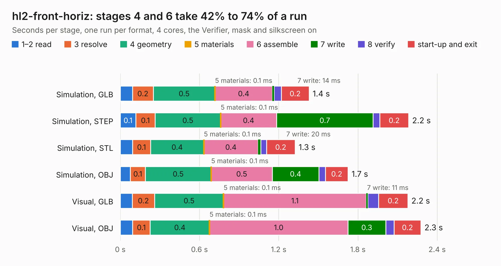

# 2581. hl2-front-horiz

Board 2,581 of the 3,117 of [Corpus Testing](../Corpus-Testing.md), on [Corpus Page 24](../CorpusTestingPages/Corpus-Testing-24.md#2581-hl2-front-horiz).

| Mode and format | 1–2 read | 3 resolve | 4 geometry | 5 materials | 6 assemble | 7 write | 8 verify | start-up and exit | Total |
|---|---:|---:|---:|---:|---:|---:|---:|---:|---:|
| Simulation, GLB | 93&nbsp;ms | 0.2 | 0.5 | 0.1&nbsp;ms | 0.4 | 14&nbsp;ms | 54&nbsp;ms | 0.2 | 1.4 |
| Simulation, STEP | 0.1 | 0.1 | 0.5 | 0.1&nbsp;ms | 0.4 | 0.7 | 50&nbsp;ms | 0.2 | 2.2 |
| Simulation, STL | 94&nbsp;ms | 0.1 | 0.4 | 0.1&nbsp;ms | 0.4 | 20&nbsp;ms | 44&nbsp;ms | 0.2 | 1.3 |
| Simulation, OBJ | 76&nbsp;ms | 0.1 | 0.5 | 0.1&nbsp;ms | 0.5 | 0.4 | 50&nbsp;ms | 0.2 | 1.7 |
| Visual, GLB | 91&nbsp;ms | 0.2 | 0.5 | 0.1&nbsp;ms | 1.1 | 11&nbsp;ms | 82&nbsp;ms | 0.2 | 2.2 |
| Visual, OBJ | 93&nbsp;ms | 0.1 | 0.4 | 0.1&nbsp;ms | 1.0 | 0.3 | 64&nbsp;ms | 0.2 | 2.3 |

<table align="center"><tr><td valign="top">

| Board | Repo: [softerhardware/Hermes-Lite2](https://github.com/softerhardware/Hermes-Lite2) Board: `hl2-front-horiz.kicad_pcb` |
|---|---|
| Folder | hardware / enclosure / endcaps / ad5dz / hl2-front-horiz |
| Complexity | 47&nbsp;/&nbsp;1000 (size&nbsp;17, features&nbsp;30) |
| KESE&nbsp;features | slotted holes, filled zones |
| Tested | 9th November 2026 |
| Copper&nbsp;layers | 2 |
| File&nbsp;format | KiCad 5 (20171130) |
| Parts,&nbsp;tracks,&nbsp;vias | 0, 0, 0 |
| Triangles,&nbsp;simulation | 73,984 in 12 parts |
| Note | no components |
| Verifier | PASS in all six runs |

</td><td valign="top">

<table>
<tr><th>File type</th><th>File size</th><th>Peak memory used</th></tr>
<tr><th colspan="3" align="left">Simulation</th></tr>
<tr><td>GLB</td><td align="right">2.7&nbsp;MB</td><td align="right">181&nbsp;MB</td></tr>
<tr><td>STEP</td><td align="right">15&nbsp;MB</td><td align="right">185&nbsp;MB</td></tr>
<tr><td>STL</td><td align="right">3.7&nbsp;MB</td><td align="right">177&nbsp;MB</td></tr>
<tr><td>OBJ</td><td align="right">7.5&nbsp;MB</td><td align="right">180&nbsp;MB</td></tr>
<tr><th colspan="3" align="left">Visual</th></tr>
<tr><td>GLB</td><td align="right">2.2&nbsp;MB</td><td align="right">155&nbsp;MB</td></tr>
<tr><td>OBJ</td><td align="right">6.2&nbsp;MB</td><td align="right">154&nbsp;MB</td></tr>
</table>

</td></tr></table>

| Previous | Next |
|:---|---:|
| [2580. hl2-back](b2580b_Hermes-Lite2_hl2-back.md) | [2582. hl2-front-vert](b2582b_Hermes-Lite2_hl2-front-vert.md) |
