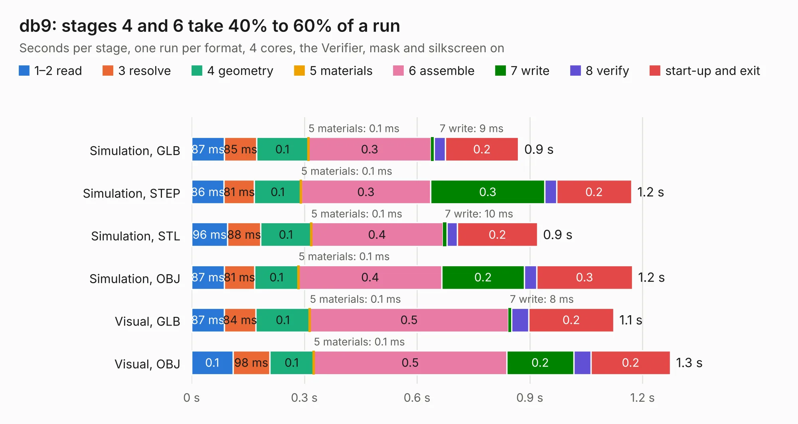

# 2582. db9

Board 2,582 of the 3,129 of [Corpus Testing](../Corpus-Testing.md), on [Corpus Page 24](../CorpusTestingPages/Corpus-Testing-24.md#2582-db9).

| Mode and format | 1–2 read | 3 resolve | 4 geometry | 5 materials | 6 assemble | 7 write | 8 verify | start-up and exit | Total |
|---|---:|---:|---:|---:|---:|---:|---:|---:|---:|
| Simulation, GLB | 87&nbsp;ms | 85&nbsp;ms | 0.1 | 0.1&nbsp;ms | 0.3 | 9&nbsp;ms | 29&nbsp;ms | 0.2 | 0.9 |
| Simulation, STEP | 86&nbsp;ms | 81&nbsp;ms | 0.1 | 0.1&nbsp;ms | 0.3 | 0.3 | 31&nbsp;ms | 0.2 | 1.2 |
| Simulation, STL | 96&nbsp;ms | 88&nbsp;ms | 0.1 | 0.1&nbsp;ms | 0.4 | 10&nbsp;ms | 29&nbsp;ms | 0.2 | 0.9 |
| Simulation, OBJ | 87&nbsp;ms | 81&nbsp;ms | 0.1 | 0.1&nbsp;ms | 0.4 | 0.2 | 33&nbsp;ms | 0.3 | 1.2 |
| Visual, GLB | 87&nbsp;ms | 84&nbsp;ms | 0.1 | 0.1&nbsp;ms | 0.5 | 8&nbsp;ms | 47&nbsp;ms | 0.2 | 1.1 |
| Visual, OBJ | 0.1 | 98&nbsp;ms | 0.1 | 0.1&nbsp;ms | 0.5 | 0.2 | 46&nbsp;ms | 0.2 | 1.3 |

<table align="center"><tr><td valign="top">

| Board | Repo: [softerhardware/Hermes-Lite2](https://github.com/softerhardware/Hermes-Lite2) Board: `db9.kicad_pcb` |
|---|---|
| Folder | hardware / companions / db9 |
| Complexity | 138&nbsp;/&nbsp;1000 (size&nbsp;123, features&nbsp;15) |
| KESE&nbsp;features | through vias |
| Tested | 9th November 2026 |
| Copper&nbsp;layers | 2 |
| File&nbsp;format | KiCad 5 (20171130) |
| Parts,&nbsp;tracks,&nbsp;vias | 9, 131, 3 |
| Triangles,&nbsp;simulation | 33,536 in 20 parts |
| Verifier | PASS in all six runs |

</td><td valign="top">

<table>
<tr><th>File type</th><th>File size</th><th>Peak memory used</th></tr>
<tr><th colspan="3" align="left">Simulation</th></tr>
<tr><td>GLB</td><td align="right">1.3&nbsp;MB</td><td align="right">66&nbsp;MB</td></tr>
<tr><td>STEP</td><td align="right">6.8&nbsp;MB</td><td align="right">70&nbsp;MB</td></tr>
<tr><td>STL</td><td align="right">1.7&nbsp;MB</td><td align="right">67&nbsp;MB</td></tr>
<tr><td>OBJ</td><td align="right">3.4&nbsp;MB</td><td align="right">76&nbsp;MB</td></tr>
<tr><th colspan="3" align="left">Visual</th></tr>
<tr><td>GLB</td><td align="right">1.1&nbsp;MB</td><td align="right">95&nbsp;MB</td></tr>
<tr><td>OBJ</td><td align="right">3.1&nbsp;MB</td><td align="right">96&nbsp;MB</td></tr>
</table>

</td></tr></table>

| Previous | Next |
|:---|---:|
| [2581. main](b2581b_816-board_main.md) | [2583. io_jumper](b2583b_Hermes-Lite2_io-jumper.md) |
