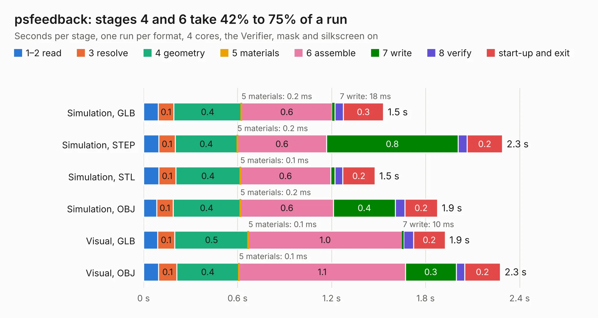

# 2582. psfeedback

Board 2,582 of the 3,123 of [Corpus Testing](../Corpus-Testing.md), on [Corpus Page 24](../CorpusTestingPages/Corpus-Testing-24.md#2582-psfeedback).

| Mode and format | 1–2 read | 3 resolve | 4 geometry | 5 materials | 6 assemble | 7 write | 8 verify | start-up and exit | Total |
|---|---:|---:|---:|---:|---:|---:|---:|---:|---:|
| Simulation, GLB | 93&nbsp;ms | 0.1 | 0.4 | 0.2&nbsp;ms | 0.6 | 18&nbsp;ms | 54&nbsp;ms | 0.3 | 1.5 |
| Simulation, STEP | 98&nbsp;ms | 0.1 | 0.4 | 0.2&nbsp;ms | 0.6 | 0.8 | 58&nbsp;ms | 0.2 | 2.3 |
| Simulation, STL | 97&nbsp;ms | 0.1 | 0.4 | 0.1&nbsp;ms | 0.6 | 28&nbsp;ms | 50&nbsp;ms | 0.2 | 1.5 |
| Simulation, OBJ | 84&nbsp;ms | 0.1 | 0.4 | 0.2&nbsp;ms | 0.6 | 0.4 | 60&nbsp;ms | 0.2 | 1.9 |
| Visual, GLB | 89&nbsp;ms | 0.1 | 0.5 | 0.1&nbsp;ms | 1.0 | 10&nbsp;ms | 63&nbsp;ms | 0.2 | 1.9 |
| Visual, OBJ | 96&nbsp;ms | 0.1 | 0.4 | 0.1&nbsp;ms | 1.1 | 0.3 | 54&nbsp;ms | 0.2 | 2.3 |

<table align="center"><tr><td valign="top">

| Board | Repo: [softerhardware/Hermes-Lite2](https://github.com/softerhardware/Hermes-Lite2) Board: `psfeedback.kicad_pcb` |
|---|---|
| Folder | hardware / companions / psfeedback |
| Complexity | 143&nbsp;/&nbsp;1000 (size&nbsp;98, features&nbsp;45) |
| KESE&nbsp;features | through vias, filled zones, curved board outline |
| Tested | 9th November 2026 |
| Copper&nbsp;layers | 2 |
| File&nbsp;format | KiCad 5 (20171130) |
| Parts,&nbsp;tracks,&nbsp;vias | 6, 27, 4 |
| Triangles,&nbsp;simulation | 72,872 in 14 parts |
| Verifier | PASS in all six runs |

</td><td valign="top">

<table>
<tr><th>File type</th><th>File size</th><th>Peak memory used</th></tr>
<tr><th colspan="3" align="left">Simulation</th></tr>
<tr><td>GLB</td><td align="right">2.6&nbsp;MB</td><td align="right">171&nbsp;MB</td></tr>
<tr><td>STEP</td><td align="right">11&nbsp;MB</td><td align="right">175&nbsp;MB</td></tr>
<tr><td>STL</td><td align="right">3.6&nbsp;MB</td><td align="right">169&nbsp;MB</td></tr>
<tr><td>OBJ</td><td align="right">7.0&nbsp;MB</td><td align="right">168&nbsp;MB</td></tr>
<tr><th colspan="3" align="left">Visual</th></tr>
<tr><td>GLB</td><td align="right">1.7&nbsp;MB</td><td align="right">151&nbsp;MB</td></tr>
<tr><td>OBJ</td><td align="right">4.5&nbsp;MB</td><td align="right">153&nbsp;MB</td></tr>
</table>

</td></tr></table>

| Previous | Next |
|:---|---:|
| [2581. Header2x20](b2581b_Hermes-Lite2_Header2x20.md) | [2583. smallio](b2583b_Hermes-Lite2_smallio.md) |
