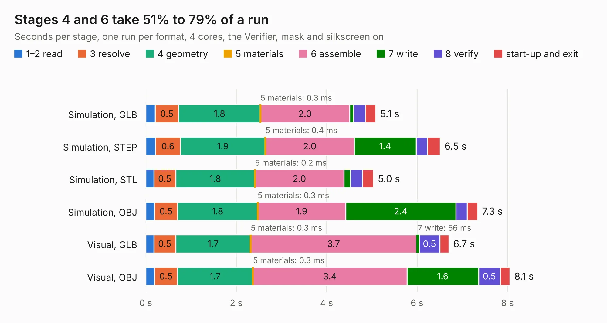

# 2582. SparkFun_GNSS_Flex_Module_DAN-F10N

Board 2,582 of the 3,105 of [Corpus Testing](../Corpus-Testing.md), on [Corpus Page 24](../CorpusTestingPages/Corpus-Testing-24.md#2582-sparkfun_gnss_flex_module_dan-f10n).

| Mode and format | 1–2 read | 3 resolve | 4 geometry | 5 materials | 6 assemble | 7 write | 8 verify | start-up and exit | Total |
|---|---:|---:|---:|---:|---:|---:|---:|---:|---:|
| Simulation, GLB | 0.2 | 0.5 | 1.8 | 0.3&nbsp;ms | 2.0 | 91&nbsp;ms | 0.3 | 0.2 | 5.1 |
| Simulation, STEP | 0.2 | 0.6 | 1.9 | 0.4&nbsp;ms | 2.0 | 1.4 | 0.2 | 0.3 | 6.5 |
| Simulation, STL | 0.2 | 0.5 | 1.8 | 0.2&nbsp;ms | 2.0 | 0.1 | 0.3 | 0.2 | 5.0 |
| Simulation, OBJ | 0.2 | 0.5 | 1.8 | 0.3&nbsp;ms | 1.9 | 2.4 | 0.2 | 0.2 | 7.3 |
| Visual, GLB | 0.2 | 0.5 | 1.7 | 0.3&nbsp;ms | 3.7 | 56&nbsp;ms | 0.5 | 0.2 | 6.7 |
| Visual, OBJ | 0.2 | 0.5 | 1.7 | 0.3&nbsp;ms | 3.4 | 1.6 | 0.5 | 0.2 | 8.1 |

<table align="center"><tr><td valign="top">

| Board | Repo: [sparkfun/sparkfun_gnss_flex_system](https://github.com/sparkfun/sparkfun_gnss_flex_system) Board: `SparkFun_GNSS_Flex_Module_DAN-F10N.kicad_pcb` |
|---|---|
| Folder | flex_boards / SparkPNT_GNSS_Flex_Module_DAN-F10N / hardware |
| Complexity | 270&nbsp;/&nbsp;1000 (size&nbsp;165, features&nbsp;105) |
| KESE&nbsp;features | through vias, rounded, trapezoid or chamfered pads, filled zones, copper text, knockout text, stack-up, dielectric εr and tanδ, mask and silkscreen colours |
| Tested | 9th November 2026 |
| Copper&nbsp;layers | 4 |
| File&nbsp;format | KiCad 9 (20241229) |
| Parts,&nbsp;tracks,&nbsp;vias | 15, 85, 137 |
| Triangles,&nbsp;simulation | 611,188 in 59 parts |
| Verifier | PASS in all six runs |

</td><td valign="top">

<table>
<tr><th>File type</th><th>File size</th><th>Peak memory used</th></tr>
<tr><th colspan="3" align="left">Simulation</th></tr>
<tr><td>GLB</td><td align="right">22&nbsp;MB</td><td align="right">387&nbsp;MB</td></tr>
<tr><td>STEP</td><td align="right">78&nbsp;MB</td><td align="right">428&nbsp;MB</td></tr>
<tr><td>STL</td><td align="right">31&nbsp;MB</td><td align="right">368&nbsp;MB</td></tr>
<tr><td>OBJ</td><td align="right">63&nbsp;MB</td><td align="right">479&nbsp;MB</td></tr>
<tr><th colspan="3" align="left">Visual</th></tr>
<tr><td>GLB</td><td align="right">14&nbsp;MB</td><td align="right">374&nbsp;MB</td></tr>
<tr><td>OBJ</td><td align="right">41&nbsp;MB</td><td align="right">383&nbsp;MB</td></tr>
</table>

</td></tr></table>

| Previous | Next |
|:---|---:|
| [2581. SparkFun_GNSS_Flex_Module_DAN-F10N_panelized](b2581b_sparkfun-gnss-flex-system_SparkFun-GNSS-Flex-Module-DAN-F10N-panelized.md) | [2583. SparkFun_GNSS_Flex_Module_LG290P-Tilt_panelized](b2583b_sparkfun-gnss-flex-system_SparkFun-GNSS-Flex-Module-LG290P-Tilt-panelized.md) |
