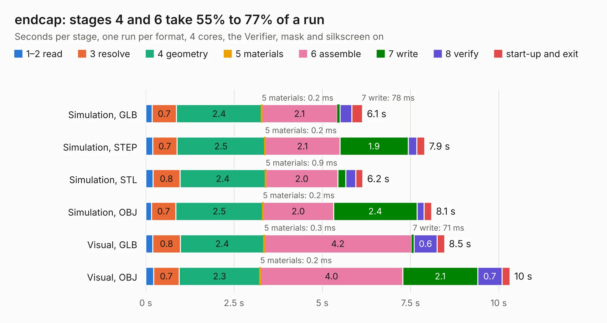

# 2583. endcap

Board 2,583 of the 3,111 of [Corpus Testing](../Corpus-Testing.md), on [Corpus Page 24](../CorpusTestingPages/Corpus-Testing-24.md#2583-endcap).

| Mode and format | 1–2 read | 3 resolve | 4 geometry | 5 materials | 6 assemble | 7 write | 8 verify | start-up and exit | Total |
|---|---:|---:|---:|---:|---:|---:|---:|---:|---:|
| Simulation, GLB | 0.2 | 0.7 | 2.4 | 0.2&nbsp;ms | 2.1 | 78&nbsp;ms | 0.3 | 0.3 | 6.1 |
| Simulation, STEP | 0.2 | 0.7 | 2.5 | 0.2&nbsp;ms | 2.1 | 1.9 | 0.2 | 0.2 | 7.9 |
| Simulation, STL | 0.2 | 0.8 | 2.4 | 0.9&nbsp;ms | 2.0 | 0.2 | 0.3 | 0.2 | 6.2 |
| Simulation, OBJ | 0.2 | 0.7 | 2.5 | 0.2&nbsp;ms | 2.0 | 2.4 | 0.2 | 0.2 | 8.1 |
| Visual, GLB | 0.2 | 0.8 | 2.4 | 0.3&nbsp;ms | 4.2 | 71&nbsp;ms | 0.6 | 0.2 | 8.5 |
| Visual, OBJ | 0.2 | 0.7 | 2.3 | 0.2&nbsp;ms | 4.0 | 2.1 | 0.7 | 0.2 | 10.3 |

<table align="center"><tr><td valign="top">

| Board | Repo: [softerhardware/Hermes-Lite2](https://github.com/softerhardware/Hermes-Lite2) Board: `endcap.kicad_pcb` |
|---|---|
| Folder | hardware / enclosure / endcaps / kf7o / hl2_55b |
| Complexity | 208&nbsp;/&nbsp;1000 (size&nbsp;153, features&nbsp;55) |
| KESE&nbsp;features | through vias, slotted holes, filled zones, curved board outline |
| Tested | 9th November 2026 |
| Copper&nbsp;layers | 2 |
| File&nbsp;format | KiCad 5 (20171130) |
| Parts,&nbsp;tracks,&nbsp;vias | 42, 278, 19 |
| Triangles,&nbsp;simulation | 545,500 in 40 parts |
| Verifier | PASS in all six runs |

</td><td valign="top">

<table>
<tr><th>File type</th><th>File size</th><th>Peak memory used</th></tr>
<tr><th colspan="3" align="left">Simulation</th></tr>
<tr><td>GLB</td><td align="right">19&nbsp;MB</td><td align="right">343&nbsp;MB</td></tr>
<tr><td>STEP</td><td align="right">87&nbsp;MB</td><td align="right">394&nbsp;MB</td></tr>
<tr><td>STL</td><td align="right">27&nbsp;MB</td><td align="right">346&nbsp;MB</td></tr>
<tr><td>OBJ</td><td align="right">57&nbsp;MB</td><td align="right">420&nbsp;MB</td></tr>
<tr><th colspan="3" align="left">Visual</th></tr>
<tr><td>GLB</td><td align="right">16&nbsp;MB</td><td align="right">444&nbsp;MB</td></tr>
<tr><td>OBJ</td><td align="right">47&nbsp;MB</td><td align="right">449&nbsp;MB</td></tr>
</table>

</td></tr></table>

| Previous | Next |
|:---|---:|
| [2582. endcap](b2582b_Hermes-Lite2_hardware-enclosure-endcaps-kf7o-hl2-40f_endcap.md) | [2584. endcap](b2584b_Hermes-Lite2_hardware-enclosure-endcaps-kf7o-hl2-55f_endcap.md) |
