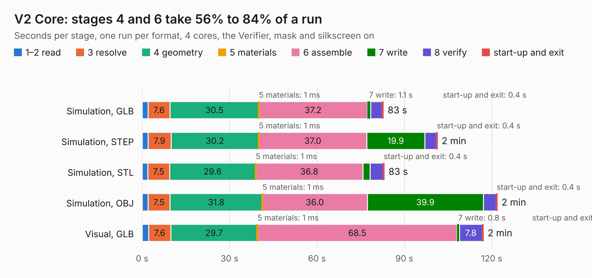

# 2583 V2 Core

Board 2,583 of the 3,138 of [Corpus Testing](../Corpus-Testing.md), on [Corpus Page 24](../CorpusTestingPages/Corpus-Testing-24.md#2583-v2-core).

| Mode and format | 1–2 read | 3 resolve | 4 geometry | 5 materials | 6 assemble | 7 write | 8 verify | start-up and exit | Total |
|---|---:|---:|---:|---:|---:|---:|---:|---:|---:|
| Simulation, GLB | 2.0 | 7.6 | 30.5 | 1&nbsp;ms | 37.2 | 1.1 | 4.0 | 0.4 | 82.8 |
| Simulation, STEP | 2.0 | 7.9 | 30.2 | 1&nbsp;ms | 37.0 | 19.9 | 4.0 | 0.4 | 101.4 |
| Simulation, STL | 2.0 | 7.5 | 29.6 | 1&nbsp;ms | 36.8 | 2.4 | 4.5 | 0.4 | 83.1 |
| Simulation, OBJ | 2.0 | 7.5 | 31.8 | 1&nbsp;ms | 36.0 | 39.9 | 4.4 | 0.4 | 121.9 |
| Visual, GLB | 2.2 | 7.6 | 29.7 | 1&nbsp;ms | 68.5 | 0.8 | 7.8 | 0.4 | 117.2 |
| Visual, OBJ | 2.1 | 7.7 | 29.9 | 1&nbsp;ms | 68.2 | 28.2 | 7.5 | 0.4 | 143.8 |

<table align="center"><tr><td valign="top">

| Board | Repo: [smoothieware/smoothieboard2](https://github.com/smoothieware/smoothieboard2) Board: `V2 Core.kicad_pcb` |
|---|---|
| Folder | V2_Core_P1 |
| Complexity | 402&nbsp;/&nbsp;1000 (size&nbsp;297, features&nbsp;105) |
| KESE&nbsp;features | through vias, custom pads, rounded, trapezoid or chamfered pads, filled zones, copper drawings, copper text, curved board outline, TrueType text |
| Tested | 9th November 2026 |
| Copper&nbsp;layers | 4 |
| File&nbsp;format | KiCad 8 (20240108) |
| Parts,&nbsp;tracks,&nbsp;vias | 325, 6,452, 788 |
| Triangles,&nbsp;simulation | 6,264,664 in 357 parts |
| Verifier | PASS in all six runs |

</td><td valign="top">

<table>
<tr><th>File type</th><th>File size</th><th>Peak memory used</th></tr>
<tr><th colspan="3" align="left">Simulation</th></tr>
<tr><td>GLB</td><td align="right">216&nbsp;MB</td><td align="right">1.7&nbsp;GB</td></tr>
<tr><td>STEP</td><td align="right">979&nbsp;MB</td><td align="right">2.4&nbsp;GB</td></tr>
<tr><td>STL</td><td align="right">313&nbsp;MB</td><td align="right">1.7&nbsp;GB</td></tr>
<tr><td>OBJ</td><td align="right">670&nbsp;MB</td><td align="right">4.0&nbsp;GB</td></tr>
<tr><th colspan="3" align="left">Visual</th></tr>
<tr><td>GLB</td><td align="right">150&nbsp;MB</td><td align="right">2.4&nbsp;GB</td></tr>
<tr><td>OBJ</td><td align="right">482&nbsp;MB</td><td align="right">3.1&nbsp;GB</td></tr>
</table>

</td></tr></table>

| Previous | Next |
|:---|---:|
| [2582 smoothiev2-prime-2660](b2582b_smoothieboard2_smoothiev2-prime-Proto9and10-Kicad5_smoothiev2-prime-2660.md) | [2584 motordriver](b2584b_smoothieboard2_motordriver.md) |
