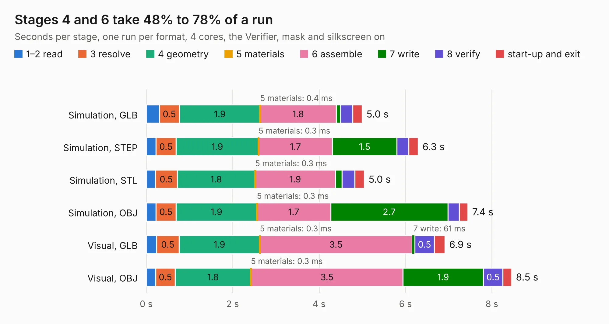

# 2584. SparkFun_GNSS_Flex_Module_LG290P

Board 2,584 of the 3,103 of [Corpus Testing](../Corpus-Testing.md), on [Corpus Page 24](../CorpusTestingPages/Corpus-Testing-24.md#2584-sparkfun_gnss_flex_module_lg290p).

| Mode and format | 1–2 read | 3 resolve | 4 geometry | 5 materials | 6 assemble | 7 write | 8 verify | start-up and exit | Total |
|---|---:|---:|---:|---:|---:|---:|---:|---:|---:|
| Simulation, GLB | 0.3 | 0.5 | 1.9 | 0.4&nbsp;ms | 1.8 | 0.1 | 0.3 | 0.2 | 5.0 |
| Simulation, STEP | 0.2 | 0.5 | 1.9 | 0.3&nbsp;ms | 1.7 | 1.5 | 0.3 | 0.2 | 6.3 |
| Simulation, STL | 0.2 | 0.5 | 1.8 | 0.3&nbsp;ms | 1.9 | 0.2 | 0.3 | 0.2 | 5.0 |
| Simulation, OBJ | 0.2 | 0.5 | 1.9 | 0.3&nbsp;ms | 1.7 | 2.7 | 0.3 | 0.2 | 7.4 |
| Visual, GLB | 0.2 | 0.5 | 1.9 | 0.3&nbsp;ms | 3.5 | 61&nbsp;ms | 0.5 | 0.2 | 6.9 |
| Visual, OBJ | 0.2 | 0.5 | 1.8 | 0.3&nbsp;ms | 3.5 | 1.9 | 0.5 | 0.2 | 8.5 |

<table align="center"><tr><td valign="top">

| Board | Repo: [sparkfun/sparkfun_gnss_flex_system](https://github.com/sparkfun/sparkfun_gnss_flex_system) Board: `SparkFun_GNSS_Flex_Module_LG290P.kicad_pcb` |
|---|---|
| Folder | flex_boards / SparkPNT_GNSS_Flex_Module_LG290P / hardware |
| Complexity | 285&nbsp;/&nbsp;1000 (size&nbsp;165, features&nbsp;120) |
| KESE&nbsp;features | through vias, rounded, trapezoid or chamfered pads, arc tracks, filled zones, copper text, knockout text, stack-up, dielectric εr and tanδ, mask and silkscreen colours |
| Tested | 9th November 2026 |
| Copper&nbsp;layers | 4 |
| File&nbsp;format | KiCad 9 (20241229) |
| Parts,&nbsp;tracks,&nbsp;vias | 15, 203, 100 |
| Triangles,&nbsp;simulation | 548,654 in 54 parts |
| Verifier | PASS in all six runs |

</td><td valign="top">

<table>
<tr><th>File type</th><th>File size</th><th>Peak memory used</th></tr>
<tr><th colspan="3" align="left">Simulation</th></tr>
<tr><td>GLB</td><td align="right">20&nbsp;MB</td><td align="right">367&nbsp;MB</td></tr>
<tr><td>STEP</td><td align="right">78&nbsp;MB</td><td align="right">375&nbsp;MB</td></tr>
<tr><td>STL</td><td align="right">27&nbsp;MB</td><td align="right">345&nbsp;MB</td></tr>
<tr><td>OBJ</td><td align="right">57&nbsp;MB</td><td align="right">430&nbsp;MB</td></tr>
<tr><th colspan="3" align="left">Visual</th></tr>
<tr><td>GLB</td><td align="right">13&nbsp;MB</td><td align="right">359&nbsp;MB</td></tr>
<tr><td>OBJ</td><td align="right">39&nbsp;MB</td><td align="right">353&nbsp;MB</td></tr>
</table>

</td></tr></table>

| Previous | Next |
|:---|---:|
| [2583. SparkFun_GNSS_Flex_Module_LG290P_panelized](b2583b_sparkfun-gnss-flex-system_SparkFun-GNSS-Flex-Module-LG290P-panelized.md) | [2585. SparkFun_GNSS_Flex_Module_LG580P_panelized](b2585b_sparkfun-gnss-flex-system_SparkFun-GNSS-Flex-Module-LG580P-panelized.md) |
