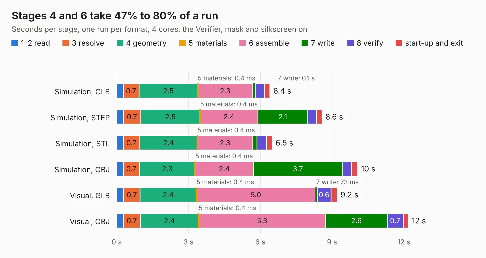

# 2585. SparkFun_GNSS_Flex_Module_LG580P

Board 2,585 of the 3,102 of [Corpus Testing](../Corpus-Testing.md), on [Corpus Page 24](../CorpusTestingPages/Corpus-Testing-24.md#2585-sparkfun_gnss_flex_module_lg580p).

| Mode and format | 1–2 read | 3 resolve | 4 geometry | 5 materials | 6 assemble | 7 write | 8 verify | start-up and exit | Total |
|---|---:|---:|---:|---:|---:|---:|---:|---:|---:|
| Simulation, GLB | 0.3 | 0.7 | 2.5 | 0.4&nbsp;ms | 2.3 | 0.1 | 0.4 | 0.2 | 6.4 |
| Simulation, STEP | 0.3 | 0.7 | 2.5 | 0.4&nbsp;ms | 2.4 | 2.1 | 0.4 | 0.2 | 8.6 |
| Simulation, STL | 0.3 | 0.7 | 2.4 | 0.4&nbsp;ms | 2.3 | 0.2 | 0.4 | 0.2 | 6.5 |
| Simulation, OBJ | 0.3 | 0.7 | 2.3 | 0.4&nbsp;ms | 2.4 | 3.7 | 0.4 | 0.2 | 10.1 |
| Visual, GLB | 0.3 | 0.7 | 2.4 | 0.4&nbsp;ms | 5.0 | 73&nbsp;ms | 0.6 | 0.3 | 9.2 |
| Visual, OBJ | 0.3 | 0.7 | 2.4 | 0.4&nbsp;ms | 5.3 | 2.6 | 0.7 | 0.2 | 12.2 |

<table align="center"><tr><td valign="top">

| Board | Repo: [sparkfun/sparkfun_gnss_flex_system](https://github.com/sparkfun/sparkfun_gnss_flex_system) Board: `SparkFun_GNSS_Flex_Module_LG580P.kicad_pcb` |
|---|---|
| Folder | flex_boards / SparkPNT_GNSS_Flex_Module_LG580P / hardware |
| Complexity | 291&nbsp;/&nbsp;1000 (size&nbsp;171, features&nbsp;120) |
| KESE&nbsp;features | through vias, rounded, trapezoid or chamfered pads, arc tracks, filled zones, copper text, knockout text, stack-up, dielectric εr and tanδ, mask and silkscreen colours |
| Tested | 10th November 2026 |
| Copper&nbsp;layers | 4 |
| File&nbsp;format | KiCad 9 (20241229) |
| Parts,&nbsp;tracks,&nbsp;vias | 22, 149, 131 |
| Triangles,&nbsp;simulation | 643,882 in 73 parts |
| Verifier | PASS in all six runs |

</td><td valign="top">

<table>
<tr><th>File type</th><th>File size</th><th>Peak memory used</th></tr>
<tr><th colspan="3" align="left">Simulation</th></tr>
<tr><td>GLB</td><td align="right">23&nbsp;MB</td><td align="right">412&nbsp;MB</td></tr>
<tr><td>STEP</td><td align="right">86&nbsp;MB</td><td align="right">429&nbsp;MB</td></tr>
<tr><td>STL</td><td align="right">32&nbsp;MB</td><td align="right">409&nbsp;MB</td></tr>
<tr><td>OBJ</td><td align="right">66&nbsp;MB</td><td align="right">496&nbsp;MB</td></tr>
<tr><th colspan="3" align="left">Visual</th></tr>
<tr><td>GLB</td><td align="right">15&nbsp;MB</td><td align="right">402&nbsp;MB</td></tr>
<tr><td>OBJ</td><td align="right">44&nbsp;MB</td><td align="right">396&nbsp;MB</td></tr>
</table>

</td></tr></table>

| Previous | Next |
|:---|---:|
| [2584. SparkFun_GNSS_Flex_Module_LG580P_panelized](b2584b_sparkfun-gnss-flex-system_SparkFun-GNSS-Flex-Module-LG580P-panelized.md) | [2586. SparkFun_GNSS_Flex_Module_mosaic-G5_P3_Tilt_panelized](b2586b_sparkfun-gnss-flex-system_SparkFun-GNSS-Flex-Module-mosaic-G5-P3-Tilt-panelized.md) |
