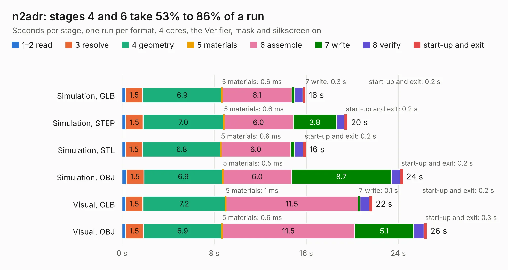

# 2586. n2adr

Board 2,586 of the 3,131 of [Corpus Testing](../Corpus-Testing.md), on [Corpus Page 24](../CorpusTestingPages/Corpus-Testing-24.md#2586-n2adr).

| Mode and format | 1–2 read | 3 resolve | 4 geometry | 5 materials | 6 assemble | 7 write | 8 verify | start-up and exit | Total |
|---|---:|---:|---:|---:|---:|---:|---:|---:|---:|
| Simulation, GLB | 0.3 | 1.5 | 6.9 | 0.6&nbsp;ms | 6.1 | 0.3 | 0.7 | 0.2 | 15.9 |
| Simulation, STEP | 0.3 | 1.5 | 7.0 | 0.6&nbsp;ms | 6.0 | 3.8 | 0.7 | 0.2 | 19.6 |
| Simulation, STL | 0.3 | 1.5 | 6.8 | 0.6&nbsp;ms | 6.0 | 0.4 | 0.7 | 0.2 | 16.0 |
| Simulation, OBJ | 0.4 | 1.5 | 6.9 | 0.5&nbsp;ms | 6.0 | 8.7 | 0.8 | 0.2 | 24.4 |
| Visual, GLB | 0.3 | 1.5 | 7.2 | 1&nbsp;ms | 11.5 | 0.1 | 0.8 | 0.2 | 21.7 |
| Visual, OBJ | 0.3 | 1.5 | 6.9 | 0.6&nbsp;ms | 11.5 | 5.1 | 0.9 | 0.3 | 26.5 |

<table align="center"><tr><td valign="top">

| Board | Repo: [softerhardware/Hermes-Lite2](https://github.com/softerhardware/Hermes-Lite2) Board: `n2adr.kicad_pcb` |
|---|---|
| Folder | hardware / companions / n2adr |
| Complexity | 236&nbsp;/&nbsp;1000 (size&nbsp;191, features&nbsp;45) |
| KESE&nbsp;features | through vias, drill offsets, filled zones |
| Tested | 9th November 2026 |
| Copper&nbsp;layers | 4 |
| File&nbsp;format | KiCad 5 (20171130) |
| Parts,&nbsp;tracks,&nbsp;vias | 99, 620, 25 |
| Triangles,&nbsp;simulation | 1,611,570 in 98 parts |
| Verifier | PASS in all six runs |

</td><td valign="top">

<table>
<tr><th>File type</th><th>File size</th><th>Peak memory used</th></tr>
<tr><th colspan="3" align="left">Simulation</th></tr>
<tr><td>GLB</td><td align="right">56&nbsp;MB</td><td align="right">539&nbsp;MB</td></tr>
<tr><td>STEP</td><td align="right">276&nbsp;MB</td><td align="right">679&nbsp;MB</td></tr>
<tr><td>STL</td><td align="right">81&nbsp;MB</td><td align="right">523&nbsp;MB</td></tr>
<tr><td>OBJ</td><td align="right">169&nbsp;MB</td><td align="right">1.1&nbsp;GB</td></tr>
<tr><th colspan="3" align="left">Visual</th></tr>
<tr><td>GLB</td><td align="right">34&nbsp;MB</td><td align="right">679&nbsp;MB</td></tr>
<tr><td>OBJ</td><td align="right">101&nbsp;MB</td><td align="right">749&nbsp;MB</td></tr>
</table>

</td></tr></table>

| Previous | Next |
|:---|---:|
| [2585. io_jumper](b2585b_Hermes-Lite2_io-jumper.md) | [2587. Header2x20](b2587b_Hermes-Lite2_Header2x20.md) |
