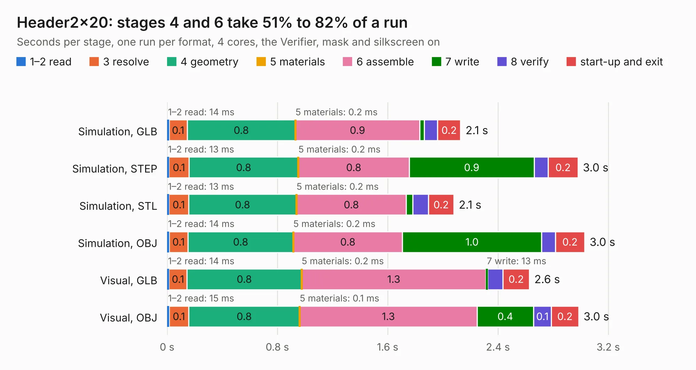

# 2588. Header2x20

Board 2,588 of the 3,132 of [Corpus Testing](../Corpus-Testing.md), on [Corpus Page 24](../CorpusTestingPages/Corpus-Testing-24.md#2588-header2x20).

| Mode and format | 1–2 read | 3 resolve | 4 geometry | 5 materials | 6 assemble | 7 write | 8 verify | start-up and exit | Total |
|---|---:|---:|---:|---:|---:|---:|---:|---:|---:|
| Simulation, GLB | 14&nbsp;ms | 0.1 | 0.8 | 0.2&nbsp;ms | 0.9 | 34&nbsp;ms | 97&nbsp;ms | 0.2 | 2.1 |
| Simulation, STEP | 13&nbsp;ms | 0.1 | 0.8 | 0.2&nbsp;ms | 0.8 | 0.9 | 0.1 | 0.2 | 3.0 |
| Simulation, STL | 13&nbsp;ms | 0.1 | 0.8 | 0.2&nbsp;ms | 0.8 | 47&nbsp;ms | 0.1 | 0.2 | 2.1 |
| Simulation, OBJ | 14&nbsp;ms | 0.1 | 0.8 | 0.2&nbsp;ms | 0.8 | 1.0 | 99&nbsp;ms | 0.2 | 3.0 |
| Visual, GLB | 14&nbsp;ms | 0.1 | 0.8 | 0.2&nbsp;ms | 1.3 | 13&nbsp;ms | 0.1 | 0.2 | 2.6 |
| Visual, OBJ | 15&nbsp;ms | 0.1 | 0.8 | 0.1&nbsp;ms | 1.3 | 0.4 | 0.1 | 0.2 | 3.0 |

<table align="center"><tr><td valign="top">

| Board | Repo: [softerhardware/Hermes-Lite2](https://github.com/softerhardware/Hermes-Lite2) Board: `Header2x20.kicad_pcb` |
|---|---|
| Folder | hardware / companions / n2adr_jumper |
| Complexity | 85&nbsp;/&nbsp;1000 (size&nbsp;85, features&nbsp;0) |
| Tested | 9th November 2026 |
| Copper&nbsp;layers | 2 |
| File&nbsp;format | KiCad 4 (4) |
| Parts,&nbsp;tracks,&nbsp;vias | 1, 40, 0 |
| Triangles,&nbsp;simulation | 205,332 in 30 parts |
| Verifier | PASS in all six runs |

</td><td valign="top">

<table>
<tr><th>File type</th><th>File size</th><th>Peak memory used</th></tr>
<tr><th colspan="3" align="left">Simulation</th></tr>
<tr><td>GLB</td><td align="right">6.9&nbsp;MB</td><td align="right">181&nbsp;MB</td></tr>
<tr><td>STEP</td><td align="right">34&nbsp;MB</td><td align="right">202&nbsp;MB</td></tr>
<tr><td>STL</td><td align="right">10&nbsp;MB</td><td align="right">181&nbsp;MB</td></tr>
<tr><td>OBJ</td><td align="right">20&nbsp;MB</td><td align="right">186&nbsp;MB</td></tr>
<tr><th colspan="3" align="left">Visual</th></tr>
<tr><td>GLB</td><td align="right">2.8&nbsp;MB</td><td align="right">145&nbsp;MB</td></tr>
<tr><td>OBJ</td><td align="right">8.0&nbsp;MB</td><td align="right">147&nbsp;MB</td></tr>
</table>

</td></tr></table>

| Previous | Next |
|:---|---:|
| [2587. n2adr](b2587b_Hermes-Lite2_n2adr.md) | [2589. psfeedback](b2589b_Hermes-Lite2_psfeedback.md) |
