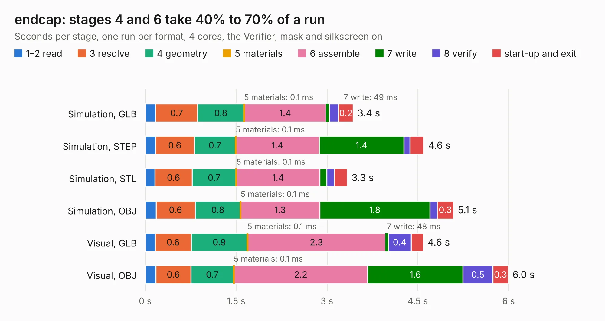

# 2588. endcap

Board 2,588 of the 3,119 of [Corpus Testing](../Corpus-Testing.md), on [Corpus Page 24](../CorpusTestingPages/Corpus-Testing-24.md#2588-endcap).

| Mode and format | 1–2 read | 3 resolve | 4 geometry | 5 materials | 6 assemble | 7 write | 8 verify | start-up and exit | Total |
|---|---:|---:|---:|---:|---:|---:|---:|---:|---:|
| Simulation, GLB | 0.2 | 0.7 | 0.8 | 0.1&nbsp;ms | 1.4 | 49&nbsp;ms | 0.2 | 0.2 | 3.4 |
| Simulation, STEP | 0.2 | 0.6 | 0.7 | 0.1&nbsp;ms | 1.4 | 1.4 | 0.1 | 0.2 | 4.6 |
| Simulation, STL | 0.2 | 0.6 | 0.7 | 0.1&nbsp;ms | 1.4 | 0.1 | 0.1 | 0.2 | 3.3 |
| Simulation, OBJ | 0.2 | 0.6 | 0.8 | 0.1&nbsp;ms | 1.3 | 1.8 | 0.1 | 0.3 | 5.1 |
| Visual, GLB | 0.2 | 0.6 | 0.9 | 0.1&nbsp;ms | 2.3 | 48&nbsp;ms | 0.4 | 0.2 | 4.6 |
| Visual, OBJ | 0.2 | 0.6 | 0.7 | 0.1&nbsp;ms | 2.2 | 1.6 | 0.5 | 0.3 | 6.0 |

<table align="center"><tr><td valign="top">

| Board | Repo: [softerhardware/Hermes-Lite2](https://github.com/softerhardware/Hermes-Lite2) Board: `endcap.kicad_pcb` |
|---|---|
| Folder | hardware / enclosure / endcaps / kd9s / hl2_55f / hl2_55f_v |
| Complexity | 72&nbsp;/&nbsp;1000 (size&nbsp;32, features&nbsp;40) |
| KESE&nbsp;features | slotted holes, filled zones, curved board outline |
| Tested | 9th November 2026 |
| Copper&nbsp;layers | 2 |
| File&nbsp;format | KiCad 5 (20171130) |
| Parts,&nbsp;tracks,&nbsp;vias | 3, 0, 0 |
| Triangles,&nbsp;simulation | 357,484 in 11 parts |
| Verifier | PASS in all six runs |

</td><td valign="top">

<table>
<tr><th>File type</th><th>File size</th><th>Peak memory used</th></tr>
<tr><th colspan="3" align="left">Simulation</th></tr>
<tr><td>GLB</td><td align="right">12&nbsp;MB</td><td align="right">340&nbsp;MB</td></tr>
<tr><td>STEP</td><td align="right">44&nbsp;MB</td><td align="right">348&nbsp;MB</td></tr>
<tr><td>STL</td><td align="right">18&nbsp;MB</td><td align="right">340&nbsp;MB</td></tr>
<tr><td>OBJ</td><td align="right">36&nbsp;MB</td><td align="right">338&nbsp;MB</td></tr>
<tr><th colspan="3" align="left">Visual</th></tr>
<tr><td>GLB</td><td align="right">10&nbsp;MB</td><td align="right">310&nbsp;MB</td></tr>
<tr><td>OBJ</td><td align="right">29&nbsp;MB</td><td align="right">313&nbsp;MB</td></tr>
</table>

</td></tr></table>

| Previous | Next |
|:---|---:|
| [2587. endcap](b2587b_Hermes-Lite2_hardware-enclosure-endcaps-kd9s-hl2-55b-hl2-55b-v_endcap.md) | [2589. endcap](b2589b_Hermes-Lite2_hardware-enclosure-endcaps-kf7o-hl2-40b_endcap.md) |
