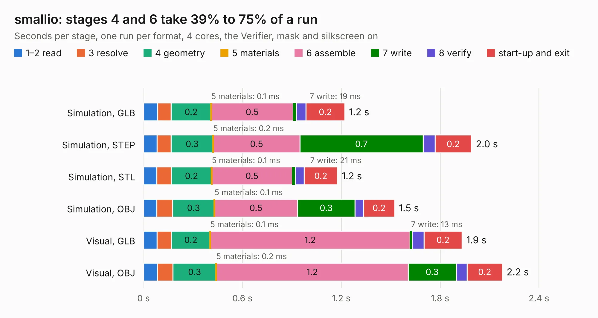

# 2588. smallio

Board 2,588 of the 3,130 of [Corpus Testing](../Corpus-Testing.md), on [Corpus Page 24](../CorpusTestingPages/Corpus-Testing-24.md#2588-smallio).

| Mode and format | 1–2 read | 3 resolve | 4 geometry | 5 materials | 6 assemble | 7 write | 8 verify | start-up and exit | Total |
|---|---:|---:|---:|---:|---:|---:|---:|---:|---:|
| Simulation, GLB | 85&nbsp;ms | 81&nbsp;ms | 0.2 | 0.1&nbsp;ms | 0.5 | 19&nbsp;ms | 59&nbsp;ms | 0.2 | 1.2 |
| Simulation, STEP | 82&nbsp;ms | 85&nbsp;ms | 0.3 | 0.2&nbsp;ms | 0.5 | 0.7 | 72&nbsp;ms | 0.2 | 2.0 |
| Simulation, STL | 81&nbsp;ms | 87&nbsp;ms | 0.2 | 0.1&nbsp;ms | 0.5 | 21&nbsp;ms | 53&nbsp;ms | 0.2 | 1.2 |
| Simulation, OBJ | 81&nbsp;ms | 96&nbsp;ms | 0.3 | 0.1&nbsp;ms | 0.5 | 0.3 | 53&nbsp;ms | 0.2 | 1.5 |
| Visual, GLB | 81&nbsp;ms | 89&nbsp;ms | 0.2 | 0.1&nbsp;ms | 1.2 | 13&nbsp;ms | 72&nbsp;ms | 0.2 | 1.9 |
| Visual, OBJ | 83&nbsp;ms | 96&nbsp;ms | 0.3 | 0.2&nbsp;ms | 1.2 | 0.3 | 66&nbsp;ms | 0.2 | 2.2 |

<table align="center"><tr><td valign="top">

| Board | Repo: [softerhardware/Hermes-Lite2](https://github.com/softerhardware/Hermes-Lite2) Board: `smallio.kicad_pcb` |
|---|---|
| Folder | hardware / companions / smallio |
| Complexity | 150&nbsp;/&nbsp;1000 (size&nbsp;115, features&nbsp;35) |
| KESE&nbsp;features | through vias, filled zones |
| Tested | 9th November 2026 |
| Copper&nbsp;layers | 2 |
| File&nbsp;format | KiCad 5 (20171130) |
| Parts,&nbsp;tracks,&nbsp;vias | 6, 83, 9 |
| Triangles,&nbsp;simulation | 70,712 in 28 parts |
| Verifier | PASS in all six runs |

</td><td valign="top">

<table>
<tr><th>File type</th><th>File size</th><th>Peak memory used</th></tr>
<tr><th colspan="3" align="left">Simulation</th></tr>
<tr><td>GLB</td><td align="right">2.5&nbsp;MB</td><td align="right">173&nbsp;MB</td></tr>
<tr><td>STEP</td><td align="right">13&nbsp;MB</td><td align="right">180&nbsp;MB</td></tr>
<tr><td>STL</td><td align="right">3.5&nbsp;MB</td><td align="right">173&nbsp;MB</td></tr>
<tr><td>OBJ</td><td align="right">6.9&nbsp;MB</td><td align="right">177&nbsp;MB</td></tr>
<tr><th colspan="3" align="left">Visual</th></tr>
<tr><td>GLB</td><td align="right">2.2&nbsp;MB</td><td align="right">152&nbsp;MB</td></tr>
<tr><td>OBJ</td><td align="right">6.1&nbsp;MB</td><td align="right">152&nbsp;MB</td></tr>
</table>

</td></tr></table>

| Previous | Next |
|:---|---:|
| [2587. psfeedback](b2587b_Hermes-Lite2_psfeedback.md) | [2589. hl2-back-horiz](b2589b_Hermes-Lite2_hl2-back-horiz.md) |
