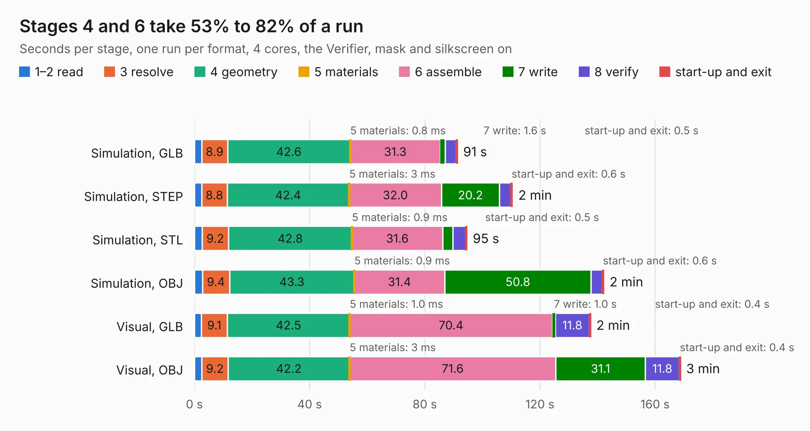

# 2589. SparkFun_GNSS_Flex_Module_LG290P_panelized

Board 2,589 of the 3,109 of [Corpus Testing](../Corpus-Testing.md), on [Corpus Page 24](../CorpusTestingPages/Corpus-Testing-24.md#2589-sparkfun_gnss_flex_module_lg290p_panelized).

| Mode and format | 1–2 read | 3 resolve | 4 geometry | 5 materials | 6 assemble | 7 write | 8 verify | start-up and exit | Total |
|---|---:|---:|---:|---:|---:|---:|---:|---:|---:|
| Simulation, GLB | 2.6 | 8.9 | 42.6 | 0.8&nbsp;ms | 31.3 | 1.6 | 3.9 | 0.5 | 91.3 |
| Simulation, STEP | 2.6 | 8.8 | 42.4 | 3&nbsp;ms | 32.0 | 20.2 | 4.0 | 0.6 | 110.5 |
| Simulation, STL | 2.6 | 9.2 | 42.8 | 0.9&nbsp;ms | 31.6 | 3.5 | 4.4 | 0.5 | 94.7 |
| Simulation, OBJ | 2.8 | 9.4 | 43.3 | 0.9&nbsp;ms | 31.4 | 50.8 | 3.8 | 0.6 | 142.2 |
| Visual, GLB | 2.4 | 9.1 | 42.5 | 1.0&nbsp;ms | 70.4 | 1.0 | 11.8 | 0.4 | 137.6 |
| Visual, OBJ | 2.5 | 9.2 | 42.2 | 3&nbsp;ms | 71.6 | 31.1 | 11.8 | 0.4 | 168.8 |

<table align="center"><tr><td valign="top">

| Board | Repo: [sparkfun/sparkfun_gnss_flex_system](https://github.com/sparkfun/sparkfun_gnss_flex_system) Board: `SparkFun_GNSS_Flex_Module_LG290P_panelized.kicad_pcb` |
|---|---|
| Folder | flex_boards / SparkPNT_GNSS_Flex_Module_LG290P / hardware / production |
| Complexity | 358&nbsp;/&nbsp;1000 (size&nbsp;238, features&nbsp;120) |
| KESE&nbsp;features | through vias, rounded, trapezoid or chamfered pads, arc tracks, filled zones, copper text, knockout text, stack-up, dielectric εr and tanδ, mask and silkscreen colours |
| Tested | 9th November 2026 |
| Copper&nbsp;layers | 4 |
| File&nbsp;format | KiCad 8 (20240108) |
| Parts,&nbsp;tracks,&nbsp;vias | 225, 3,045, 1,500 |
| Triangles,&nbsp;simulation | 8,237,804 in 54 parts |
| Note | panel |
| Verifier | PASS in all six runs |

</td><td valign="top">

<table>
<tr><th>File type</th><th>File size</th><th>Peak memory used</th></tr>
<tr><th colspan="3" align="left">Simulation</th></tr>
<tr><td>GLB</td><td align="right">294&nbsp;MB</td><td align="right">2.9&nbsp;GB</td></tr>
<tr><td>STEP</td><td align="right">1.2&nbsp;GB</td><td align="right">3.5&nbsp;GB</td></tr>
<tr><td>STL</td><td align="right">412&nbsp;MB</td><td align="right">2.8&nbsp;GB</td></tr>
<tr><td>OBJ</td><td align="right">909&nbsp;MB</td><td align="right">5.5&nbsp;GB</td></tr>
<tr><th colspan="3" align="left">Visual</th></tr>
<tr><td>GLB</td><td align="right">198&nbsp;MB</td><td align="right">3.1&nbsp;GB</td></tr>
<tr><td>OBJ</td><td align="right">627&nbsp;MB</td><td align="right">4.0&nbsp;GB</td></tr>
</table>

</td></tr></table>

| Previous | Next |
|:---|---:|
| [2588. SparkFun_GNSS_Flex_Module_LG290P-Tilt](b2588b_sparkfun-gnss-flex-system_SparkFun-GNSS-Flex-Module-LG290P-Tilt.md) | [2590. SparkFun_GNSS_Flex_Module_LG290P](b2590b_sparkfun-gnss-flex-system_SparkFun-GNSS-Flex-Module-LG290P.md) |
