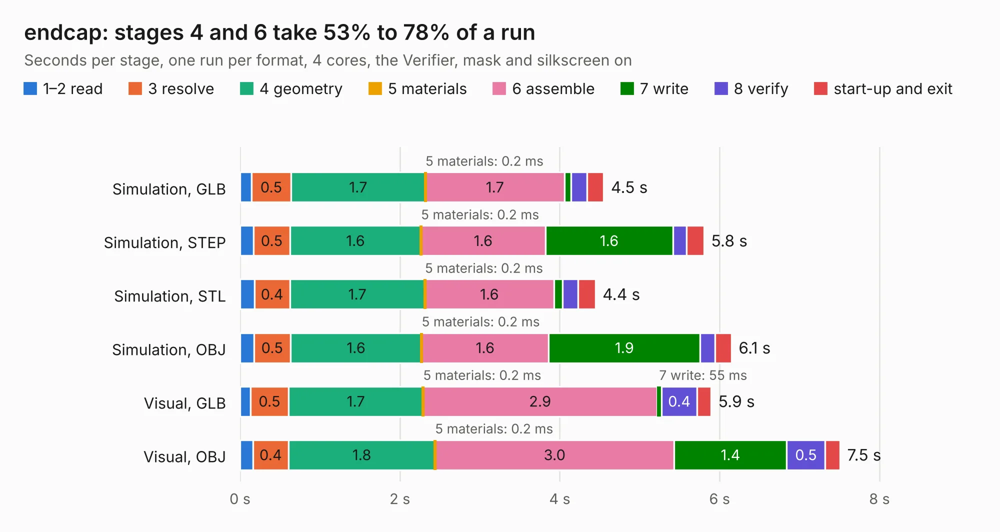

# 2592. endcap

Board 2,592 of the 3,122 of [Corpus Testing](../Corpus-Testing.md), on [Corpus Page 24](../CorpusTestingPages/Corpus-Testing-24.md#2592-endcap).

| Mode and format | 1–2 read | 3 resolve | 4 geometry | 5 materials | 6 assemble | 7 write | 8 verify | start-up and exit | Total |
|---|---:|---:|---:|---:|---:|---:|---:|---:|---:|
| Simulation, GLB | 0.1 | 0.5 | 1.7 | 0.2&nbsp;ms | 1.7 | 80&nbsp;ms | 0.2 | 0.2 | 4.5 |
| Simulation, STEP | 0.2 | 0.5 | 1.6 | 0.2&nbsp;ms | 1.6 | 1.6 | 0.2 | 0.2 | 5.8 |
| Simulation, STL | 0.2 | 0.4 | 1.7 | 0.2&nbsp;ms | 1.6 | 0.1 | 0.2 | 0.2 | 4.4 |
| Simulation, OBJ | 0.2 | 0.5 | 1.6 | 0.2&nbsp;ms | 1.6 | 1.9 | 0.2 | 0.2 | 6.1 |
| Visual, GLB | 0.1 | 0.5 | 1.7 | 0.2&nbsp;ms | 2.9 | 55&nbsp;ms | 0.4 | 0.2 | 5.9 |
| Visual, OBJ | 0.2 | 0.4 | 1.8 | 0.2&nbsp;ms | 3.0 | 1.4 | 0.5 | 0.2 | 7.5 |

<table align="center"><tr><td valign="top">

| Board | Repo: [softerhardware/Hermes-Lite2](https://github.com/softerhardware/Hermes-Lite2) Board: `endcap.kicad_pcb` |
|---|---|
| Folder | hardware / enclosure / endcaps / kf7o / hl2_40b |
| Complexity | 197&nbsp;/&nbsp;1000 (size&nbsp;152, features&nbsp;45) |
| KESE&nbsp;features | through vias, filled zones, curved board outline |
| Tested | 9th November 2026 |
| Copper&nbsp;layers | 2 |
| File&nbsp;format | KiCad 5 (20171130) |
| Parts,&nbsp;tracks,&nbsp;vias | 42, 267, 19 |
| Triangles,&nbsp;simulation | 399,626 in 40 parts |
| Verifier | PASS in all six runs |

</td><td valign="top">

<table>
<tr><th>File type</th><th>File size</th><th>Peak memory used</th></tr>
<tr><th colspan="3" align="left">Simulation</th></tr>
<tr><td>GLB</td><td align="right">14&nbsp;MB</td><td align="right">294&nbsp;MB</td></tr>
<tr><td>STEP</td><td align="right">67&nbsp;MB</td><td align="right">339&nbsp;MB</td></tr>
<tr><td>STL</td><td align="right">20&nbsp;MB</td><td align="right">293&nbsp;MB</td></tr>
<tr><td>OBJ</td><td align="right">42&nbsp;MB</td><td align="right">346&nbsp;MB</td></tr>
<tr><th colspan="3" align="left">Visual</th></tr>
<tr><td>GLB</td><td align="right">12&nbsp;MB</td><td align="right">339&nbsp;MB</td></tr>
<tr><td>OBJ</td><td align="right">34&nbsp;MB</td><td align="right">329&nbsp;MB</td></tr>
</table>

</td></tr></table>

| Previous | Next |
|:---|---:|
| [2591. endcap](b2591b_Hermes-Lite2_hardware-enclosure-endcaps-kd9s-hl2-55f-hl2-55f-v_endcap.md) | [2593. endcap](b2593b_Hermes-Lite2_hardware-enclosure-endcaps-kf7o-hl2-40f_endcap.md) |
