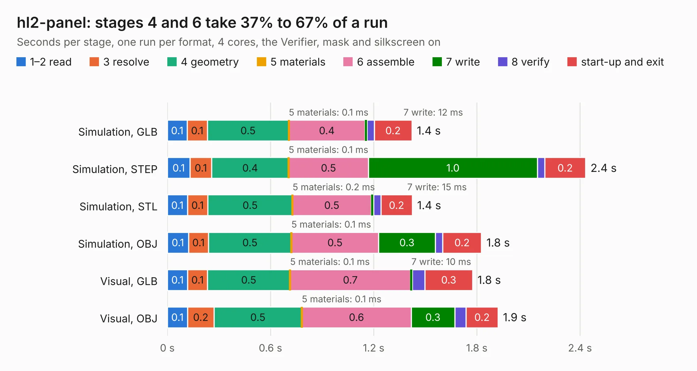

# 2592. hl2-panel

Board 2,592 of the 3,125 of [Corpus Testing](../Corpus-Testing.md), on [Corpus Page 24](../CorpusTestingPages/Corpus-Testing-24.md#2592-hl2-panel).

| Mode and format | 1–2 read | 3 resolve | 4 geometry | 5 materials | 6 assemble | 7 write | 8 verify | start-up and exit | Total |
|---|---:|---:|---:|---:|---:|---:|---:|---:|---:|
| Simulation, GLB | 0.1 | 0.1 | 0.5 | 0.1&nbsp;ms | 0.4 | 12&nbsp;ms | 43&nbsp;ms | 0.2 | 1.4 |
| Simulation, STEP | 0.1 | 0.1 | 0.4 | 0.1&nbsp;ms | 0.5 | 1.0 | 42&nbsp;ms | 0.2 | 2.4 |
| Simulation, STL | 0.1 | 0.1 | 0.5 | 0.2&nbsp;ms | 0.5 | 15&nbsp;ms | 43&nbsp;ms | 0.2 | 1.4 |
| Simulation, OBJ | 0.1 | 0.1 | 0.5 | 0.1&nbsp;ms | 0.5 | 0.3 | 43&nbsp;ms | 0.2 | 1.8 |
| Visual, GLB | 0.1 | 0.1 | 0.5 | 0.1&nbsp;ms | 0.7 | 10&nbsp;ms | 74&nbsp;ms | 0.3 | 1.8 |
| Visual, OBJ | 0.1 | 0.2 | 0.5 | 0.1&nbsp;ms | 0.6 | 0.3 | 66&nbsp;ms | 0.2 | 1.9 |

<table align="center"><tr><td valign="top">

| Board | Repo: [softerhardware/Hermes-Lite2](https://github.com/softerhardware/Hermes-Lite2) Board: `hl2-panel.kicad_pcb` |
|---|---|
| Folder | hardware / enclosure / endcaps / ad5dz / hl2-panel |
| Complexity | 47&nbsp;/&nbsp;1000 (size&nbsp;17, features&nbsp;30) |
| KESE&nbsp;features | slotted holes, filled zones |
| Tested | 9th November 2026 |
| Copper&nbsp;layers | 2 |
| File&nbsp;format | KiCad 5 (20171130) |
| Parts,&nbsp;tracks,&nbsp;vias | 0, 0, 0 |
| Triangles,&nbsp;simulation | 58,308 in 11 parts |
| Note | panel, no components |
| Verifier | PASS in all six runs |

</td><td valign="top">

<table>
<tr><th>File type</th><th>File size</th><th>Peak memory used</th></tr>
<tr><th colspan="3" align="left">Simulation</th></tr>
<tr><td>GLB</td><td align="right">2.2&nbsp;MB</td><td align="right">79&nbsp;MB</td></tr>
<tr><td>STEP</td><td align="right">12&nbsp;MB</td><td align="right">188&nbsp;MB</td></tr>
<tr><td>STL</td><td align="right">2.9&nbsp;MB</td><td align="right">79&nbsp;MB</td></tr>
<tr><td>OBJ</td><td align="right">6.0&nbsp;MB</td><td align="right">94&nbsp;MB</td></tr>
<tr><th colspan="3" align="left">Visual</th></tr>
<tr><td>GLB</td><td align="right">1.7&nbsp;MB</td><td align="right">117&nbsp;MB</td></tr>
<tr><td>OBJ</td><td align="right">4.7&nbsp;MB</td><td align="right">102&nbsp;MB</td></tr>
</table>

</td></tr></table>

| Previous | Next |
|:---|---:|
| [2591. hl2-front](b2591b_Hermes-Lite2_hl2-front.md) | [2593. endcap](b2593b_Hermes-Lite2_hardware-enclosure-endcaps-kd9s-hl2-55b-hl2-55b-v_endcap.md) |
