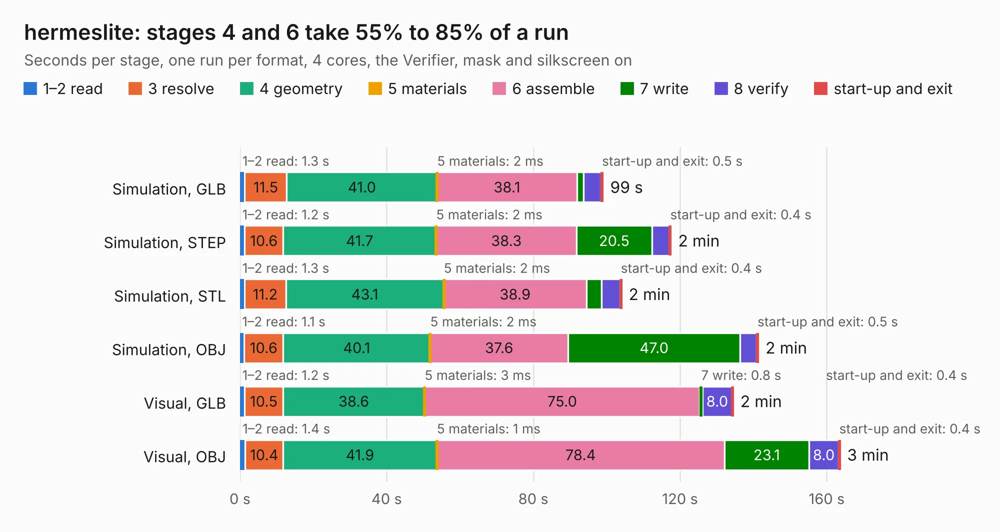

# 2595. hermeslite

Board 2,595 of the 3,120 of [Corpus Testing](../Corpus-Testing.md), on [Corpus Page 25](../CorpusTestingPages/Corpus-Testing-25.md#2595-hermeslite).

| Mode and format | 1–2 read | 3 resolve | 4 geometry | 5 materials | 6 assemble | 7 write | 8 verify | start-up and exit | Total |
|---|---:|---:|---:|---:|---:|---:|---:|---:|---:|
| Simulation, GLB | 1.3 | 11.5 | 41.0 | 2&nbsp;ms | 38.1 | 1.8 | 4.8 | 0.5 | 99.0 |
| Simulation, STEP | 1.2 | 10.6 | 41.7 | 2&nbsp;ms | 38.3 | 20.5 | 4.8 | 0.4 | 117.5 |
| Simulation, STL | 1.3 | 11.2 | 43.1 | 2&nbsp;ms | 38.9 | 4.2 | 5.0 | 0.4 | 104.1 |
| Simulation, OBJ | 1.1 | 10.6 | 40.1 | 2&nbsp;ms | 37.6 | 47.0 | 4.5 | 0.5 | 141.4 |
| Visual, GLB | 1.2 | 10.5 | 38.6 | 3&nbsp;ms | 75.0 | 0.8 | 8.0 | 0.4 | 134.5 |
| Visual, OBJ | 1.4 | 10.4 | 41.9 | 1&nbsp;ms | 78.4 | 23.1 | 8.0 | 0.4 | 163.6 |

<table align="center"><tr><td valign="top">

| Board | Repo: [softerhardware/Hermes-Lite2](https://github.com/softerhardware/Hermes-Lite2) Board: `hermeslite.kicad_pcb` |
|---|---|
| Folder | hardware / hl |
| Complexity | 288&nbsp;/&nbsp;1000 (size&nbsp;243, features&nbsp;45) |
| KESE&nbsp;features | through vias, rounded, trapezoid or chamfered pads, filled zones |
| Tested | 9th November 2026 to 10th November 2026 |
| Copper&nbsp;layers | 4 |
| File&nbsp;format | KiCad 5 (20171130) |
| Parts,&nbsp;tracks,&nbsp;vias | 456, 4,630, 489 |
| Triangles,&nbsp;simulation | 7,524,040 in 307 parts |
| Verifier | PASS in all six runs |
| Run&nbsp;again | Visual, GLB; Visual, OBJ: failed in the corpus run, run again with fixes to KESE made after the corpus run, and passed |

</td><td valign="top">

<table>
<tr><th>File type</th><th>File size</th><th>Peak memory used</th></tr>
<tr><th colspan="3" align="left">Simulation</th></tr>
<tr><td>GLB</td><td align="right">264&nbsp;MB</td><td align="right">1.8&nbsp;GB</td></tr>
<tr><td>STEP</td><td align="right">1.3&nbsp;GB</td><td align="right">2.3&nbsp;GB</td></tr>
<tr><td>STL</td><td align="right">376&nbsp;MB</td><td align="right">1.9&nbsp;GB</td></tr>
<tr><td>OBJ</td><td align="right">822&nbsp;MB</td><td align="right">4.8&nbsp;GB</td></tr>
<tr><th colspan="3" align="left">Visual</th></tr>
<tr><td>GLB</td><td align="right">138&nbsp;MB</td><td align="right">2.2&nbsp;GB</td></tr>
<tr><td>OBJ</td><td align="right">434&nbsp;MB</td><td align="right">2.8&nbsp;GB</td></tr>
</table>

</td></tr></table>

| Previous | Next |
|:---|---:|
| [2594. endcap](b2594b_Hermes-Lite2_hardware-enclosure-endcaps-kf7o-hl2-55fb_endcap.md) | [2596. SparkFun_GNSS_Flex_Module_DAN-F10N_panelized](b2596b_sparkfun-gnss-flex-system_SparkFun-GNSS-Flex-Module-DAN-F10N-panelized.md) |
