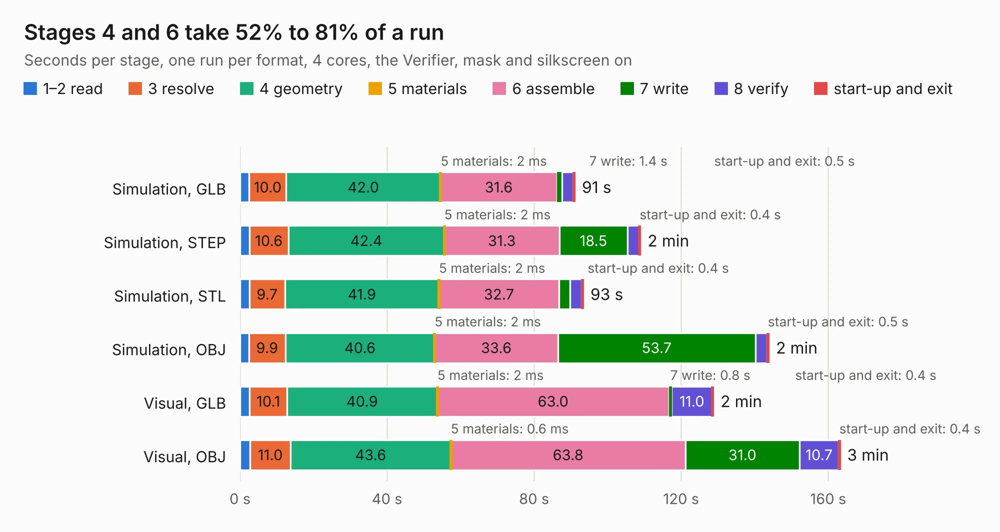

# 2596. SparkFun_GNSS_Flex_Module_DAN-F10N_panelized

Board 2,596 of the 3,120 of [Corpus Testing](../Corpus-Testing.md), on [Corpus Page 25](../CorpusTestingPages/Corpus-Testing-25.md#2596-sparkfun_gnss_flex_module_dan-f10n_panelized).

| Mode and format | 1–2 read | 3 resolve | 4 geometry | 5 materials | 6 assemble | 7 write | 8 verify | start-up and exit | Total |
|---|---:|---:|---:|---:|---:|---:|---:|---:|---:|
| Simulation, GLB | 2.5 | 10.0 | 42.0 | 2&nbsp;ms | 31.6 | 1.4 | 3.0 | 0.5 | 91.1 |
| Simulation, STEP | 2.5 | 10.6 | 42.4 | 2&nbsp;ms | 31.3 | 18.5 | 3.1 | 0.4 | 108.9 |
| Simulation, STL | 2.5 | 9.7 | 41.9 | 2&nbsp;ms | 32.7 | 3.0 | 3.2 | 0.4 | 93.4 |
| Simulation, OBJ | 2.4 | 9.9 | 40.6 | 2&nbsp;ms | 33.6 | 53.7 | 3.2 | 0.5 | 143.9 |
| Visual, GLB | 2.6 | 10.1 | 40.9 | 2&nbsp;ms | 63.0 | 0.8 | 11.0 | 0.4 | 128.8 |
| Visual, OBJ | 2.7 | 11.0 | 43.6 | 0.6&nbsp;ms | 63.8 | 31.0 | 10.7 | 0.4 | 163.2 |

<table align="center"><tr><td valign="top">

| Board | Repo: [sparkfun/sparkfun_gnss_flex_system](https://github.com/sparkfun/sparkfun_gnss_flex_system) Board: `SparkFun_GNSS_Flex_Module_DAN-F10N_panelized.kicad_pcb` |
|---|---|
| Folder | flex_boards / SparkPNT_GNSS_Flex_Module_DAN-F10N / hardware / production |
| Complexity | 337&nbsp;/&nbsp;1000 (size&nbsp;232, features&nbsp;105) |
| KESE&nbsp;features | through vias, rounded, trapezoid or chamfered pads, filled zones, copper text, knockout text, stack-up, dielectric εr and tanδ, mask and silkscreen colours |
| Tested | 9th November 2026 |
| Copper&nbsp;layers | 4 |
| File&nbsp;format | KiCad 9 (20241229) |
| Parts,&nbsp;tracks,&nbsp;vias | 180, 1,020, 1,644 |
| Triangles,&nbsp;simulation | 7,341,262 in 59 parts |
| Note | panel |
| Verifier | PASS in all six runs |

</td><td valign="top">

<table>
<tr><th>File type</th><th>File size</th><th>Peak memory used</th></tr>
<tr><th colspan="3" align="left">Simulation</th></tr>
<tr><td>GLB</td><td align="right">262&nbsp;MB</td><td align="right">2.8&nbsp;GB</td></tr>
<tr><td>STEP</td><td align="right">981&nbsp;MB</td><td align="right">3.2&nbsp;GB</td></tr>
<tr><td>STL</td><td align="right">367&nbsp;MB</td><td align="right">2.6&nbsp;GB</td></tr>
<tr><td>OBJ</td><td align="right">808&nbsp;MB</td><td align="right">4.9&nbsp;GB</td></tr>
<tr><th colspan="3" align="left">Visual</th></tr>
<tr><td>GLB</td><td align="right">165&nbsp;MB</td><td align="right">2.6&nbsp;GB</td></tr>
<tr><td>OBJ</td><td align="right">520&nbsp;MB</td><td align="right">3.5&nbsp;GB</td></tr>
</table>

</td></tr></table>

| Previous | Next |
|:---|---:|
| [2595. hermeslite](b2595b_Hermes-Lite2_hermeslite.md) | [2597. SparkFun_GNSS_Flex_Module_DAN-F10N](b2597b_sparkfun-gnss-flex-system_SparkFun-GNSS-Flex-Module-DAN-F10N.md) |
