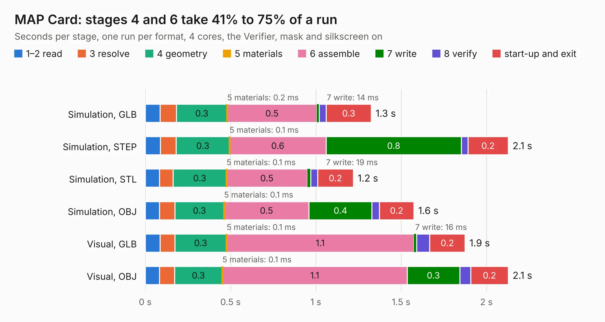

# 2598. MAP Card

Board 2,598 of the 3,100 of [Corpus Testing](../Corpus-Testing.md), on [Corpus Page 25](../CorpusTestingPages/Corpus-Testing-25.md#2598-map-card).

| Mode and format | 1–2 read | 3 resolve | 4 geometry | 5 materials | 6 assemble | 7 write | 8 verify | start-up and exit | Total |
|---|---:|---:|---:|---:|---:|---:|---:|---:|---:|
| Simulation, GLB | 88&nbsp;ms | 95&nbsp;ms | 0.3 | 0.2&nbsp;ms | 0.5 | 14&nbsp;ms | 41&nbsp;ms | 0.3 | 1.3 |
| Simulation, STEP | 89&nbsp;ms | 93&nbsp;ms | 0.3 | 0.1&nbsp;ms | 0.6 | 0.8 | 38&nbsp;ms | 0.2 | 2.1 |
| Simulation, STL | 83&nbsp;ms | 80&nbsp;ms | 0.3 | 0.1&nbsp;ms | 0.5 | 19&nbsp;ms | 41&nbsp;ms | 0.2 | 1.2 |
| Simulation, OBJ | 84&nbsp;ms | 90&nbsp;ms | 0.3 | 0.1&nbsp;ms | 0.5 | 0.4 | 44&nbsp;ms | 0.2 | 1.6 |
| Visual, GLB | 87&nbsp;ms | 86&nbsp;ms | 0.3 | 0.1&nbsp;ms | 1.1 | 16&nbsp;ms | 76&nbsp;ms | 0.2 | 1.9 |
| Visual, OBJ | 84&nbsp;ms | 88&nbsp;ms | 0.3 | 0.1&nbsp;ms | 1.1 | 0.3 | 65&nbsp;ms | 0.2 | 2.1 |

<table align="center"><tr><td valign="top">

| Board | Repo: [speeduino/hardware](https://github.com/speeduino/hardware) Board: `MAP Card.kicad_pcb` |
|---|---|
| Folder | DropBear / MAP Card / v0.2 |
| Complexity | 155&nbsp;/&nbsp;1000 (size&nbsp;100, features&nbsp;55) |
| KESE&nbsp;features | through vias, rounded, trapezoid or chamfered pads, filled zones, curved board outline |
| Tested | 9th November 2026 |
| Copper&nbsp;layers | 2 |
| File&nbsp;format | KiCad 5 (20171130) |
| Parts,&nbsp;tracks,&nbsp;vias | 6, 29, 5 |
| Triangles,&nbsp;simulation | 68,062 in 21 parts |
| Verifier | PASS in all six runs |

</td><td valign="top">

<table>
<tr><th>File type</th><th>File size</th><th>Peak memory used</th></tr>
<tr><th colspan="3" align="left">Simulation</th></tr>
<tr><td>GLB</td><td align="right">2.4&nbsp;MB</td><td align="right">170&nbsp;MB</td></tr>
<tr><td>STEP</td><td align="right">13&nbsp;MB</td><td align="right">181&nbsp;MB</td></tr>
<tr><td>STL</td><td align="right">3.4&nbsp;MB</td><td align="right">177&nbsp;MB</td></tr>
<tr><td>OBJ</td><td align="right">6.7&nbsp;MB</td><td align="right">174&nbsp;MB</td></tr>
<tr><th colspan="3" align="left">Visual</th></tr>
<tr><td>GLB</td><td align="right">2.0&nbsp;MB</td><td align="right">153&nbsp;MB</td></tr>
<tr><td>OBJ</td><td align="right">5.7&nbsp;MB</td><td align="right">154&nbsp;MB</td></tr>
</table>

</td></tr></table>

| Previous | Next |
|:---|---:|
| [2597. SparkFun_Thing_Plus_ESP32-S3](b2597b_SparkFun-Thing-Plus-ESP32-S3_SparkFun-Thing-Plus-ESP32-S3.md) | [2599. MAP Card](b2599b_hardware_DropBear-MAP-Card-v0-3_MAP-Card.md) |
