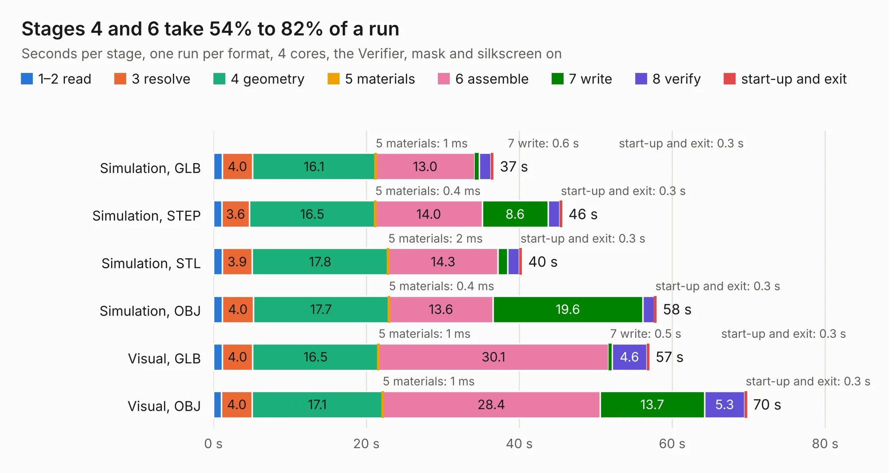

# 2599. SparkFun_GNSS_Flex_Module_LG580P_panelized

Board 2,599 of the 3,117 of [Corpus Testing](../Corpus-Testing.md), on [Corpus Page 25](../CorpusTestingPages/Corpus-Testing-25.md#2599-sparkfun_gnss_flex_module_lg580p_panelized).

| Mode and format | 1–2 read | 3 resolve | 4 geometry | 5 materials | 6 assemble | 7 write | 8 verify | start-up and exit | Total |
|---|---:|---:|---:|---:|---:|---:|---:|---:|---:|
| Simulation, GLB | 1.2 | 4.0 | 16.1 | 1&nbsp;ms | 13.0 | 0.6 | 1.5 | 0.3 | 36.6 |
| Simulation, STEP | 1.1 | 3.6 | 16.5 | 0.4&nbsp;ms | 14.0 | 8.6 | 1.5 | 0.3 | 45.6 |
| Simulation, STL | 1.2 | 3.9 | 17.8 | 2&nbsp;ms | 14.3 | 1.3 | 1.5 | 0.3 | 40.3 |
| Simulation, OBJ | 1.2 | 4.0 | 17.7 | 0.4&nbsp;ms | 13.6 | 19.6 | 1.5 | 0.3 | 57.9 |
| Visual, GLB | 1.2 | 4.0 | 16.5 | 1&nbsp;ms | 30.1 | 0.5 | 4.6 | 0.3 | 57.0 |
| Visual, OBJ | 1.1 | 4.0 | 17.1 | 1&nbsp;ms | 28.4 | 13.7 | 5.3 | 0.3 | 69.8 |

<table align="center"><tr><td valign="top">

| Board | Repo: [sparkfun/sparkfun_gnss_flex_system](https://github.com/sparkfun/sparkfun_gnss_flex_system) Board: `SparkFun_GNSS_Flex_Module_LG580P_panelized.kicad_pcb` |
|---|---|
| Folder | flex_boards / SparkPNT_GNSS_Flex_Module_LG580P / hardware / production |
| Complexity | 339&nbsp;/&nbsp;1000 (size&nbsp;219, features&nbsp;120) |
| KESE&nbsp;features | through vias, rounded, trapezoid or chamfered pads, arc tracks, filled zones, copper text, knockout text, stack-up, dielectric εr and tanδ, mask and silkscreen colours |
| Tested | 9th November 2026 |
| Copper&nbsp;layers | 4 |
| File&nbsp;format | KiCad 9 (20241229) |
| Parts,&nbsp;tracks,&nbsp;vias | 132, 894, 786 |
| Triangles,&nbsp;simulation | 3,878,978 in 73 parts |
| Note | panel |
| Verifier | PASS in all six runs |

</td><td valign="top">

<table>
<tr><th>File type</th><th>File size</th><th>Peak memory used</th></tr>
<tr><th colspan="3" align="left">Simulation</th></tr>
<tr><td>GLB</td><td align="right">137&nbsp;MB</td><td align="right">1.5&nbsp;GB</td></tr>
<tr><td>STEP</td><td align="right">532&nbsp;MB</td><td align="right">1.7&nbsp;GB</td></tr>
<tr><td>STL</td><td align="right">194&nbsp;MB</td><td align="right">1.6&nbsp;GB</td></tr>
<tr><td>OBJ</td><td align="right">421&nbsp;MB</td><td align="right">2.6&nbsp;GB</td></tr>
<tr><th colspan="3" align="left">Visual</th></tr>
<tr><td>GLB</td><td align="right">89&nbsp;MB</td><td align="right">1.5&nbsp;GB</td></tr>
<tr><td>OBJ</td><td align="right">279&nbsp;MB</td><td align="right">1.8&nbsp;GB</td></tr>
</table>

</td></tr></table>

| Previous | Next |
|:---|---:|
| [2598. SparkFun_GNSS_Flex_Module_LG290P](b2598b_sparkfun-gnss-flex-system_SparkFun-GNSS-Flex-Module-LG290P.md) | [2600. SparkFun_GNSS_Flex_Module_LG580P](b2600b_sparkfun-gnss-flex-system_SparkFun-GNSS-Flex-Module-LG580P.md) |
