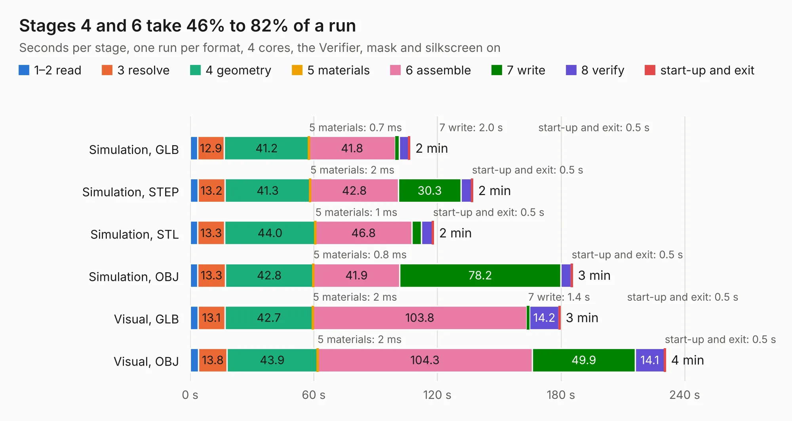

# 2599. SparkFun_GNSS_Flex_Module_ZED-X20P_Tilt_panelized

Board 2,599 of the 3,109 of [Corpus Testing](../Corpus-Testing.md), on [Corpus Page 25](../CorpusTestingPages/Corpus-Testing-25.md#2599-sparkfun_gnss_flex_module_zed-x20p_tilt_panelized).

| Mode and format | 1–2 read | 3 resolve | 4 geometry | 5 materials | 6 assemble | 7 write | 8 verify | start-up and exit | Total |
|---|---:|---:|---:|---:|---:|---:|---:|---:|---:|
| Simulation, GLB | 3.7 | 12.9 | 41.2 | 0.7&nbsp;ms | 41.8 | 2.0 | 4.6 | 0.5 | 106.6 |
| Simulation, STEP | 3.8 | 13.2 | 41.3 | 2&nbsp;ms | 42.8 | 30.3 | 5.1 | 0.5 | 137.1 |
| Simulation, STL | 3.6 | 13.3 | 44.0 | 1&nbsp;ms | 46.8 | 4.7 | 5.3 | 0.5 | 118.1 |
| Simulation, OBJ | 3.7 | 13.3 | 42.8 | 0.8&nbsp;ms | 41.9 | 78.2 | 5.0 | 0.5 | 185.4 |
| Visual, GLB | 3.8 | 13.1 | 42.7 | 2&nbsp;ms | 103.8 | 1.4 | 14.2 | 0.5 | 179.5 |
| Visual, OBJ | 4.1 | 13.8 | 43.9 | 2&nbsp;ms | 104.3 | 49.9 | 14.1 | 0.5 | 230.6 |

<table align="center"><tr><td valign="top">

| Board | Repo: [sparkfun/sparkfun_gnss_flex_system](https://github.com/sparkfun/sparkfun_gnss_flex_system) Board: `SparkFun_GNSS_Flex_Module_ZED-X20P_Tilt_panelized.kicad_pcb` |
|---|---|
| Folder | flex_boards / SparkPNT_GNSS_Flex_Module_ZED-X20P-Tilt / hardware / production |
| Complexity | 370&nbsp;/&nbsp;1000 (size&nbsp;250, features&nbsp;120) |
| KESE&nbsp;features | through vias, rounded, trapezoid or chamfered pads, arc tracks, filled zones, copper text, knockout text, stack-up, dielectric εr and tanδ, mask and silkscreen colours |
| Tested | 9th November 2026 |
| Copper&nbsp;layers | 4 |
| File&nbsp;format | KiCad 9 (20241229) |
| Parts,&nbsp;tracks,&nbsp;vias | 345, 5,220, 2,010 |
| Triangles,&nbsp;simulation | 11,566,264 in 86 parts |
| Note | panel |
| Verifier | PASS in all six runs |

</td><td valign="top">

<table>
<tr><th>File type</th><th>File size</th><th>Peak memory used</th></tr>
<tr><th colspan="3" align="left">Simulation</th></tr>
<tr><td>GLB</td><td align="right">410&nbsp;MB</td><td align="right">3.5&nbsp;GB</td></tr>
<tr><td>STEP</td><td align="right">1.8&nbsp;GB</td><td align="right">4.4&nbsp;GB</td></tr>
<tr><td>STL</td><td align="right">578&nbsp;MB</td><td align="right">3.3&nbsp;GB</td></tr>
<tr><td>OBJ</td><td align="right">1.3&nbsp;GB</td><td align="right">7.6&nbsp;GB</td></tr>
<tr><th colspan="3" align="left">Visual</th></tr>
<tr><td>GLB</td><td align="right">284&nbsp;MB</td><td align="right">4.3&nbsp;GB</td></tr>
<tr><td>OBJ</td><td align="right">908&nbsp;MB</td><td align="right">5.7&nbsp;GB</td></tr>
</table>

</td></tr></table>

| Previous | Next |
|:---|---:|
| [2598. SparkFun_GNSS_Flex_Module_mosaic-X5](b2598b_sparkfun-gnss-flex-system_SparkFun-GNSS-Flex-Module-mosaic-X5.md) | [2600. SparkFun_GNSS_Flex_Module_ZED-X20P_Tilt](b2600b_sparkfun-gnss-flex-system_SparkFun-GNSS-Flex-Module-ZED-X20P-Tilt.md) |
