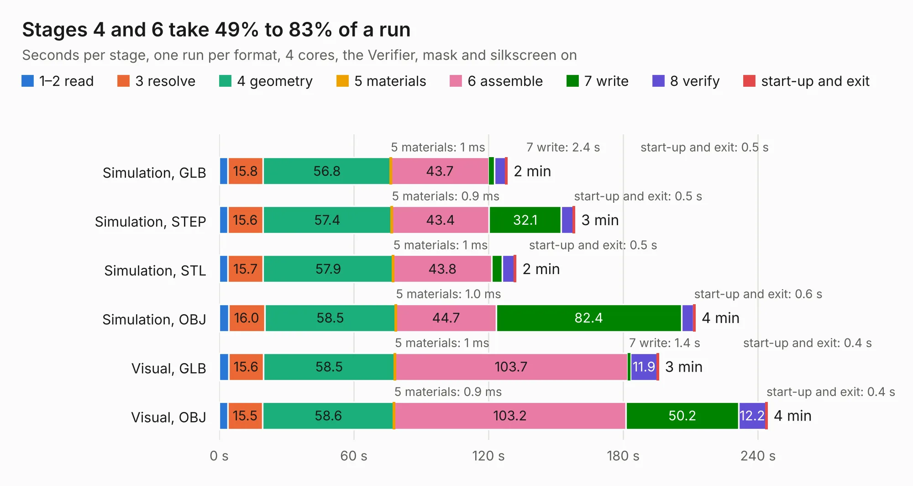

# 2600. SparkFun_GNSS_Flex_Module_mosaic-G5_P3_Tilt_panelized

Board 2,600 of the 3,116 of [Corpus Testing](../Corpus-Testing.md), on [Corpus Page 25](../CorpusTestingPages/Corpus-Testing-25.md#2600-sparkfun_gnss_flex_module_mosaic-g5_p3_tilt_panelized).

| Mode and format | 1–2 read | 3 resolve | 4 geometry | 5 materials | 6 assemble | 7 write | 8 verify | start-up and exit | Total |
|---|---:|---:|---:|---:|---:|---:|---:|---:|---:|
| Simulation, GLB | 3.9 | 15.8 | 56.8 | 1&nbsp;ms | 43.7 | 2.4 | 5.2 | 0.5 | 128.2 |
| Simulation, STEP | 3.8 | 15.6 | 57.4 | 0.9&nbsp;ms | 43.4 | 32.1 | 5.4 | 0.5 | 158.3 |
| Simulation, STL | 3.9 | 15.7 | 57.9 | 1&nbsp;ms | 43.8 | 4.8 | 5.4 | 0.5 | 132.1 |
| Simulation, OBJ | 4.2 | 16.0 | 58.5 | 1.0&nbsp;ms | 44.7 | 82.4 | 5.4 | 0.6 | 211.9 |
| Visual, GLB | 4.2 | 15.6 | 58.5 | 1&nbsp;ms | 103.7 | 1.4 | 11.9 | 0.4 | 195.6 |
| Visual, OBJ | 3.8 | 15.5 | 58.6 | 0.9&nbsp;ms | 103.2 | 50.2 | 12.2 | 0.4 | 244.0 |

<table align="center"><tr><td valign="top">

| Board | Repo: [sparkfun/sparkfun_gnss_flex_system](https://github.com/sparkfun/sparkfun_gnss_flex_system) Board: `SparkFun_GNSS_Flex_Module_mosaic-G5_P3_Tilt_panelized.kicad_pcb` |
|---|---|
| Folder | flex_boards / SparkPNT_GNSS_Flex_Module_mosaic-G5_P3-Tilt / hardware / production |
| Complexity | 448&nbsp;/&nbsp;1000 (size&nbsp;328, features&nbsp;120) |
| KESE&nbsp;features | through vias, rounded, trapezoid or chamfered pads, arc tracks, filled zones, copper text, knockout text, stack-up, dielectric εr and tanδ, mask and silkscreen colours |
| Tested | 9th November 2026 |
| Copper&nbsp;layers | 4 |
| File&nbsp;format | KiCad 9 (20241229) |
| Parts,&nbsp;tracks,&nbsp;vias | 300, 4,920, 2,475 |
| Triangles,&nbsp;simulation | 13,247,162 in 79 parts |
| Note | panel |
| Verifier | PASS in all six runs |

</td><td valign="top">

<table>
<tr><th>File type</th><th>File size</th><th>Peak memory used</th></tr>
<tr><th colspan="3" align="left">Simulation</th></tr>
<tr><td>GLB</td><td align="right">463&nbsp;MB</td><td align="right">4.4&nbsp;GB</td></tr>
<tr><td>STEP</td><td align="right">2.1&nbsp;GB</td><td align="right">5.1&nbsp;GB</td></tr>
<tr><td>STL</td><td align="right">662&nbsp;MB</td><td align="right">4.1&nbsp;GB</td></tr>
<tr><td>OBJ</td><td align="right">1.5&nbsp;GB</td><td align="right">8.7&nbsp;GB</td></tr>
<tr><th colspan="3" align="left">Visual</th></tr>
<tr><td>GLB</td><td align="right">306&nbsp;MB</td><td align="right">4.7&nbsp;GB</td></tr>
<tr><td>OBJ</td><td align="right">982&nbsp;MB</td><td align="right">6.2&nbsp;GB</td></tr>
</table>

</td></tr></table>

| Previous | Next |
|:---|---:|
| [2599. SparkFun_GNSS_Flex_Module_LG580P](b2599b_sparkfun-gnss-flex-system_SparkFun-GNSS-Flex-Module-LG580P.md) | [2601. SparkFun_GNSS_Flex_Module_mosaic-G5_P3_Tilt](b2601b_sparkfun-gnss-flex-system_SparkFun-GNSS-Flex-Module-mosaic-G5-P3-Tilt.md) |
