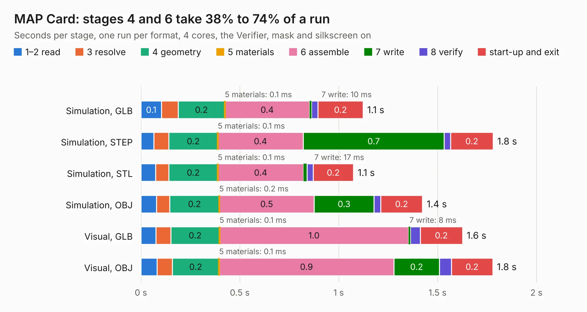

# 2606. MAP Card

Board 2,606 of the 3,107 of [Corpus Testing](../Corpus-Testing.md), on [Corpus Page 25](../CorpusTestingPages/Corpus-Testing-25.md#2606-map-card).

| Mode and format | 1–2 read | 3 resolve | 4 geometry | 5 materials | 6 assemble | 7 write | 8 verify | start-up and exit | Total |
|---|---:|---:|---:|---:|---:|---:|---:|---:|---:|
| Simulation, GLB | 0.1 | 84&nbsp;ms | 0.2 | 0.1&nbsp;ms | 0.4 | 10&nbsp;ms | 33&nbsp;ms | 0.2 | 1.1 |
| Simulation, STEP | 66&nbsp;ms | 75&nbsp;ms | 0.2 | 0.1&nbsp;ms | 0.4 | 0.7 | 32&nbsp;ms | 0.2 | 1.8 |
| Simulation, STL | 74&nbsp;ms | 67&nbsp;ms | 0.2 | 0.1&nbsp;ms | 0.4 | 17&nbsp;ms | 31&nbsp;ms | 0.2 | 1.1 |
| Simulation, OBJ | 78&nbsp;ms | 68&nbsp;ms | 0.2 | 0.2&nbsp;ms | 0.5 | 0.3 | 34&nbsp;ms | 0.2 | 1.4 |
| Visual, GLB | 76&nbsp;ms | 75&nbsp;ms | 0.2 | 0.1&nbsp;ms | 1.0 | 8&nbsp;ms | 51&nbsp;ms | 0.2 | 1.6 |
| Visual, OBJ | 82&nbsp;ms | 77&nbsp;ms | 0.2 | 0.1&nbsp;ms | 0.9 | 0.2 | 60&nbsp;ms | 0.2 | 1.8 |

<table align="center"><tr><td valign="top">

| Board | Repo: [speeduino/hardware](https://github.com/speeduino/hardware) Board: `MAP Card.kicad_pcb` |
|---|---|
| Folder | DropBear / MAP Card / v0.3 |
| Complexity | 184&nbsp;/&nbsp;1000 (size&nbsp;99, features&nbsp;85) |
| KESE&nbsp;features | through vias, rounded, trapezoid or chamfered pads, filled zones, curved board outline, stack-up, dielectric εr and tanδ |
| Tested | 9th November 2026 |
| Copper&nbsp;layers | 2 |
| File&nbsp;format | KiCad 7 (20221018) |
| Parts,&nbsp;tracks,&nbsp;vias | 6, 25, 5 |
| Triangles,&nbsp;simulation | 61,804 in 21 parts |
| Verifier | PASS in all six runs |

</td><td valign="top">

<table>
<tr><th>File type</th><th>File size</th><th>Peak memory used</th></tr>
<tr><th colspan="3" align="left">Simulation</th></tr>
<tr><td>GLB</td><td align="right">2.2&nbsp;MB</td><td align="right">171&nbsp;MB</td></tr>
<tr><td>STEP</td><td align="right">12&nbsp;MB</td><td align="right">175&nbsp;MB</td></tr>
<tr><td>STL</td><td align="right">3.1&nbsp;MB</td><td align="right">174&nbsp;MB</td></tr>
<tr><td>OBJ</td><td align="right">6.2&nbsp;MB</td><td align="right">170&nbsp;MB</td></tr>
<tr><th colspan="3" align="left">Visual</th></tr>
<tr><td>GLB</td><td align="right">1.8&nbsp;MB</td><td align="right">153&nbsp;MB</td></tr>
<tr><td>OBJ</td><td align="right">5.1&nbsp;MB</td><td align="right">152&nbsp;MB</td></tr>
</table>

</td></tr></table>

| Previous | Next |
|:---|---:|
| [2605. MAP Card](b2605b_hardware_DropBear-MAP-Card-v0-2_MAP-Card.md) | [2607. DropBear](b2607b_hardware_DropBear-V1-1_DropBear.md) |
