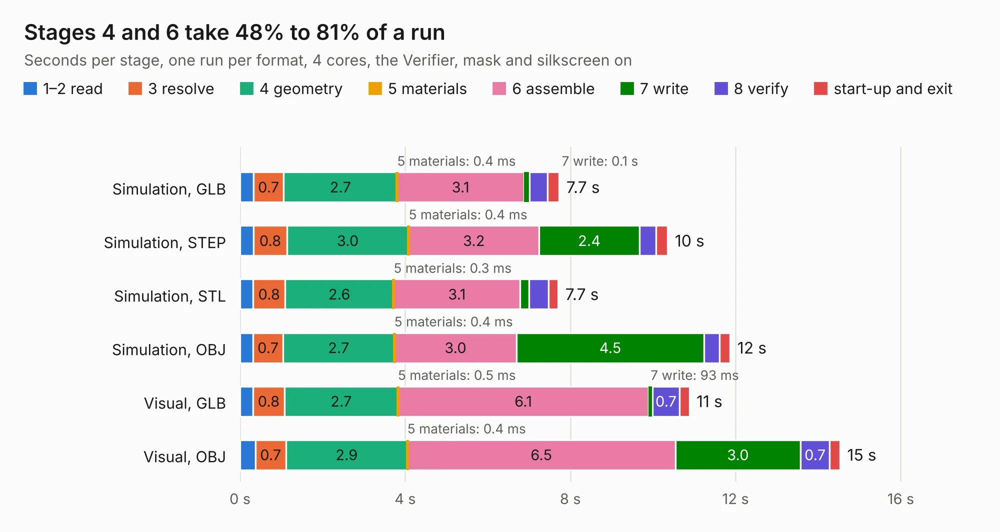

# 2606. SparkFun_GNSS_Flex_Module_LG290P-Tilt

Board 2,606 of the 3,129 of [Corpus Testing](../Corpus-Testing.md), on [Corpus Page 25](../CorpusTestingPages/Corpus-Testing-25.md#2606-sparkfun_gnss_flex_module_lg290p-tilt).

| Mode and format | 1–2 read | 3 resolve | 4 geometry | 5 materials | 6 assemble | 7 write | 8 verify | start-up and exit | Total |
|---|---:|---:|---:|---:|---:|---:|---:|---:|---:|
| Simulation, GLB | 0.3 | 0.7 | 2.7 | 0.4&nbsp;ms | 3.1 | 0.1 | 0.4 | 0.3 | 7.7 |
| Simulation, STEP | 0.3 | 0.8 | 3.0 | 0.4&nbsp;ms | 3.2 | 2.4 | 0.4 | 0.3 | 10.4 |
| Simulation, STL | 0.3 | 0.8 | 2.6 | 0.3&nbsp;ms | 3.1 | 0.2 | 0.5 | 0.2 | 7.7 |
| Simulation, OBJ | 0.3 | 0.7 | 2.7 | 0.4&nbsp;ms | 3.0 | 4.5 | 0.4 | 0.3 | 11.9 |
| Visual, GLB | 0.3 | 0.8 | 2.7 | 0.5&nbsp;ms | 6.1 | 93&nbsp;ms | 0.7 | 0.2 | 10.9 |
| Visual, OBJ | 0.4 | 0.7 | 2.9 | 0.4&nbsp;ms | 6.5 | 3.0 | 0.7 | 0.3 | 14.5 |

<table align="center"><tr><td valign="top">

| Board | Repo: [sparkfun/sparkfun_gnss_flex_system](https://github.com/sparkfun/sparkfun_gnss_flex_system) Board: `SparkFun_GNSS_Flex_Module_LG290P-Tilt.kicad_pcb` |
|---|---|
| Folder | flex_boards / SparkPNT_GNSS_Flex_Module_LG290P-Tilt / hardware |
| Complexity | 295&nbsp;/&nbsp;1000 (size&nbsp;175, features&nbsp;120) |
| KESE&nbsp;features | through vias, rounded, trapezoid or chamfered pads, arc tracks, filled zones, copper text, knockout text, stack-up, dielectric εr and tanδ, mask and silkscreen colours |
| Tested | 10th November 2026 |
| Copper&nbsp;layers | 4 |
| File&nbsp;format | KiCad 9 (20241229) |
| Parts,&nbsp;tracks,&nbsp;vias | 24, 327, 121 |
| Triangles,&nbsp;simulation | 754,390 in 65 parts |
| Verifier | PASS in all six runs |

</td><td valign="top">

<table>
<tr><th>File type</th><th>File size</th><th>Peak memory used</th></tr>
<tr><th colspan="3" align="left">Simulation</th></tr>
<tr><td>GLB</td><td align="right">27&nbsp;MB</td><td align="right">425&nbsp;MB</td></tr>
<tr><td>STEP</td><td align="right">118&nbsp;MB</td><td align="right">456&nbsp;MB</td></tr>
<tr><td>STL</td><td align="right">38&nbsp;MB</td><td align="right">399&nbsp;MB</td></tr>
<tr><td>OBJ</td><td align="right">79&nbsp;MB</td><td align="right">586&nbsp;MB</td></tr>
<tr><th colspan="3" align="left">Visual</th></tr>
<tr><td>GLB</td><td align="right">19&nbsp;MB</td><td align="right">450&nbsp;MB</td></tr>
<tr><td>OBJ</td><td align="right">56&nbsp;MB</td><td align="right">446&nbsp;MB</td></tr>
</table>

</td></tr></table>

| Previous | Next |
|:---|---:|
| [2605. SparkFun_GNSS_Flex_Module_LG290P-Tilt_panelized](b2605b_sparkfun-gnss-flex-system_SparkFun-GNSS-Flex-Module-LG290P-Tilt-panelized.md) | [2607. SparkFun_GNSS_Flex_Module_LG290P_panelized](b2607b_sparkfun-gnss-flex-system_SparkFun-GNSS-Flex-Module-LG290P-panelized.md) |
