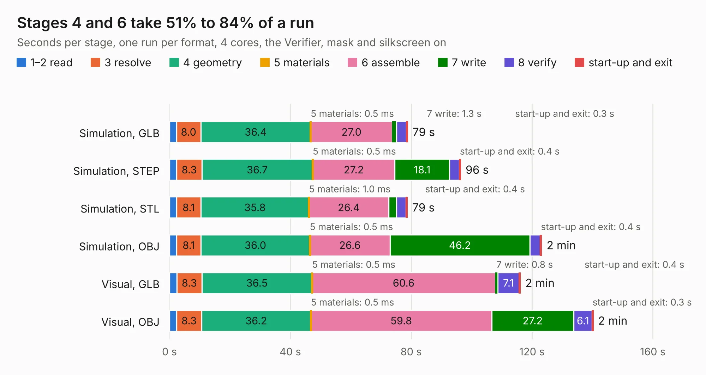

# 2606. SparkFun_GNSS_Flex_Module_mosaic-X5_panelized

Board 2,606 of the 3,118 of [Corpus Testing](../Corpus-Testing.md), on [Corpus Page 25](../CorpusTestingPages/Corpus-Testing-25.md#2606-sparkfun_gnss_flex_module_mosaic-x5_panelized).

| Mode and format | 1–2 read | 3 resolve | 4 geometry | 5 materials | 6 assemble | 7 write | 8 verify | start-up and exit | Total |
|---|---:|---:|---:|---:|---:|---:|---:|---:|---:|
| Simulation, GLB | 2.3 | 8.0 | 36.4 | 0.5&nbsp;ms | 27.0 | 1.3 | 3.4 | 0.3 | 78.8 |
| Simulation, STEP | 2.4 | 8.3 | 36.7 | 0.5&nbsp;ms | 27.2 | 18.1 | 3.3 | 0.4 | 96.4 |
| Simulation, STL | 2.3 | 8.1 | 35.8 | 1.0&nbsp;ms | 26.4 | 2.6 | 3.2 | 0.4 | 78.7 |
| Simulation, OBJ | 2.3 | 8.1 | 36.0 | 0.5&nbsp;ms | 26.6 | 46.2 | 3.5 | 0.4 | 123.2 |
| Visual, GLB | 2.4 | 8.3 | 36.5 | 0.5&nbsp;ms | 60.6 | 0.8 | 7.1 | 0.4 | 116.1 |
| Visual, OBJ | 2.3 | 8.3 | 36.2 | 0.5&nbsp;ms | 59.8 | 27.2 | 6.1 | 0.3 | 140.2 |

<table align="center"><tr><td valign="top">

| Board | Repo: [sparkfun/sparkfun_gnss_flex_system](https://github.com/sparkfun/sparkfun_gnss_flex_system) Board: `SparkFun_GNSS_Flex_Module_mosaic-X5_panelized.kicad_pcb` |
|---|---|
| Folder | flex_boards / SparkPNT_GNSS_Flex_Module_mosaic-X5 / hardware / production |
| Complexity | 423&nbsp;/&nbsp;1000 (size&nbsp;303, features&nbsp;120) |
| KESE&nbsp;features | through vias, rounded, trapezoid or chamfered pads, arc tracks, filled zones, copper text, knockout text, stack-up, dielectric εr and tanδ, mask and silkscreen colours |
| Tested | 9th November 2026 |
| Copper&nbsp;layers | 4 |
| File&nbsp;format | KiCad 8 (20240108) |
| Parts,&nbsp;tracks,&nbsp;vias | 168, 3,144, 1,272 |
| Triangles,&nbsp;simulation | 7,837,644 in 80 parts |
| Note | panel |
| Verifier | PASS in all six runs |

</td><td valign="top">

<table>
<tr><th>File type</th><th>File size</th><th>Peak memory used</th></tr>
<tr><th colspan="3" align="left">Simulation</th></tr>
<tr><td>GLB</td><td align="right">276&nbsp;MB</td><td align="right">2.6&nbsp;GB</td></tr>
<tr><td>STEP</td><td align="right">1.2&nbsp;GB</td><td align="right">3.3&nbsp;GB</td></tr>
<tr><td>STL</td><td align="right">392&nbsp;MB</td><td align="right">2.5&nbsp;GB</td></tr>
<tr><td>OBJ</td><td align="right">858&nbsp;MB</td><td align="right">5.2&nbsp;GB</td></tr>
<tr><th colspan="3" align="left">Visual</th></tr>
<tr><td>GLB</td><td align="right">173&nbsp;MB</td><td align="right">2.9&nbsp;GB</td></tr>
<tr><td>OBJ</td><td align="right">558&nbsp;MB</td><td align="right">3.6&nbsp;GB</td></tr>
</table>

</td></tr></table>

| Previous | Next |
|:---|---:|
| [2605. SparkFun_GNSS_Flex_Module_mosaic-X5_IM19](b2605b_sparkfun-gnss-flex-system_SparkFun-GNSS-Flex-Module-mosaic-X5-IM19.md) | [2607. SparkFun_GNSS_Flex_Module_mosaic-X5](b2607b_sparkfun-gnss-flex-system_SparkFun-GNSS-Flex-Module-mosaic-X5.md) |
