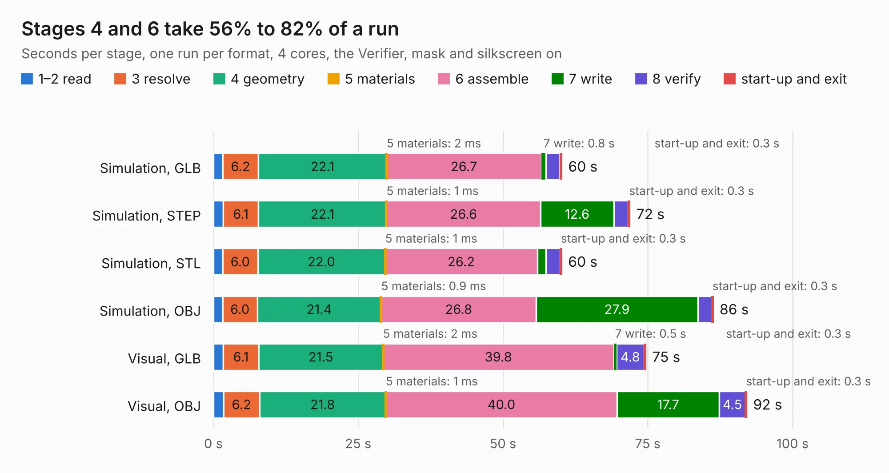

# 2606. SparkPNT_GNSSDO_Plus_panelized

Board 2,606 of the 3,112 of [Corpus Testing](../Corpus-Testing.md), on [Corpus Page 25](../CorpusTestingPages/Corpus-Testing-25.md#2606-sparkpnt_gnssdo_plus_panelized).

| Mode and format | 1–2 read | 3 resolve | 4 geometry | 5 materials | 6 assemble | 7 write | 8 verify | start-up and exit | Total |
|---|---:|---:|---:|---:|---:|---:|---:|---:|---:|
| Simulation, GLB | 1.6 | 6.2 | 22.1 | 2&nbsp;ms | 26.7 | 0.8 | 2.5 | 0.3 | 60.2 |
| Simulation, STEP | 1.7 | 6.1 | 22.1 | 1&nbsp;ms | 26.6 | 12.6 | 2.5 | 0.3 | 71.9 |
| Simulation, STL | 1.6 | 6.0 | 22.0 | 1&nbsp;ms | 26.2 | 1.5 | 2.4 | 0.3 | 60.2 |
| Simulation, OBJ | 1.6 | 6.0 | 21.4 | 0.9&nbsp;ms | 26.8 | 27.9 | 2.4 | 0.3 | 86.3 |
| Visual, GLB | 1.7 | 6.1 | 21.5 | 2&nbsp;ms | 39.8 | 0.5 | 4.8 | 0.3 | 74.7 |
| Visual, OBJ | 1.7 | 6.2 | 21.8 | 1&nbsp;ms | 40.0 | 17.7 | 4.5 | 0.3 | 92.1 |

<table align="center"><tr><td valign="top">

| Board | Repo: [sparkfun/sparkfun_gnssdo](https://github.com/sparkfun/sparkfun_gnssdo) Board: `SparkPNT_GNSSDO_Plus_panelized.kicad_pcb` |
|---|---|
| Folder | Hardware / GNSSDO_Plus / Production |
| Complexity | 430&nbsp;/&nbsp;1000 (size&nbsp;290, features&nbsp;140) |
| KESE&nbsp;features | through vias, slotted holes, rounded, trapezoid or chamfered pads, arc tracks, filled zones, copper text, curved board outline, knockout text, stack-up, dielectric εr and tanδ, mask and silkscreen colours |
| Tested | 9th November 2026 |
| Copper&nbsp;layers | 4 |
| File&nbsp;format | KiCad 9 (20241229) |
| Parts,&nbsp;tracks,&nbsp;vias | 295, 2,557, 880 |
| Triangles,&nbsp;simulation | 5,206,738 in 314 parts |
| Note | panel |
| Verifier | PASS in all six runs |

</td><td valign="top">

<table>
<tr><th>File type</th><th>File size</th><th>Peak memory used</th></tr>
<tr><th colspan="3" align="left">Simulation</th></tr>
<tr><td>GLB</td><td align="right">178&nbsp;MB</td><td align="right">1.6&nbsp;GB</td></tr>
<tr><td>STEP</td><td align="right">723&nbsp;MB</td><td align="right">2.1&nbsp;GB</td></tr>
<tr><td>STL</td><td align="right">260&nbsp;MB</td><td align="right">1.6&nbsp;GB</td></tr>
<tr><td>OBJ</td><td align="right">552&nbsp;MB</td><td align="right">3.4&nbsp;GB</td></tr>
<tr><th colspan="3" align="left">Visual</th></tr>
<tr><td>GLB</td><td align="right">115&nbsp;MB</td><td align="right">1.9&nbsp;GB</td></tr>
<tr><td>OBJ</td><td align="right">366&nbsp;MB</td><td align="right">2.4&nbsp;GB</td></tr>
</table>

</td></tr></table>

| Previous | Next |
|:---|---:|
| [2605. SparkPNT_GPSDO](b2605b_sparkfun-gnssdo_SparkPNT-GPSDO.md) | [2607. SparkPNT_GNSSDO_Plus](b2607b_sparkfun-gnssdo_SparkPNT-GNSSDO-Plus.md) |
