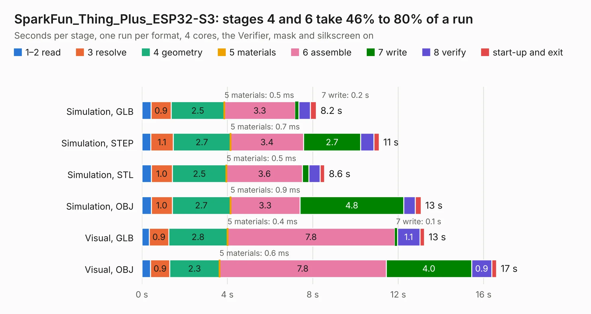

# 2607. SparkFun_Thing_Plus_ESP32-S3

Board 2,607 of the 3,110 of [Corpus Testing](../Corpus-Testing.md), on [Corpus Page 25](../CorpusTestingPages/Corpus-Testing-25.md#2607-sparkfun_thing_plus_esp32-s3).

| Mode and format | 1–2 read | 3 resolve | 4 geometry | 5 materials | 6 assemble | 7 write | 8 verify | start-up and exit | Total |
|---|---:|---:|---:|---:|---:|---:|---:|---:|---:|
| Simulation, GLB | 0.4 | 0.9 | 2.5 | 0.5&nbsp;ms | 3.3 | 0.2 | 0.5 | 0.3 | 8.2 |
| Simulation, STEP | 0.4 | 1.1 | 2.7 | 0.7&nbsp;ms | 3.4 | 2.7 | 0.6 | 0.2 | 11.1 |
| Simulation, STL | 0.4 | 1.0 | 2.5 | 0.5&nbsp;ms | 3.6 | 0.3 | 0.5 | 0.2 | 8.6 |
| Simulation, OBJ | 0.4 | 1.0 | 2.7 | 0.9&nbsp;ms | 3.3 | 4.8 | 0.5 | 0.3 | 13.1 |
| Visual, GLB | 0.3 | 0.9 | 2.8 | 0.4&nbsp;ms | 7.8 | 0.1 | 1.1 | 0.2 | 13.2 |
| Visual, OBJ | 0.4 | 0.9 | 2.3 | 0.6&nbsp;ms | 7.8 | 4.0 | 0.9 | 0.2 | 16.6 |

<table align="center"><tr><td valign="top">

| Board | Repo: [sparkfun/SparkFun_Thing_Plus_ESP32-S3](https://github.com/sparkfun/SparkFun_Thing_Plus_ESP32-S3) Board: `SparkFun_Thing_Plus_ESP32-S3.kicad_pcb` |
|---|---|
| Folder | Hardware |
| Complexity | 333&nbsp;/&nbsp;1000 (size&nbsp;193, features&nbsp;140) |
| KESE&nbsp;features | through vias, slotted holes, rounded, trapezoid or chamfered pads, filled zones, copper text, curved board outline, knockout text, stack-up, dielectric εr and tanδ, copper finish, mask and silkscreen colours |
| Tested | 9th November 2026 |
| Copper&nbsp;layers | 4 |
| File&nbsp;format | KiCad 8 (20240108) |
| Parts,&nbsp;tracks,&nbsp;vias | 54, 800, 130 |
| Triangles,&nbsp;simulation | 1,078,334 in 86 parts |
| Verifier | PASS in all six runs |

</td><td valign="top">

<table>
<tr><th>File type</th><th>File size</th><th>Peak memory used</th></tr>
<tr><th colspan="3" align="left">Simulation</th></tr>
<tr><td>GLB</td><td align="right">37&nbsp;MB</td><td align="right">460&nbsp;MB</td></tr>
<tr><td>STEP</td><td align="right">167&nbsp;MB</td><td align="right">552&nbsp;MB</td></tr>
<tr><td>STL</td><td align="right">54&nbsp;MB</td><td align="right">446&nbsp;MB</td></tr>
<tr><td>OBJ</td><td align="right">110&nbsp;MB</td><td align="right">749&nbsp;MB</td></tr>
<tr><th colspan="3" align="left">Visual</th></tr>
<tr><td>GLB</td><td align="right">26&nbsp;MB</td><td align="right">608&nbsp;MB</td></tr>
<tr><td>OBJ</td><td align="right">79&nbsp;MB</td><td align="right">615&nbsp;MB</td></tr>
</table>

</td></tr></table>

| Previous | Next |
|:---|---:|
| [2606. SparkFun_Thing_Plus_ESP32-S3_panelized](b2606b_SparkFun-Thing-Plus-ESP32-S3_SparkFun-Thing-Plus-ESP32-S3-panelized.md) | [2608. MAP Card](b2608b_hardware_DropBear-MAP-Card-v0-2_MAP-Card.md) |
