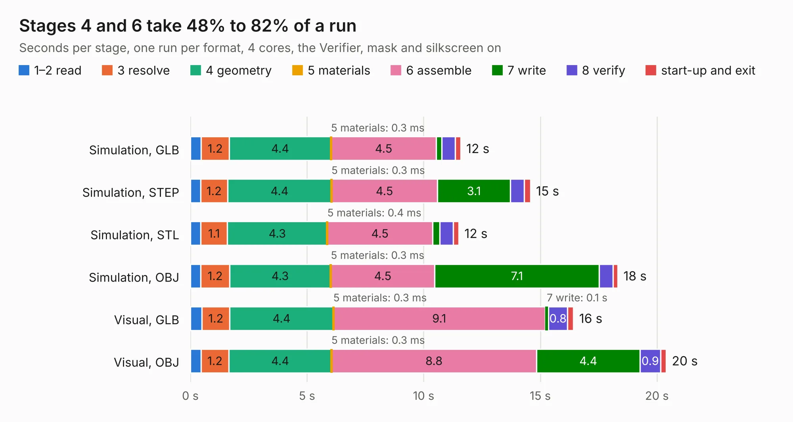

# 2611. SparkFun_GNSS_Flex_Module_mosaic-X5_IM19

Board 2,611 of the 3,124 of [Corpus Testing](../Corpus-Testing.md), on [Corpus Page 25](../CorpusTestingPages/Corpus-Testing-25.md#2611-sparkfun_gnss_flex_module_mosaic-x5_im19).

| Mode and format | 1–2 read | 3 resolve | 4 geometry | 5 materials | 6 assemble | 7 write | 8 verify | start-up and exit | Total |
|---|---:|---:|---:|---:|---:|---:|---:|---:|---:|
| Simulation, GLB | 0.5 | 1.2 | 4.4 | 0.3&nbsp;ms | 4.5 | 0.2 | 0.6 | 0.2 | 11.6 |
| Simulation, STEP | 0.4 | 1.2 | 4.4 | 0.3&nbsp;ms | 4.5 | 3.1 | 0.6 | 0.3 | 14.6 |
| Simulation, STL | 0.4 | 1.1 | 4.3 | 0.4&nbsp;ms | 4.5 | 0.3 | 0.6 | 0.2 | 11.5 |
| Simulation, OBJ | 0.4 | 1.2 | 4.3 | 0.3&nbsp;ms | 4.5 | 7.1 | 0.6 | 0.2 | 18.3 |
| Visual, GLB | 0.5 | 1.2 | 4.4 | 0.3&nbsp;ms | 9.1 | 0.1 | 0.8 | 0.3 | 16.4 |
| Visual, OBJ | 0.5 | 1.2 | 4.4 | 0.3&nbsp;ms | 8.8 | 4.4 | 0.9 | 0.2 | 20.4 |

<table align="center"><tr><td valign="top">

| Board | Repo: [sparkfun/sparkfun_gnss_flex_system](https://github.com/sparkfun/sparkfun_gnss_flex_system) Board: `SparkFun_GNSS_Flex_Module_mosaic-X5_IM19.kicad_pcb` |
|---|---|
| Folder | flex_boards / SparkPNT_GNSS_Flex_Module_mosaic-X5-Tilt / hardware |
| Complexity | 360&nbsp;/&nbsp;1000 (size&nbsp;240, features&nbsp;120) |
| KESE&nbsp;features | through vias, rounded, trapezoid or chamfered pads, arc tracks, filled zones, copper text, knockout text, stack-up, dielectric εr and tanδ, mask and silkscreen colours |
| Tested | 9th November 2026 |
| Copper&nbsp;layers | 4 |
| File&nbsp;format | KiCad 9 (20241229) |
| Parts,&nbsp;tracks,&nbsp;vias | 35, 529, 209 |
| Triangles,&nbsp;simulation | 1,331,060 in 95 parts |
| Verifier | PASS in all six runs |

</td><td valign="top">

<table>
<tr><th>File type</th><th>File size</th><th>Peak memory used</th></tr>
<tr><th colspan="3" align="left">Simulation</th></tr>
<tr><td>GLB</td><td align="right">47&nbsp;MB</td><td align="right">633&nbsp;MB</td></tr>
<tr><td>STEP</td><td align="right">209&nbsp;MB</td><td align="right">683&nbsp;MB</td></tr>
<tr><td>STL</td><td align="right">67&nbsp;MB</td><td align="right">647&nbsp;MB</td></tr>
<tr><td>OBJ</td><td align="right">140&nbsp;MB</td><td align="right">965&nbsp;MB</td></tr>
<tr><th colspan="3" align="left">Visual</th></tr>
<tr><td>GLB</td><td align="right">30&nbsp;MB</td><td align="right">635&nbsp;MB</td></tr>
<tr><td>OBJ</td><td align="right">90&nbsp;MB</td><td align="right">704&nbsp;MB</td></tr>
</table>

</td></tr></table>

| Previous | Next |
|:---|---:|
| [2610. SparkFun_GNSS_Flex_Module_mosaic-X5_IM19_panelized](b2610b_sparkfun-gnss-flex-system_SparkFun-GNSS-Flex-Module-mosaic-X5-IM19-panelized.md) | [2612. SparkFun_GNSS_Flex_Module_mosaic-X5_panelized](b2612b_sparkfun-gnss-flex-system_SparkFun-GNSS-Flex-Module-mosaic-X5-panelized.md) |
