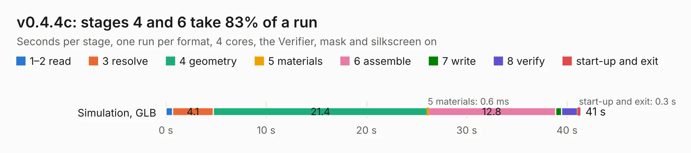

# 2614. v0.4.4c

Board 2,614 of the 3,106 of [Corpus Testing](../Corpus-Testing.md), on [Corpus Page 25](../CorpusTestingPages/Corpus-Testing-25.md#2614-v044c).

| Mode and format | 1–2 read | 3 resolve | 4 geometry | 5 materials | 6 assemble | 7 write | 8 verify | start-up and exit | Total |
|---|---:|---:|---:|---:|---:|---:|---:|---:|---:|
| Simulation, GLB | 0.7 | 4.1 | 21.4 | 0.6&nbsp;ms | 12.8 | 0.6 | 1.6 | 0.3 | 41.3 |
| Simulation, STEP | 0.7 | 4.1 | 20.9 | 0.6&nbsp;ms | 12.0 | 9.4 | 1.6 | 0.3 | 48.9 |
| Simulation, STL | 0.7 | 4.2 | 22.0 | 0.7&nbsp;ms | 12.9 | 1.3 | 1.7 | 0.3 | 43.1 |
| Simulation, OBJ | 0.7 | 4.2 | 21.4 | 0.9&nbsp;ms | 12.9 | 16.7 | 1.9 | 0.3 | 58.2 |
| Visual, GLB | 0.6 | 4.3 | 22.0 | 0.8&nbsp;ms | 28.2 | 0.3 | 3.9 | 0.3 | 59.7 |
| Visual, OBJ | 0.7 | 4.4 | 21.1 | 0.7&nbsp;ms | 26.2 | 10.1 | 4.0 | 0.3 | 66.8 |

<table align="center"><tr><td valign="top">

| Board | Repo: [speeduino/hardware](https://github.com/speeduino/hardware) Board: `v0.4.4c.kicad_pcb` |
|---|---|
| Folder | v0.4 / SMD / Prior Versions / 0.4.4c |
| Complexity | 259&nbsp;/&nbsp;1000 (size&nbsp;189, features&nbsp;70) |
| KESE&nbsp;features | through vias, custom pads, rounded, trapezoid or chamfered pads, filled zones, copper drawings |
| Tested | 9th November 2026 |
| Copper&nbsp;layers | 2 |
| File&nbsp;format | KiCad 5 (20171130) |
| Parts,&nbsp;tracks,&nbsp;vias | 148, 1,038, 113 |
| Triangles,&nbsp;simulation | 3,484,966 in 196 parts |
| Verifier | PASS in all six runs |

</td><td valign="top">

<table>
<tr><th>File type</th><th>File size</th><th>Peak memory used</th></tr>
<tr><th colspan="3" align="left">Simulation</th></tr>
<tr><td>GLB</td><td align="right">120&nbsp;MB</td><td align="right">1.3&nbsp;GB</td></tr>
<tr><td>STEP</td><td align="right">640&nbsp;MB</td><td align="right">1.4&nbsp;GB</td></tr>
<tr><td>STL</td><td align="right">174&nbsp;MB</td><td align="right">1.3&nbsp;GB</td></tr>
<tr><td>OBJ</td><td align="right">371&nbsp;MB</td><td align="right">2.3&nbsp;GB</td></tr>
<tr><th colspan="3" align="left">Visual</th></tr>
<tr><td>GLB</td><td align="right">78&nbsp;MB</td><td align="right">1.3&nbsp;GB</td></tr>
<tr><td>OBJ</td><td align="right">243&nbsp;MB</td><td align="right">1.7&nbsp;GB</td></tr>
</table>

</td></tr></table>

| Previous | Next |
|:---|---:|
| [2613. v0.4.4b](b2613b_hardware_v0-4-4b.md) | [2615. v0.4.3d](b2615b_hardware_v0-4-3d.md) |
