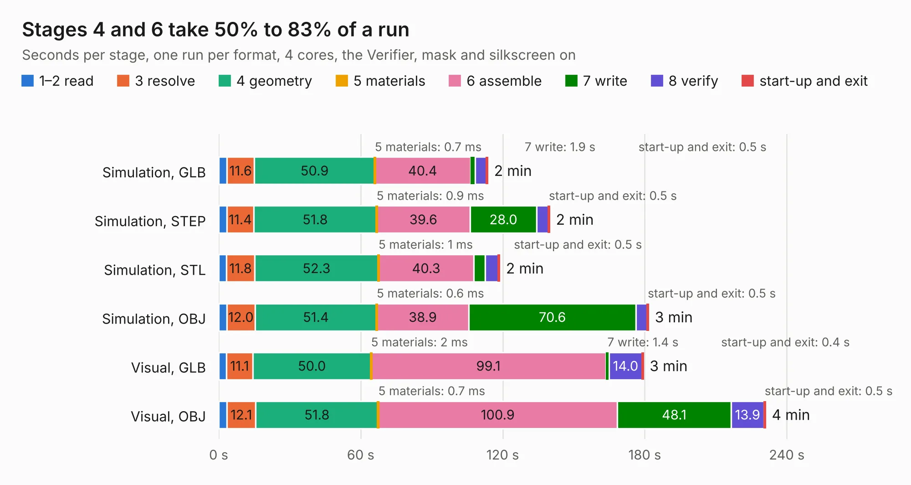

# 2614 SparkFun_GNSS_Flex_Module_LG290P-Tilt_panelized

Board 2,614 of the 3,138 of [Corpus Testing](../Corpus-Testing.md), on [Corpus Page 25](../CorpusTestingPages/Corpus-Testing-25.md#2614-sparkfun_gnss_flex_module_lg290p-tilt_panelized).

| Mode and format | 1–2 read | 3 resolve | 4 geometry | 5 materials | 6 assemble | 7 write | 8 verify | start-up and exit | Total |
|---|---:|---:|---:|---:|---:|---:|---:|---:|---:|
| Simulation, GLB | 3.5 | 11.6 | 50.9 | 0.7&nbsp;ms | 40.4 | 1.9 | 4.8 | 0.5 | 113.6 |
| Simulation, STEP | 3.4 | 11.4 | 51.8 | 0.9&nbsp;ms | 39.6 | 28.0 | 5.0 | 0.5 | 139.7 |
| Simulation, STL | 3.3 | 11.8 | 52.3 | 1&nbsp;ms | 40.3 | 4.7 | 5.6 | 0.5 | 118.6 |
| Simulation, OBJ | 3.4 | 12.0 | 51.4 | 0.6&nbsp;ms | 38.9 | 70.6 | 4.8 | 0.5 | 181.5 |
| Visual, GLB | 3.3 | 11.1 | 50.0 | 2&nbsp;ms | 99.1 | 1.4 | 14.0 | 0.4 | 179.3 |
| Visual, OBJ | 3.5 | 12.1 | 51.8 | 0.7&nbsp;ms | 100.9 | 48.1 | 13.9 | 0.5 | 230.9 |

<table align="center"><tr><td valign="top">

| Board | Repo: [sparkfun/sparkfun_gnss_flex_system](https://github.com/sparkfun/sparkfun_gnss_flex_system) Board: `SparkFun_GNSS_Flex_Module_LG290P-Tilt_panelized.kicad_pcb` |
|---|---|
| Folder | flex_boards / SparkPNT_GNSS_Flex_Module_LG290P-Tilt / hardware / production |
| Complexity | 369&nbsp;/&nbsp;1000 (size&nbsp;249, features&nbsp;120) |
| KESE&nbsp;features | through vias, rounded, trapezoid or chamfered pads, arc tracks, filled zones, copper text, knockout text, stack-up, dielectric εr and tanδ, mask and silkscreen colours |
| Tested | 9th November 2026 |
| Copper&nbsp;layers | 4 |
| File&nbsp;format | KiCad 9 (20241229) |
| Parts,&nbsp;tracks,&nbsp;vias | 360, 4,905, 1,815 |
| Triangles,&nbsp;simulation | 11,325,460 in 65 parts |
| Note | panel |
| Verifier | PASS in all six runs |

</td><td valign="top">

<table>
<tr><th>File type</th><th>File size</th><th>Peak memory used</th></tr>
<tr><th colspan="3" align="left">Simulation</th></tr>
<tr><td>GLB</td><td align="right">404&nbsp;MB</td><td align="right">3.5&nbsp;GB</td></tr>
<tr><td>STEP</td><td align="right">1.8&nbsp;GB</td><td align="right">4.3&nbsp;GB</td></tr>
<tr><td>STL</td><td align="right">566&nbsp;MB</td><td align="right">3.4&nbsp;GB</td></tr>
<tr><td>OBJ</td><td align="right">1.3&nbsp;GB</td><td align="right">7.5&nbsp;GB</td></tr>
<tr><th colspan="3" align="left">Visual</th></tr>
<tr><td>GLB</td><td align="right">282&nbsp;MB</td><td align="right">4.2&nbsp;GB</td></tr>
<tr><td>OBJ</td><td align="right">894&nbsp;MB</td><td align="right">5.7&nbsp;GB</td></tr>
</table>

</td></tr></table>

| Previous | Next |
|:---|---:|
| [2613 SparkFun_GNSS_Flex_Module_DAN-F10N](b2613b_sparkfun-gnss-flex-system_SparkFun-GNSS-Flex-Module-DAN-F10N.md) | [2615 SparkFun_GNSS_Flex_Module_LG290P-Tilt](b2615b_sparkfun-gnss-flex-system_SparkFun-GNSS-Flex-Module-LG290P-Tilt.md) |
