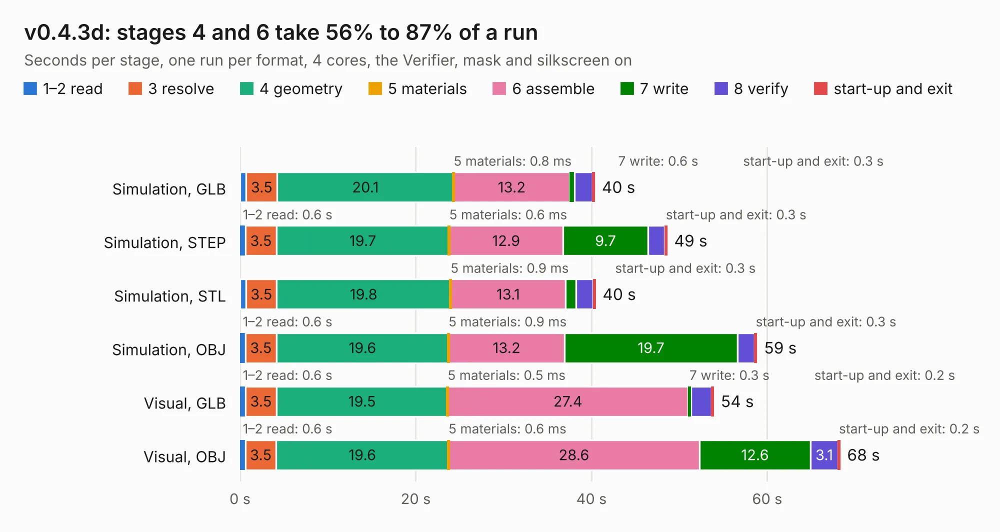

# 2615. v0.4.3d

Board 2,615 of the 3,106 of [Corpus Testing](../Corpus-Testing.md), on [Corpus Page 25](../CorpusTestingPages/Corpus-Testing-25.md#2615-v043d).

| Mode and format | 1–2 read | 3 resolve | 4 geometry | 5 materials | 6 assemble | 7 write | 8 verify | start-up and exit | Total |
|---|---:|---:|---:|---:|---:|---:|---:|---:|---:|
| Simulation, GLB | 0.7 | 3.5 | 20.1 | 0.8&nbsp;ms | 13.2 | 0.6 | 2.0 | 0.3 | 40.4 |
| Simulation, STEP | 0.6 | 3.5 | 19.7 | 0.6&nbsp;ms | 12.9 | 9.7 | 1.9 | 0.3 | 48.6 |
| Simulation, STL | 0.7 | 3.5 | 19.8 | 0.9&nbsp;ms | 13.1 | 1.1 | 2.0 | 0.3 | 40.5 |
| Simulation, OBJ | 0.6 | 3.5 | 19.6 | 0.9&nbsp;ms | 13.2 | 19.7 | 2.0 | 0.3 | 58.8 |
| Visual, GLB | 0.6 | 3.5 | 19.5 | 0.5&nbsp;ms | 27.4 | 0.3 | 2.4 | 0.2 | 53.9 |
| Visual, OBJ | 0.6 | 3.5 | 19.6 | 0.6&nbsp;ms | 28.6 | 12.6 | 3.1 | 0.2 | 68.3 |

<table align="center"><tr><td valign="top">

| Board | Repo: [speeduino/hardware](https://github.com/speeduino/hardware) Board: `v0.4.3d.kicad_pcb` |
|---|---|
| Folder | v0.4 / THT / Latest |
| Complexity | 258&nbsp;/&nbsp;1000 (size&nbsp;188, features&nbsp;70) |
| KESE&nbsp;features | through vias, custom pads, drill offsets, filled zones, copper drawings |
| Tested | 9th November 2026 |
| Copper&nbsp;layers | 2 |
| File&nbsp;format | KiCad 5 (20171130) |
| Parts,&nbsp;tracks,&nbsp;vias | 133, 989, 124 |
| Triangles,&nbsp;simulation | 3,718,100 in 174 parts |
| Verifier | PASS in all six runs |

</td><td valign="top">

<table>
<tr><th>File type</th><th>File size</th><th>Peak memory used</th></tr>
<tr><th colspan="3" align="left">Simulation</th></tr>
<tr><td>GLB</td><td align="right">128&nbsp;MB</td><td align="right">1.1&nbsp;GB</td></tr>
<tr><td>STEP</td><td align="right">622&nbsp;MB</td><td align="right">1.4&nbsp;GB</td></tr>
<tr><td>STL</td><td align="right">186&nbsp;MB</td><td align="right">1.1&nbsp;GB</td></tr>
<tr><td>OBJ</td><td align="right">396&nbsp;MB</td><td align="right">2.4&nbsp;GB</td></tr>
<tr><th colspan="3" align="left">Visual</th></tr>
<tr><td>GLB</td><td align="right">80&nbsp;MB</td><td align="right">1.3&nbsp;GB</td></tr>
<tr><td>OBJ</td><td align="right">250&nbsp;MB</td><td align="right">1.7&nbsp;GB</td></tr>
</table>

</td></tr></table>

| Previous | Next |
|:---|---:|
| [2614. v0.4.4c](b2614b_hardware_v0-4-4c.md) | [2616. VR-Conditioner-MAX9926+reg](b2616b_hardware_VR-Conditioner-MAX9926-reg.md) |
