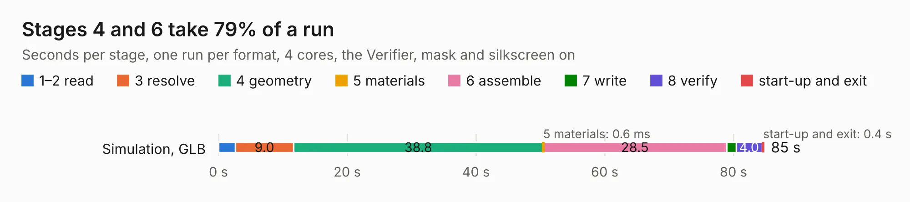

# 2615. SparkFun_GNSS_Flex_Module_mosaic-X5_IM19_panelized

Board 2,615 of the 3,131 of [Corpus Testing](../Corpus-Testing.md), on [Corpus Page 25](../CorpusTestingPages/Corpus-Testing-25.md#2615-sparkfun_gnss_flex_module_mosaic-x5_im19_panelized).

| Mode and format | 1–2 read | 3 resolve | 4 geometry | 5 materials | 6 assemble | 7 write | 8 verify | start-up and exit | Total |
|---|---:|---:|---:|---:|---:|---:|---:|---:|---:|
| Simulation, GLB | 2.6 | 9.0 | 38.8 | 0.6&nbsp;ms | 28.5 | 1.5 | 4.0 | 0.4 | 84.8 |
| Simulation, STEP | 2.6 | 9.2 | 39.9 | 0.7&nbsp;ms | 28.8 | 19.7 | 3.9 | 0.4 | 104.6 |
| Simulation, STL | 2.6 | 9.1 | 38.6 | 0.8&nbsp;ms | 28.7 | 2.9 | 3.7 | 0.4 | 86.0 |
| Simulation, OBJ | 2.7 | 8.9 | 38.2 | 1&nbsp;ms | 28.4 | 47.4 | 4.0 | 0.4 | 130.1 |
| Visual, GLB | 2.9 | 9.4 | 38.3 | 0.6&nbsp;ms | 65.9 | 1.0 | 7.0 | 0.4 | 124.8 |
| Visual, OBJ | 2.7 | 8.8 | 38.5 | 0.6&nbsp;ms | 65.2 | 30.0 | 6.6 | 0.4 | 152.1 |

<table align="center"><tr><td valign="top">

| Board | Repo: [sparkfun/sparkfun_gnss_flex_system](https://github.com/sparkfun/sparkfun_gnss_flex_system) Board: `SparkFun_GNSS_Flex_Module_mosaic-X5_IM19_panelized.kicad_pcb` |
|---|---|
| Folder | flex_boards / SparkPNT_GNSS_Flex_Module_mosaic-X5-Tilt / hardware / production |
| Complexity | 426&nbsp;/&nbsp;1000 (size&nbsp;306, features&nbsp;120) |
| KESE&nbsp;features | through vias, rounded, trapezoid or chamfered pads, arc tracks, filled zones, copper text, knockout text, stack-up, dielectric εr and tanδ, mask and silkscreen colours |
| Tested | 9th November 2026 |
| Copper&nbsp;layers | 4 |
| File&nbsp;format | KiCad 9 (20241229) |
| Parts,&nbsp;tracks,&nbsp;vias | 210, 3,174, 1,254 |
| Triangles,&nbsp;simulation | 7,998,602 in 95 parts |
| Note | panel |
| Verifier | PASS in all six runs |

</td><td valign="top">

<table>
<tr><th>File type</th><th>File size</th><th>Peak memory used</th></tr>
<tr><th colspan="3" align="left">Simulation</th></tr>
<tr><td>GLB</td><td align="right">282&nbsp;MB</td><td align="right">2.9&nbsp;GB</td></tr>
<tr><td>STEP</td><td align="right">1.3&nbsp;GB</td><td align="right">3.3&nbsp;GB</td></tr>
<tr><td>STL</td><td align="right">400&nbsp;MB</td><td align="right">2.7&nbsp;GB</td></tr>
<tr><td>OBJ</td><td align="right">877&nbsp;MB</td><td align="right">5.3&nbsp;GB</td></tr>
<tr><th colspan="3" align="left">Visual</th></tr>
<tr><td>GLB</td><td align="right">179&nbsp;MB</td><td align="right">3.0&nbsp;GB</td></tr>
<tr><td>OBJ</td><td align="right">575&nbsp;MB</td><td align="right">3.8&nbsp;GB</td></tr>
</table>

</td></tr></table>

| Previous | Next |
|:---|---:|
| [2614. SparkFun_GNSS_Flex_Module_mosaic-G5_P3_Tilt](b2614b_sparkfun-gnss-flex-system_SparkFun-GNSS-Flex-Module-mosaic-G5-P3-Tilt.md) | [2616. SparkFun_GNSS_Flex_Module_mosaic-X5_IM19](b2616b_sparkfun-gnss-flex-system_SparkFun-GNSS-Flex-Module-mosaic-X5-IM19.md) |
