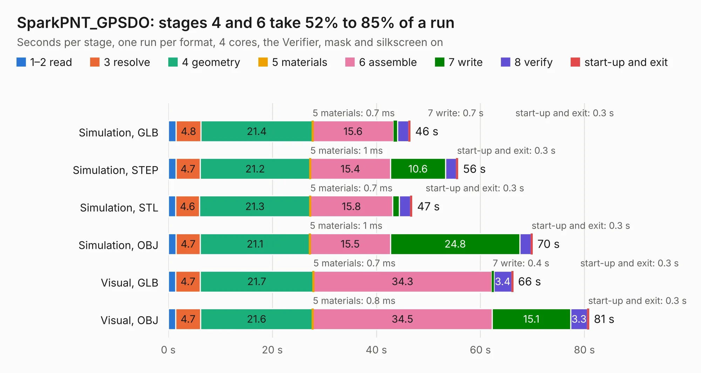

# 2615. SparkPNT_GPSDO

Board 2,615 of the 3,122 of [Corpus Testing](../Corpus-Testing.md), on [Corpus Page 25](../CorpusTestingPages/Corpus-Testing-25.md#2615-sparkpnt_gpsdo).

| Mode and format | 1–2 read | 3 resolve | 4 geometry | 5 materials | 6 assemble | 7 write | 8 verify | start-up and exit | Total |
|---|---:|---:|---:|---:|---:|---:|---:|---:|---:|
| Simulation, GLB | 1.5 | 4.8 | 21.4 | 0.7&nbsp;ms | 15.6 | 0.7 | 2.2 | 0.3 | 46.5 |
| Simulation, STEP | 1.5 | 4.7 | 21.2 | 1&nbsp;ms | 15.4 | 10.6 | 2.0 | 0.3 | 55.7 |
| Simulation, STL | 1.4 | 4.6 | 21.3 | 0.7&nbsp;ms | 15.8 | 1.3 | 2.1 | 0.3 | 46.9 |
| Simulation, OBJ | 1.5 | 4.7 | 21.1 | 1&nbsp;ms | 15.5 | 24.8 | 2.1 | 0.3 | 70.0 |
| Visual, GLB | 1.4 | 4.7 | 21.7 | 0.7&nbsp;ms | 34.3 | 0.4 | 3.4 | 0.3 | 66.3 |
| Visual, OBJ | 1.4 | 4.7 | 21.6 | 0.8&nbsp;ms | 34.5 | 15.1 | 3.3 | 0.3 | 80.9 |

<table align="center"><tr><td valign="top">

| Board | Repo: [sparkfun/sparkfun_gnssdo](https://github.com/sparkfun/sparkfun_gnssdo) Board: `SparkPNT_GPSDO.kicad_pcb` |
|---|---|
| Folder | Hardware / GNSSDO |
| Complexity | 408&nbsp;/&nbsp;1000 (size&nbsp;283, features&nbsp;125) |
| KESE&nbsp;features | through vias, slotted holes, rounded, trapezoid or chamfered pads, filled zones, copper text, curved board outline, knockout text, stack-up, dielectric εr and tanδ, mask and silkscreen colours |
| Tested | 9th November 2026 |
| Copper&nbsp;layers | 4 |
| File&nbsp;format | KiCad 8 (20240108) |
| Parts,&nbsp;tracks,&nbsp;vias | 232, 2,036, 692 |
| Triangles,&nbsp;simulation | 4,617,486 in 261 parts |
| Verifier | PASS in all six runs |

</td><td valign="top">

<table>
<tr><th>File type</th><th>File size</th><th>Peak memory used</th></tr>
<tr><th colspan="3" align="left">Simulation</th></tr>
<tr><td>GLB</td><td align="right">160&nbsp;MB</td><td align="right">1.4&nbsp;GB</td></tr>
<tr><td>STEP</td><td align="right">682&nbsp;MB</td><td align="right">1.8&nbsp;GB</td></tr>
<tr><td>STL</td><td align="right">231&nbsp;MB</td><td align="right">1.4&nbsp;GB</td></tr>
<tr><td>OBJ</td><td align="right">494&nbsp;MB</td><td align="right">3.0&nbsp;GB</td></tr>
<tr><th colspan="3" align="left">Visual</th></tr>
<tr><td>GLB</td><td align="right">99&nbsp;MB</td><td align="right">1.7&nbsp;GB</td></tr>
<tr><td>OBJ</td><td align="right">311&nbsp;MB</td><td align="right">2.2&nbsp;GB</td></tr>
</table>

</td></tr></table>

| Previous | Next |
|:---|---:|
| [2614. SparkPNT_GPSDO_panelized](b2614b_sparkfun-gnssdo_SparkPNT-GPSDO-panelized.md) | [2616. SparkPNT_GNSSDO_Plus_panelized](b2616b_sparkfun-gnssdo_SparkPNT-GNSSDO-Plus-panelized.md) |
