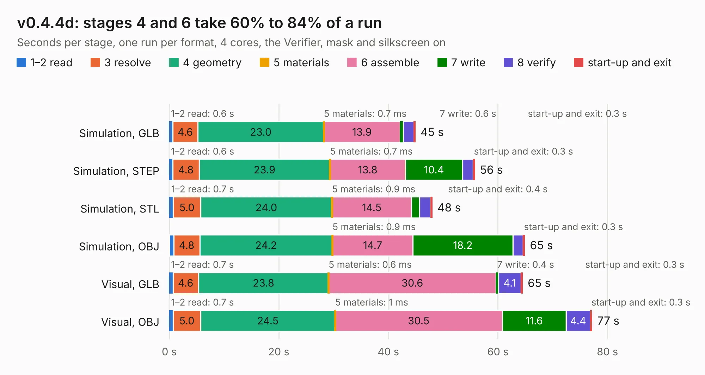

# 2616. v0.4.4d

Board 2,616 of the 3,110 of [Corpus Testing](../Corpus-Testing.md), on [Corpus Page 25](../CorpusTestingPages/Corpus-Testing-25.md#2616-v044d).

| Mode and format | 1–2 read | 3 resolve | 4 geometry | 5 materials | 6 assemble | 7 write | 8 verify | start-up and exit | Total |
|---|---:|---:|---:|---:|---:|---:|---:|---:|---:|
| Simulation, GLB | 0.6 | 4.6 | 23.0 | 0.7&nbsp;ms | 13.9 | 0.6 | 1.9 | 0.3 | 45.0 |
| Simulation, STEP | 0.6 | 4.8 | 23.9 | 0.7&nbsp;ms | 13.8 | 10.4 | 2.0 | 0.3 | 55.8 |
| Simulation, STL | 0.7 | 5.0 | 24.0 | 0.9&nbsp;ms | 14.5 | 1.4 | 2.0 | 0.4 | 48.0 |
| Simulation, OBJ | 0.8 | 4.8 | 24.2 | 0.9&nbsp;ms | 14.7 | 18.2 | 1.9 | 0.3 | 64.9 |
| Visual, GLB | 0.7 | 4.6 | 23.8 | 0.6&nbsp;ms | 30.6 | 0.4 | 4.1 | 0.3 | 64.5 |
| Visual, OBJ | 0.7 | 5.0 | 24.5 | 1&nbsp;ms | 30.5 | 11.6 | 4.4 | 0.3 | 77.2 |

<table align="center"><tr><td valign="top">

| Board | Repo: [speeduino/hardware](https://github.com/speeduino/hardware) Board: `v0.4.4d.kicad_pcb` |
|---|---|
| Folder | v0.4 / SMD / Latest |
| Complexity | 262&nbsp;/&nbsp;1000 (size&nbsp;192, features&nbsp;70) |
| KESE&nbsp;features | through vias, custom pads, rounded, trapezoid or chamfered pads, filled zones, copper drawings |
| Tested | 9th November 2026 |
| Copper&nbsp;layers | 2 |
| File&nbsp;format | KiCad 5 (20171130) |
| Parts,&nbsp;tracks,&nbsp;vias | 147, 1,055, 178 |
| Triangles,&nbsp;simulation | 3,530,694 in 196 parts |
| Verifier | PASS in all six runs |

</td><td valign="top">

<table>
<tr><th>File type</th><th>File size</th><th>Peak memory used</th></tr>
<tr><th colspan="3" align="left">Simulation</th></tr>
<tr><td>GLB</td><td align="right">122&nbsp;MB</td><td align="right">1.2&nbsp;GB</td></tr>
<tr><td>STEP</td><td align="right">641&nbsp;MB</td><td align="right">1.3&nbsp;GB</td></tr>
<tr><td>STL</td><td align="right">177&nbsp;MB</td><td align="right">1.2&nbsp;GB</td></tr>
<tr><td>OBJ</td><td align="right">376&nbsp;MB</td><td align="right">2.3&nbsp;GB</td></tr>
<tr><th colspan="3" align="left">Visual</th></tr>
<tr><td>GLB</td><td align="right">80&nbsp;MB</td><td align="right">1.3&nbsp;GB</td></tr>
<tr><td>OBJ</td><td align="right">249&nbsp;MB</td><td align="right">1.6&nbsp;GB</td></tr>
</table>

</td></tr></table>

| Previous | Next |
|:---|---:|
| [2615. Screw terminal interface](b2615b_hardware_Screw-terminal-interface.md) | [2617. v0.4.4b](b2617b_hardware_v0-4-4b.md) |
