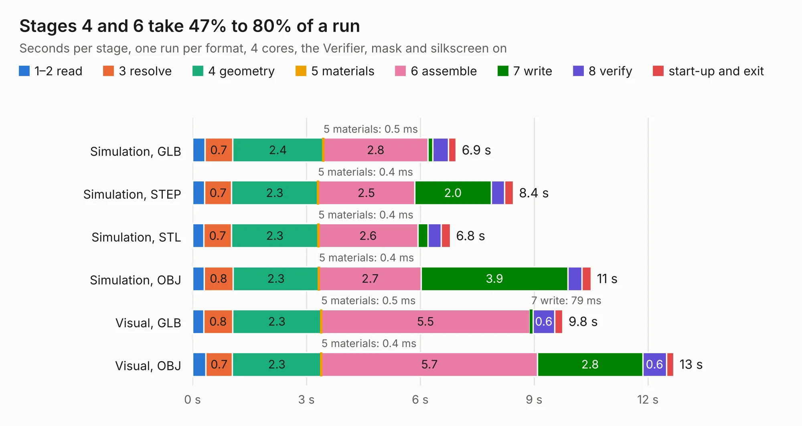

# 2617. SparkFun_GNSS_Flex_Module_ZED-X20P_Tilt

Board 2,617 of the 3,128 of [Corpus Testing](../Corpus-Testing.md), on [Corpus Page 25](../CorpusTestingPages/Corpus-Testing-25.md#2617-sparkfun_gnss_flex_module_zed-x20p_tilt).

| Mode and format | 1–2 read | 3 resolve | 4 geometry | 5 materials | 6 assemble | 7 write | 8 verify | start-up and exit | Total |
|---|---:|---:|---:|---:|---:|---:|---:|---:|---:|
| Simulation, GLB | 0.3 | 0.7 | 2.4 | 0.5&nbsp;ms | 2.8 | 0.1 | 0.4 | 0.2 | 6.9 |
| Simulation, STEP | 0.3 | 0.7 | 2.3 | 0.4&nbsp;ms | 2.5 | 2.0 | 0.4 | 0.2 | 8.4 |
| Simulation, STL | 0.3 | 0.7 | 2.3 | 0.4&nbsp;ms | 2.6 | 0.3 | 0.4 | 0.2 | 6.8 |
| Simulation, OBJ | 0.3 | 0.8 | 2.3 | 0.4&nbsp;ms | 2.7 | 3.9 | 0.4 | 0.2 | 10.5 |
| Visual, GLB | 0.3 | 0.8 | 2.3 | 0.5&nbsp;ms | 5.5 | 79&nbsp;ms | 0.6 | 0.2 | 9.8 |
| Visual, OBJ | 0.4 | 0.7 | 2.3 | 0.4&nbsp;ms | 5.7 | 2.8 | 0.6 | 0.2 | 12.7 |

<table align="center"><tr><td valign="top">

| Board | Repo: [sparkfun/sparkfun_gnss_flex_system](https://github.com/sparkfun/sparkfun_gnss_flex_system) Board: `SparkFun_GNSS_Flex_Module_ZED-X20P_Tilt.kicad_pcb` |
|---|---|
| Folder | flex_boards / SparkPNT_GNSS_Flex_Module_ZED-X20P-Tilt / hardware |
| Complexity | 296&nbsp;/&nbsp;1000 (size&nbsp;176, features&nbsp;120) |
| KESE&nbsp;features | through vias, rounded, trapezoid or chamfered pads, arc tracks, filled zones, copper text, knockout text, stack-up, dielectric εr and tanδ, mask and silkscreen colours |
| Tested | 9th November 2026 |
| Copper&nbsp;layers | 4 |
| File&nbsp;format | KiCad 9 (20241229) |
| Parts,&nbsp;tracks,&nbsp;vias | 23, 348, 134 |
| Triangles,&nbsp;simulation | 770,344 in 86 parts |
| Verifier | PASS in all six runs |

</td><td valign="top">

<table>
<tr><th>File type</th><th>File size</th><th>Peak memory used</th></tr>
<tr><th colspan="3" align="left">Simulation</th></tr>
<tr><td>GLB</td><td align="right">27&nbsp;MB</td><td align="right">421&nbsp;MB</td></tr>
<tr><td>STEP</td><td align="right">115&nbsp;MB</td><td align="right">478&nbsp;MB</td></tr>
<tr><td>STL</td><td align="right">39&nbsp;MB</td><td align="right">445&nbsp;MB</td></tr>
<tr><td>OBJ</td><td align="right">80&nbsp;MB</td><td align="right">582&nbsp;MB</td></tr>
<tr><th colspan="3" align="left">Visual</th></tr>
<tr><td>GLB</td><td align="right">19&nbsp;MB</td><td align="right">482&nbsp;MB</td></tr>
<tr><td>OBJ</td><td align="right">57&nbsp;MB</td><td align="right">481&nbsp;MB</td></tr>
</table>

</td></tr></table>

| Previous | Next |
|:---|---:|
| [2616. SparkFun_GNSS_Flex_Module_ZED-X20P_Tilt_panelized](b2616b_sparkfun-gnss-flex-system_SparkFun-GNSS-Flex-Module-ZED-X20P-Tilt-panelized.md) | [2618. SparkPNT_GPSDO_panelized](b2618b_sparkfun-gnssdo_SparkPNT-GPSDO-panelized.md) |
