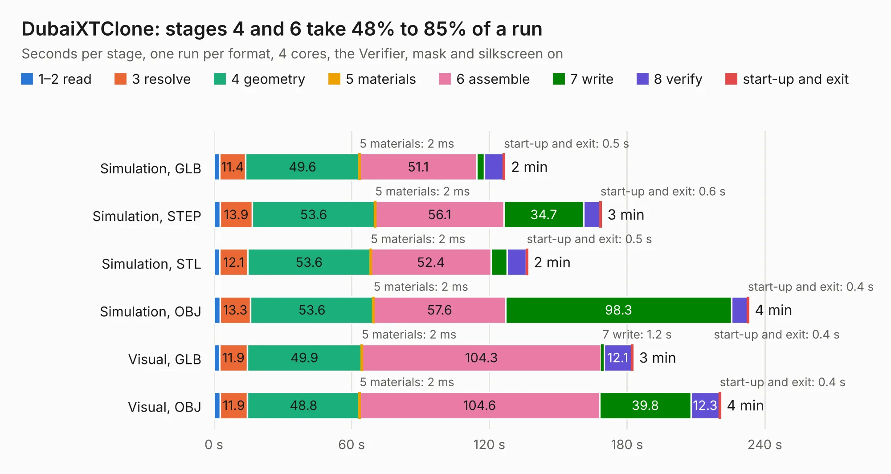

# 2619. DubaiXTClone

Board 2,619 of the 3,108 of [Corpus Testing](../Corpus-Testing.md), on [Corpus Page 25](../CorpusTestingPages/Corpus-Testing-25.md#2619-dubaixtclone).

| Mode and format | 1–2 read | 3 resolve | 4 geometry | 5 materials | 6 assemble | 7 write | 8 verify | start-up and exit | Total |
|---|---:|---:|---:|---:|---:|---:|---:|---:|---:|
| Simulation, GLB | 2.5 | 11.4 | 49.6 | 2&nbsp;ms | 51.1 | 3.3 | 8.2 | 0.5 | 126.6 |
| Simulation, STEP | 2.7 | 13.9 | 53.6 | 2&nbsp;ms | 56.1 | 34.7 | 7.0 | 0.6 | 168.7 |
| Simulation, STL | 2.6 | 12.1 | 53.6 | 2&nbsp;ms | 52.4 | 7.0 | 8.4 | 0.5 | 136.6 |
| Simulation, OBJ | 2.7 | 13.3 | 53.6 | 2&nbsp;ms | 57.6 | 98.3 | 7.0 | 0.4 | 232.9 |
| Visual, GLB | 2.6 | 11.9 | 49.9 | 2&nbsp;ms | 104.3 | 1.2 | 12.1 | 0.4 | 182.5 |
| Visual, OBJ | 2.7 | 11.9 | 48.8 | 2&nbsp;ms | 104.6 | 39.8 | 12.3 | 0.4 | 220.6 |

<table align="center"><tr><td valign="top">

| Board | Repo: [spencer-uk/DubaiXTClone](https://github.com/spencer-uk/DubaiXTClone) Board: `DubaiXTClone.kicad_pcb` |
|---|---|
| Complexity | 360&nbsp;/&nbsp;1000 (size&nbsp;240, features&nbsp;120) |
| KESE&nbsp;features | through vias, rounded, trapezoid or chamfered pads, filled zones, copper text, TrueType text, stack-up, dielectric εr and tanδ, copper finish, mask and silkscreen colours |
| Tested | 9th November 2026 |
| Copper&nbsp;layers | 4 |
| File&nbsp;format | KiCad 9 (20241229) |
| Parts,&nbsp;tracks,&nbsp;vias | 144, 9,528, 536 |
| Triangles,&nbsp;simulation | 14,240,612 in 407 parts |
| Verifier | PASS in all six runs |

</td><td valign="top">

<table>
<tr><th>File type</th><th>File size</th><th>Peak memory used</th></tr>
<tr><th colspan="3" align="left">Simulation</th></tr>
<tr><td>GLB</td><td align="right">481&nbsp;MB</td><td align="right">3.1&nbsp;GB</td></tr>
<tr><td>STEP</td><td align="right">1.7&nbsp;GB</td><td align="right">4.3&nbsp;GB</td></tr>
<tr><td>STL</td><td align="right">712&nbsp;MB</td><td align="right">3.1&nbsp;GB</td></tr>
<tr><td>OBJ</td><td align="right">1.5&nbsp;GB</td><td align="right">8.8&nbsp;GB</td></tr>
<tr><th colspan="3" align="left">Visual</th></tr>
<tr><td>GLB</td><td align="right">225&nbsp;MB</td><td align="right">3.7&nbsp;GB</td></tr>
<tr><td>OBJ</td><td align="right">734&nbsp;MB</td><td align="right">4.8&nbsp;GB</td></tr>
</table>

</td></tr></table>

| Previous | Next |
|:---|---:|
| [2618. VR-Conditioner-MAX9926+reg](b2618b_hardware_VR-Conditioner-MAX9926-reg.md) | [2620. cm5-carrier](b2620b_spirit_cm5-carrier.md) |
