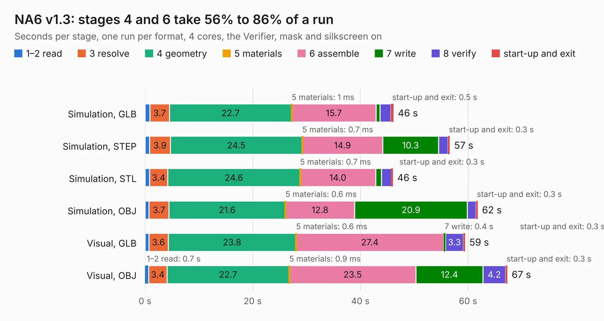

# 2620. NA6 v1.3

Board 2,620 of the 3,117 of [Corpus Testing](../Corpus-Testing.md), on [Corpus Page 25](../CorpusTestingPages/Corpus-Testing-25.md#2620-na6-v13).

| Mode and format | 1–2 read | 3 resolve | 4 geometry | 5 materials | 6 assemble | 7 write | 8 verify | start-up and exit | Total |
|---|---:|---:|---:|---:|---:|---:|---:|---:|---:|
| Simulation, GLB | 0.9 | 3.7 | 22.7 | 1&nbsp;ms | 15.7 | 0.7 | 2.0 | 0.5 | 46.2 |
| Simulation, STEP | 0.8 | 3.9 | 24.5 | 0.7&nbsp;ms | 14.9 | 10.3 | 1.8 | 0.3 | 56.6 |
| Simulation, STL | 0.8 | 3.4 | 24.6 | 0.7&nbsp;ms | 14.0 | 1.1 | 1.9 | 0.3 | 46.0 |
| Simulation, OBJ | 0.7 | 3.7 | 21.6 | 0.6&nbsp;ms | 12.8 | 20.9 | 1.6 | 0.3 | 61.8 |
| Visual, GLB | 0.7 | 3.6 | 23.8 | 0.6&nbsp;ms | 27.4 | 0.4 | 3.3 | 0.3 | 59.4 |
| Visual, OBJ | 0.7 | 3.4 | 22.7 | 0.9&nbsp;ms | 23.5 | 12.4 | 4.2 | 0.3 | 67.3 |

<table align="center"><tr><td valign="top">

| Board | Repo: [speeduino/hardware](https://github.com/speeduino/hardware) Board: `NA6 v1.3.kicad_pcb` |
|---|---|
| Folder | PNPs / Miata NA6 / Latest |
| Complexity | 300&nbsp;/&nbsp;1000 (size&nbsp;230, features&nbsp;70) |
| KESE&nbsp;features | through vias, custom pads, rounded, trapezoid or chamfered pads, filled zones, copper drawings |
| Tested | 9th November 2026 |
| Copper&nbsp;layers | 2 |
| File&nbsp;format | KiCad 7 (20221018) |
| Parts,&nbsp;tracks,&nbsp;vias | 146, 1,019, 130 |
| Triangles,&nbsp;simulation | 2,797,794 in 233 parts |
| Verifier | PASS in all six runs |

</td><td valign="top">

<table>
<tr><th>File type</th><th>File size</th><th>Peak memory used</th></tr>
<tr><th colspan="3" align="left">Simulation</th></tr>
<tr><td>GLB</td><td align="right">97&nbsp;MB</td><td align="right">880&nbsp;MB</td></tr>
<tr><td>STEP</td><td align="right">517&nbsp;MB</td><td align="right">1.2&nbsp;GB</td></tr>
<tr><td>STL</td><td align="right">140&nbsp;MB</td><td align="right">979&nbsp;MB</td></tr>
<tr><td>OBJ</td><td align="right">298&nbsp;MB</td><td align="right">1.9&nbsp;GB</td></tr>
<tr><th colspan="3" align="left">Visual</th></tr>
<tr><td>GLB</td><td align="right">60&nbsp;MB</td><td align="right">1.0&nbsp;GB</td></tr>
<tr><td>OBJ</td><td align="right">184&nbsp;MB</td><td align="right">1.3&nbsp;GB</td></tr>
</table>

</td></tr></table>

| Previous | Next |
|:---|---:|
| [2619. 48-pin breakout](b2619b_hardware_48-pin-breakout.md) | [2621. NA6](b2621b_hardware_NA6.md) |
