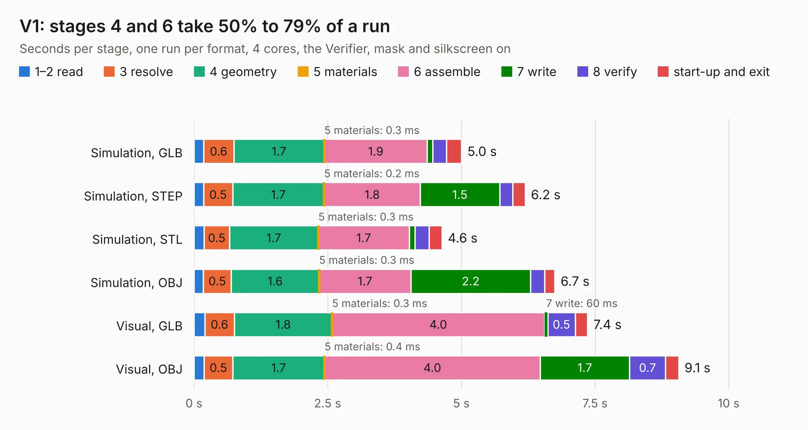

# 2620. V1

Board 2,620 of the 3,100 of [Corpus Testing](../Corpus-Testing.md), on [Corpus Page 25](../CorpusTestingPages/Corpus-Testing-25.md#2620-v1).

| Mode and format | 1–2 read | 3 resolve | 4 geometry | 5 materials | 6 assemble | 7 write | 8 verify | start-up and exit | Total |
|---|---:|---:|---:|---:|---:|---:|---:|---:|---:|
| Simulation, GLB | 0.2 | 0.6 | 1.7 | 0.3&nbsp;ms | 1.9 | 0.1 | 0.3 | 0.3 | 5.0 |
| Simulation, STEP | 0.2 | 0.5 | 1.7 | 0.2&nbsp;ms | 1.8 | 1.5 | 0.2 | 0.2 | 6.2 |
| Simulation, STL | 0.2 | 0.5 | 1.7 | 0.3&nbsp;ms | 1.7 | 0.1 | 0.3 | 0.2 | 4.6 |
| Simulation, OBJ | 0.2 | 0.5 | 1.6 | 0.3&nbsp;ms | 1.7 | 2.2 | 0.3 | 0.2 | 6.7 |
| Visual, GLB | 0.2 | 0.6 | 1.8 | 0.3&nbsp;ms | 4.0 | 60&nbsp;ms | 0.5 | 0.2 | 7.4 |
| Visual, OBJ | 0.2 | 0.5 | 1.7 | 0.4&nbsp;ms | 4.0 | 1.7 | 0.7 | 0.2 | 9.1 |

<table align="center"><tr><td valign="top">

| Board | Repo: [ssmiao/intel-i210-network-card](https://github.com/ssmiao/intel-i210-network-card) Board: `V1.kicad_pcb` |
|---|---|
| Folder | PCBV3.0 / reference / OCP2PCIe-master / OCP2PCIe-H-F-4 / OCP2PCIe-H-F-4-V0.1Beta |
| Complexity | 214&nbsp;/&nbsp;1000 (size&nbsp;149, features&nbsp;65) |
| KESE&nbsp;features | through vias, rounded, trapezoid or chamfered pads, drill offsets, filled zones, curved board outline |
| Tested | 9th November 2026 |
| Copper&nbsp;layers | 2 |
| File&nbsp;format | KiCad 5 (20171130) |
| Parts,&nbsp;tracks,&nbsp;vias | 12, 286, 95 |
| Triangles,&nbsp;simulation | 483,816 in 79 parts |
| Verifier | PASS in all six runs |

</td><td valign="top">

<table>
<tr><th>File type</th><th>File size</th><th>Peak memory used</th></tr>
<tr><th colspan="3" align="left">Simulation</th></tr>
<tr><td>GLB</td><td align="right">17&nbsp;MB</td><td align="right">288&nbsp;MB</td></tr>
<tr><td>STEP</td><td align="right">72&nbsp;MB</td><td align="right">353&nbsp;MB</td></tr>
<tr><td>STL</td><td align="right">24&nbsp;MB</td><td align="right">299&nbsp;MB</td></tr>
<tr><td>OBJ</td><td align="right">50&nbsp;MB</td><td align="right">385&nbsp;MB</td></tr>
<tr><th colspan="3" align="left">Visual</th></tr>
<tr><td>GLB</td><td align="right">13&nbsp;MB</td><td align="right">348&nbsp;MB</td></tr>
<tr><td>OBJ</td><td align="right">38&nbsp;MB</td><td align="right">357&nbsp;MB</td></tr>
</table>

</td></tr></table>

| Previous | Next |
|:---|---:|
| [2619. inteli210AT](b2619b_intel-i210-network-card_inteli210AT.md) | [2621. V1](b2621b_intel-i210-network-card_PCBV3-0-reference-OCP2PCIe-master-OCP2PCIe-H-F-4-OCP2PCIe-H-F-4-V1-0Beta_V1.md) |
