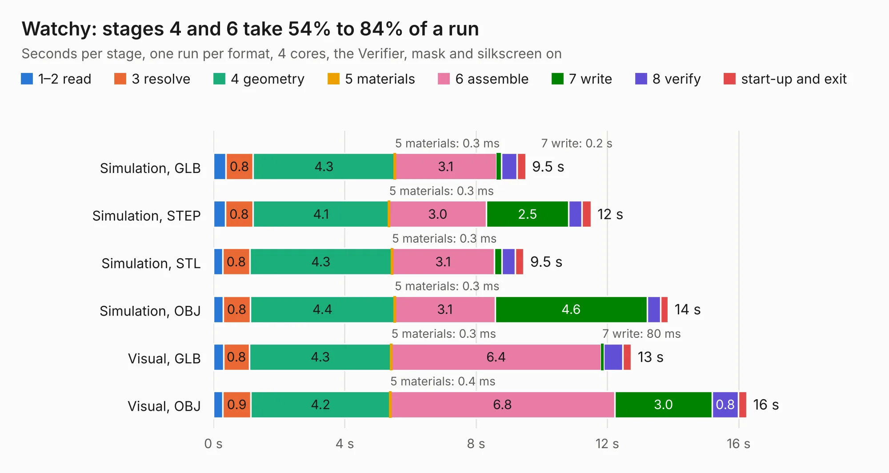

# 2620. Watchy

Board 2,620 of the 3,102 of [Corpus Testing](../Corpus-Testing.md), on [Corpus Page 25](../CorpusTestingPages/Corpus-Testing-25.md#2620-watchy).

| Mode and format | 1–2 read | 3 resolve | 4 geometry | 5 materials | 6 assemble | 7 write | 8 verify | start-up and exit | Total |
|---|---:|---:|---:|---:|---:|---:|---:|---:|---:|
| Simulation, GLB | 0.4 | 0.8 | 4.3 | 0.3&nbsp;ms | 3.1 | 0.2 | 0.5 | 0.3 | 9.5 |
| Simulation, STEP | 0.4 | 0.8 | 4.1 | 0.3&nbsp;ms | 3.0 | 2.5 | 0.4 | 0.3 | 11.5 |
| Simulation, STL | 0.3 | 0.8 | 4.3 | 0.3&nbsp;ms | 3.1 | 0.2 | 0.4 | 0.3 | 9.5 |
| Simulation, OBJ | 0.3 | 0.8 | 4.4 | 0.3&nbsp;ms | 3.1 | 4.6 | 0.4 | 0.2 | 13.9 |
| Visual, GLB | 0.3 | 0.8 | 4.3 | 0.3&nbsp;ms | 6.4 | 80&nbsp;ms | 0.6 | 0.3 | 12.7 |
| Visual, OBJ | 0.3 | 0.9 | 4.2 | 0.4&nbsp;ms | 6.8 | 3.0 | 0.8 | 0.3 | 16.2 |

<table align="center"><tr><td valign="top">

| Board | Repo: [sqfmi/watchy-hardware](https://github.com/sqfmi/watchy-hardware) Board: `Watchy.kicad_pcb` |
|---|---|
| Complexity | 344&nbsp;/&nbsp;1000 (size&nbsp;234, features&nbsp;110) |
| KESE&nbsp;features | through vias, slotted holes, rounded, trapezoid or chamfered pads, arc tracks, filled zones, curved board outline, stack-up, dielectric εr and tanδ |
| Tested | 9th November 2026 |
| Copper&nbsp;layers | 4 |
| File&nbsp;format | KiCad 7 (20221018) |
| Parts,&nbsp;tracks,&nbsp;vias | 75, 697, 108 |
| Triangles,&nbsp;simulation | 784,726 in 97 parts |
| Verifier | PASS in all six runs |

</td><td valign="top">

<table>
<tr><th>File type</th><th>File size</th><th>Peak memory used</th></tr>
<tr><th colspan="3" align="left">Simulation</th></tr>
<tr><td>GLB</td><td align="right">27&nbsp;MB</td><td align="right">404&nbsp;MB</td></tr>
<tr><td>STEP</td><td align="right">121&nbsp;MB</td><td align="right">471&nbsp;MB</td></tr>
<tr><td>STL</td><td align="right">39&nbsp;MB</td><td align="right">395&nbsp;MB</td></tr>
<tr><td>OBJ</td><td align="right">81&nbsp;MB</td><td align="right">575&nbsp;MB</td></tr>
<tr><th colspan="3" align="left">Visual</th></tr>
<tr><td>GLB</td><td align="right">16&nbsp;MB</td><td align="right">433&nbsp;MB</td></tr>
<tr><td>OBJ</td><td align="right">49&nbsp;MB</td><td align="right">440&nbsp;MB</td></tr>
</table>

</td></tr></table>

| Previous | Next |
|:---|---:|
| [2619. beepy](b2619b_beepy-hardware_beepy.md) | [2621. inteli210AT](b2621b_intel-i210-network-card_inteli210AT.md) |
