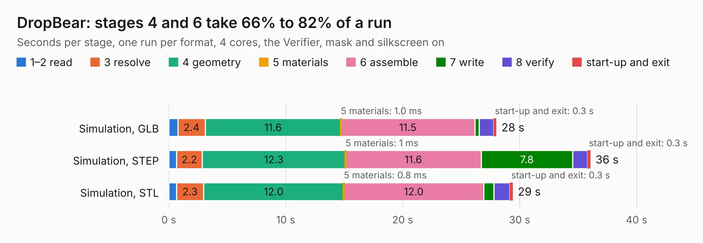

# 2621. DropBear

Board 2,621 of the 3,120 of [Corpus Testing](../Corpus-Testing.md), on [Corpus Page 25](../CorpusTestingPages/Corpus-Testing-25.md#2621-dropbear).

| Mode and format | 1–2 read | 3 resolve | 4 geometry | 5 materials | 6 assemble | 7 write | 8 verify | start-up and exit | Total |
|---|---:|---:|---:|---:|---:|---:|---:|---:|---:|
| Simulation, GLB | 0.8 | 2.4 | 11.6 | 1.0&nbsp;ms | 11.5 | 0.4 | 1.2 | 0.3 | 28.0 |
| Simulation, STEP | 0.7 | 2.2 | 12.3 | 1&nbsp;ms | 11.6 | 7.8 | 1.3 | 0.3 | 36.1 |
| Simulation, STL | 0.7 | 2.3 | 12.0 | 0.8&nbsp;ms | 12.0 | 0.9 | 1.3 | 0.3 | 29.4 |
| Simulation, OBJ | 0.7 | 2.2 | 12.5 | 0.7&nbsp;ms | 11.9 | 12.6 | 1.3 | 0.3 | 41.4 |
| Visual, GLB | 0.9 | 2.5 | 12.4 | 0.9&nbsp;ms | 26.2 | 0.3 | 3.3 | 0.3 | 45.9 |
| Visual, OBJ | 0.8 | 2.4 | 12.8 | 1&nbsp;ms | 26.3 | 9.9 | 4.0 | 0.3 | 56.4 |

<table align="center"><tr><td valign="top">

| Board | Repo: [speeduino/hardware](https://github.com/speeduino/hardware) Board: `DropBear.kicad_pcb` |
|---|---|
| Folder | DropBear / V2 |
| Complexity | 347&nbsp;/&nbsp;1000 (size&nbsp;252, features&nbsp;95) |
| KESE&nbsp;features | through vias, slotted holes, rounded, trapezoid or chamfered pads, filled zones, curved board outline, stack-up, dielectric εr and tanδ |
| Tested | 9th November 2026 |
| Copper&nbsp;layers | 2 |
| File&nbsp;format | KiCad 7 (20221018) |
| Parts,&nbsp;tracks,&nbsp;vias | 196, 1,873, 400 |
| Triangles,&nbsp;simulation | 2,619,384 in 260 parts |
| Verifier | PASS in all six runs |

</td><td valign="top">

<table>
<tr><th>File type</th><th>File size</th><th>Peak memory used</th></tr>
<tr><th colspan="3" align="left">Simulation</th></tr>
<tr><td>GLB</td><td align="right">90&nbsp;MB</td><td align="right">930&nbsp;MB</td></tr>
<tr><td>STEP</td><td align="right">447&nbsp;MB</td><td align="right">1.2&nbsp;GB</td></tr>
<tr><td>STL</td><td align="right">131&nbsp;MB</td><td align="right">926&nbsp;MB</td></tr>
<tr><td>OBJ</td><td align="right">277&nbsp;MB</td><td align="right">1.7&nbsp;GB</td></tr>
<tr><th colspan="3" align="left">Visual</th></tr>
<tr><td>GLB</td><td align="right">71&nbsp;MB</td><td align="right">1.2&nbsp;GB</td></tr>
<tr><td>OBJ</td><td align="right">219&nbsp;MB</td><td align="right">1.5&nbsp;GB</td></tr>
</table>

</td></tr></table>

| Previous | Next |
|:---|---:|
| [2620. DropBear](b2620b_hardware_DropBear-V1-1_DropBear.md) | [2622. 48-pin breakout](b2622b_hardware_48-pin-breakout.md) |
