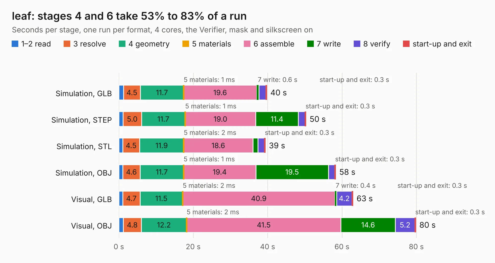

# 2621. leaf

Board 2,621 of the 3,107 of [Corpus Testing](../Corpus-Testing.md), on [Corpus Page 25](../CorpusTestingPages/Corpus-Testing-25.md#2621-leaf).

| Mode and format | 1–2 read | 3 resolve | 4 geometry | 5 materials | 6 assemble | 7 write | 8 verify | start-up and exit | Total |
|---|---:|---:|---:|---:|---:|---:|---:|---:|---:|
| Simulation, GLB | 1.3 | 4.5 | 11.7 | 1&nbsp;ms | 19.6 | 0.6 | 1.8 | 0.3 | 39.8 |
| Simulation, STEP | 1.1 | 5.0 | 11.7 | 1&nbsp;ms | 19.0 | 11.4 | 1.8 | 0.3 | 50.3 |
| Simulation, STL | 1.0 | 4.5 | 11.9 | 2&nbsp;ms | 18.6 | 1.3 | 1.7 | 0.3 | 39.4 |
| Simulation, OBJ | 1.1 | 4.6 | 11.7 | 1&nbsp;ms | 19.4 | 19.5 | 1.7 | 0.3 | 58.3 |
| Visual, GLB | 1.0 | 4.7 | 11.5 | 2&nbsp;ms | 40.9 | 0.4 | 4.2 | 0.3 | 63.0 |
| Visual, OBJ | 1.2 | 4.8 | 12.2 | 2&nbsp;ms | 41.5 | 14.6 | 5.2 | 0.3 | 79.9 |

<table align="center"><tr><td valign="top">

| Board | Repo: [sprhawk/leaf-rv1126](https://github.com/sprhawk/leaf-rv1126) Board: `leaf.kicad_pcb` |
|---|---|
| Complexity | 418&nbsp;/&nbsp;1000 (size&nbsp;313, features&nbsp;105) |
| KESE&nbsp;features | through vias, slotted holes, custom pads, rounded, trapezoid or chamfered pads, arc tracks, copper drawings, stack-up, dielectric εr and tanδ |
| Tested | 9th November 2026 |
| Copper&nbsp;layers | 6 |
| File&nbsp;format | KiCad 8 (20240108) |
| Parts,&nbsp;tracks,&nbsp;vias | 285, 4,899, 266 |
| Triangles,&nbsp;simulation | 4,149,684 in 578 parts |
| Verifier | PASS in all six runs |

</td><td valign="top">

<table>
<tr><th>File type</th><th>File size</th><th>Peak memory used</th></tr>
<tr><th colspan="3" align="left">Simulation</th></tr>
<tr><td>GLB</td><td align="right">138&nbsp;MB</td><td align="right">1.3&nbsp;GB</td></tr>
<tr><td>STEP</td><td align="right">661&nbsp;MB</td><td align="right">1.7&nbsp;GB</td></tr>
<tr><td>STL</td><td align="right">208&nbsp;MB</td><td align="right">1.4&nbsp;GB</td></tr>
<tr><td>OBJ</td><td align="right">438&nbsp;MB</td><td align="right">2.7&nbsp;GB</td></tr>
<tr><th colspan="3" align="left">Visual</th></tr>
<tr><td>GLB</td><td align="right">103&nbsp;MB</td><td align="right">1.7&nbsp;GB</td></tr>
<tr><td>OBJ</td><td align="right">327&nbsp;MB</td><td align="right">2.1&nbsp;GB</td></tr>
</table>

</td></tr></table>

| Previous | Next |
|:---|---:|
| [2620. motherboard](b2620b_kicad-conversions-atari-260-520-st-motherboard-c070231_motherboard.md) | [2622. leaf-minipcie](b2622b_leaf-rv1126_leaf-minipcie.md) |
