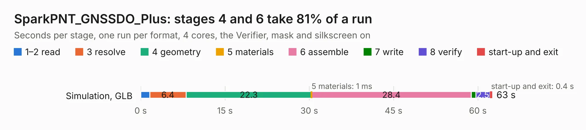

# 2621. SparkPNT_GNSSDO_Plus

Board 2,621 of the 3,127 of [Corpus Testing](../Corpus-Testing.md), on [Corpus Page 25](../CorpusTestingPages/Corpus-Testing-25.md#2621-sparkpnt_gnssdo_plus).

| Mode and format | 1–2 read | 3 resolve | 4 geometry | 5 materials | 6 assemble | 7 write | 8 verify | start-up and exit | Total |
|---|---:|---:|---:|---:|---:|---:|---:|---:|---:|
| Simulation, GLB | 1.6 | 6.4 | 22.3 | 1&nbsp;ms | 28.4 | 0.8 | 2.5 | 0.4 | 62.6 |
| Simulation, STEP | 1.7 | 6.1 | 21.9 | 0.8&nbsp;ms | 29.3 | 13.7 | 2.4 | 0.3 | 75.4 |
| Simulation, STL | 1.7 | 6.5 | 22.2 | 1&nbsp;ms | 30.6 | 1.8 | 2.7 | 0.3 | 65.8 |
| Simulation, OBJ | 1.6 | 6.2 | 22.8 | 2&nbsp;ms | 30.1 | 31.3 | 2.5 | 0.3 | 94.8 |
| Visual, GLB | 1.7 | 5.9 | 21.9 | 0.9&nbsp;ms | 45.8 | 0.5 | 6.0 | 0.3 | 82.1 |
| Visual, OBJ | 1.7 | 6.0 | 21.3 | 1.0&nbsp;ms | 42.3 | 18.0 | 6.4 | 0.3 | 96.0 |

<table align="center"><tr><td valign="top">

| Board | Repo: [sparkfun/sparkfun_gnssdo](https://github.com/sparkfun/sparkfun_gnssdo) Board: `SparkPNT_GNSSDO_Plus.kicad_pcb` |
|---|---|
| Folder | Hardware / GNSSDO_Plus |
| Complexity | 430&nbsp;/&nbsp;1000 (size&nbsp;290, features&nbsp;140) |
| KESE&nbsp;features | through vias, slotted holes, rounded, trapezoid or chamfered pads, arc tracks, filled zones, copper text, curved board outline, knockout text, stack-up, dielectric εr and tanδ, mask and silkscreen colours |
| Tested | 9th November 2026 |
| Copper&nbsp;layers | 4 |
| File&nbsp;format | KiCad 9 (20241229) |
| Parts,&nbsp;tracks,&nbsp;vias | 295, 2,557, 880 |
| Triangles,&nbsp;simulation | 5,196,270 in 314 parts |
| Verifier | PASS in all six runs |

</td><td valign="top">

<table>
<tr><th>File type</th><th>File size</th><th>Peak memory used</th></tr>
<tr><th colspan="3" align="left">Simulation</th></tr>
<tr><td>GLB</td><td align="right">177&nbsp;MB</td><td align="right">1.6&nbsp;GB</td></tr>
<tr><td>STEP</td><td align="right">721&nbsp;MB</td><td align="right">2.1&nbsp;GB</td></tr>
<tr><td>STL</td><td align="right">260&nbsp;MB</td><td align="right">1.6&nbsp;GB</td></tr>
<tr><td>OBJ</td><td align="right">551&nbsp;MB</td><td align="right">3.4&nbsp;GB</td></tr>
<tr><th colspan="3" align="left">Visual</th></tr>
<tr><td>GLB</td><td align="right">114&nbsp;MB</td><td align="right">1.9&nbsp;GB</td></tr>
<tr><td>OBJ</td><td align="right">365&nbsp;MB</td><td align="right">2.4&nbsp;GB</td></tr>
</table>

</td></tr></table>

| Previous | Next |
|:---|---:|
| [2620. SparkPNT_GNSSDO_Plus_panelized](b2620b_sparkfun-gnssdo_SparkPNT-GNSSDO-Plus-panelized.md) | [2622. SparkFun_Thing_Plus_ESP32-S3_panelized](b2622b_SparkFun-Thing-Plus-ESP32-S3_SparkFun-Thing-Plus-ESP32-S3-panelized.md) |
