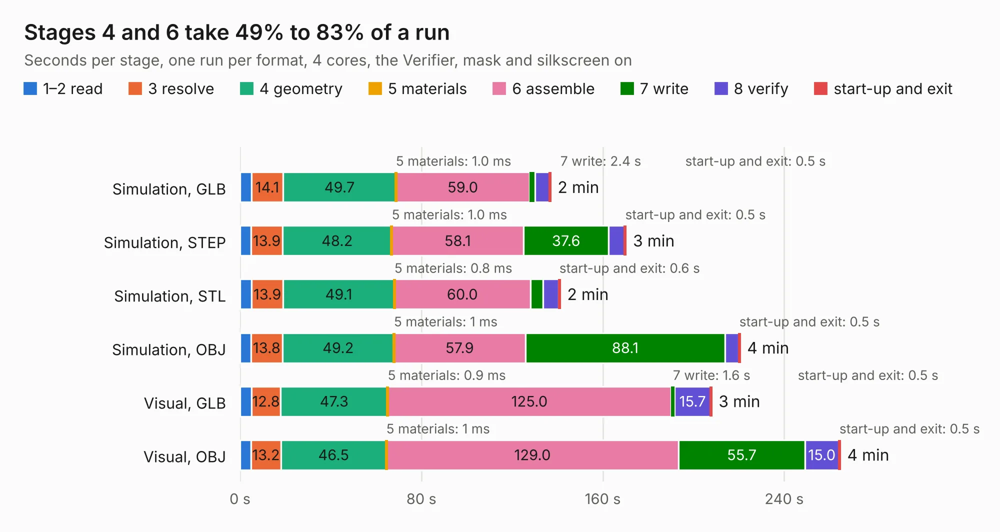

# 2622. SparkFun_Thing_Plus_ESP32-S3_panelized

Board 2,622 of the 3,127 of [Corpus Testing](../Corpus-Testing.md), on [Corpus Page 25](../CorpusTestingPages/Corpus-Testing-25.md#2622-sparkfun_thing_plus_esp32-s3_panelized).

| Mode and format | 1–2 read | 3 resolve | 4 geometry | 5 materials | 6 assemble | 7 write | 8 verify | start-up and exit | Total |
|---|---:|---:|---:|---:|---:|---:|---:|---:|---:|
| Simulation, GLB | 5.0 | 14.1 | 49.7 | 1.0&nbsp;ms | 59.0 | 2.4 | 6.3 | 0.5 | 136.9 |
| Simulation, STEP | 4.9 | 13.9 | 48.2 | 1.0&nbsp;ms | 58.1 | 37.6 | 7.0 | 0.5 | 170.2 |
| Simulation, STL | 5.1 | 13.9 | 49.1 | 0.8&nbsp;ms | 60.0 | 5.6 | 6.9 | 0.6 | 141.1 |
| Simulation, OBJ | 4.9 | 13.8 | 49.2 | 1&nbsp;ms | 57.9 | 88.1 | 6.0 | 0.5 | 220.5 |
| Visual, GLB | 5.0 | 12.8 | 47.3 | 0.9&nbsp;ms | 125.0 | 1.6 | 15.7 | 0.5 | 207.9 |
| Visual, OBJ | 4.9 | 13.2 | 46.5 | 1&nbsp;ms | 129.0 | 55.7 | 15.0 | 0.5 | 264.6 |

<table align="center"><tr><td valign="top">

| Board | Repo: [sparkfun/SparkFun_Thing_Plus_ESP32-S3](https://github.com/sparkfun/SparkFun_Thing_Plus_ESP32-S3) Board: `SparkFun_Thing_Plus_ESP32-S3_panelized.kicad_pcb` |
|---|---|
| Folder | Hardware / Production |
| Complexity | 400&nbsp;/&nbsp;1000 (size&nbsp;260, features&nbsp;140) |
| KESE&nbsp;features | through vias, slotted holes, rounded, trapezoid or chamfered pads, filled zones, copper text, curved board outline, knockout text, stack-up, dielectric εr and tanδ, copper finish, mask and silkscreen colours |
| Tested | 9th November 2026 |
| Copper&nbsp;layers | 4 |
| File&nbsp;format | KiCad 7 (20221018) |
| Parts,&nbsp;tracks,&nbsp;vias | 648, 9,624, 1,560 |
| Triangles,&nbsp;simulation | 13,717,750 in 86 parts |
| Note | panel |
| Verifier | PASS in all six runs |

</td><td valign="top">

<table>
<tr><th>File type</th><th>File size</th><th>Peak memory used</th></tr>
<tr><th colspan="3" align="left">Simulation</th></tr>
<tr><td>GLB</td><td align="right">478&nbsp;MB</td><td align="right">3.4&nbsp;GB</td></tr>
<tr><td>STEP</td><td align="right">2.3&nbsp;GB</td><td align="right">4.9&nbsp;GB</td></tr>
<tr><td>STL</td><td align="right">686&nbsp;MB</td><td align="right">3.5&nbsp;GB</td></tr>
<tr><td>OBJ</td><td align="right">1.5&nbsp;GB</td><td align="right">9.0&nbsp;GB</td></tr>
<tr><th colspan="3" align="left">Visual</th></tr>
<tr><td>GLB</td><td align="right">330&nbsp;MB</td><td align="right">5.0&nbsp;GB</td></tr>
<tr><td>OBJ</td><td align="right">1.1&nbsp;GB</td><td align="right">6.4&nbsp;GB</td></tr>
</table>

</td></tr></table>

| Previous | Next |
|:---|---:|
| [2621. SparkPNT_GNSSDO_Plus](b2621b_sparkfun-gnssdo_SparkPNT-GNSSDO-Plus.md) | [2623. SparkFun_Thing_Plus_ESP32-S3](b2623b_SparkFun-Thing-Plus-ESP32-S3_SparkFun-Thing-Plus-ESP32-S3.md) |
