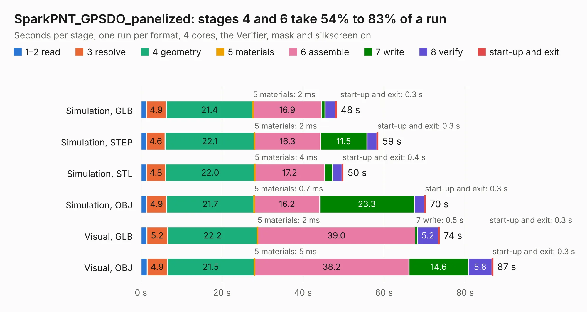

# 2622. SparkPNT_GPSDO_panelized

Board 2,622 of the 3,132 of [Corpus Testing](../Corpus-Testing.md), on [Corpus Page 25](../CorpusTestingPages/Corpus-Testing-25.md#2622-sparkpnt_gpsdo_panelized).

| Mode and format | 1–2 read | 3 resolve | 4 geometry | 5 materials | 6 assemble | 7 write | 8 verify | start-up and exit | Total |
|---|---:|---:|---:|---:|---:|---:|---:|---:|---:|
| Simulation, GLB | 1.3 | 4.9 | 21.4 | 2&nbsp;ms | 16.9 | 0.9 | 2.5 | 0.3 | 48.3 |
| Simulation, STEP | 1.4 | 4.6 | 22.1 | 2&nbsp;ms | 16.3 | 11.5 | 2.4 | 0.3 | 58.5 |
| Simulation, STL | 1.3 | 4.8 | 22.0 | 4&nbsp;ms | 17.2 | 2.0 | 2.3 | 0.4 | 50.0 |
| Simulation, OBJ | 1.4 | 4.9 | 21.7 | 0.7&nbsp;ms | 16.2 | 23.3 | 2.6 | 0.3 | 70.3 |
| Visual, GLB | 1.4 | 5.2 | 22.2 | 2&nbsp;ms | 39.0 | 0.5 | 5.2 | 0.3 | 73.7 |
| Visual, OBJ | 1.5 | 4.9 | 21.5 | 5&nbsp;ms | 38.2 | 14.6 | 5.8 | 0.3 | 86.9 |

<table align="center"><tr><td valign="top">

| Board | Repo: [sparkfun/sparkfun_gnssdo](https://github.com/sparkfun/sparkfun_gnssdo) Board: `SparkPNT_GPSDO_panelized.kicad_pcb` |
|---|---|
| Folder | Hardware / GNSSDO / Production |
| Complexity | 408&nbsp;/&nbsp;1000 (size&nbsp;283, features&nbsp;125) |
| KESE&nbsp;features | through vias, slotted holes, rounded, trapezoid or chamfered pads, filled zones, copper text, curved board outline, knockout text, stack-up, dielectric εr and tanδ, mask and silkscreen colours |
| Tested | 9th November 2026 |
| Copper&nbsp;layers | 4 |
| File&nbsp;format | KiCad 8 (20240108) |
| Parts,&nbsp;tracks,&nbsp;vias | 232, 2,036, 692 |
| Triangles,&nbsp;simulation | 4,628,930 in 261 parts |
| Note | panel |
| Verifier | PASS in all six runs |

</td><td valign="top">

<table>
<tr><th>File type</th><th>File size</th><th>Peak memory used</th></tr>
<tr><th colspan="3" align="left">Simulation</th></tr>
<tr><td>GLB</td><td align="right">160&nbsp;MB</td><td align="right">1.4&nbsp;GB</td></tr>
<tr><td>STEP</td><td align="right">685&nbsp;MB</td><td align="right">1.9&nbsp;GB</td></tr>
<tr><td>STL</td><td align="right">231&nbsp;MB</td><td align="right">1.4&nbsp;GB</td></tr>
<tr><td>OBJ</td><td align="right">496&nbsp;MB</td><td align="right">3.1&nbsp;GB</td></tr>
<tr><th colspan="3" align="left">Visual</th></tr>
<tr><td>GLB</td><td align="right">99&nbsp;MB</td><td align="right">1.7&nbsp;GB</td></tr>
<tr><td>OBJ</td><td align="right">312&nbsp;MB</td><td align="right">2.1&nbsp;GB</td></tr>
</table>

</td></tr></table>

| Previous | Next |
|:---|---:|
| [2621. SparkFun_GNSS_Flex_Module_ZED-X20P_Tilt](b2621b_sparkfun-gnss-flex-system_SparkFun-GNSS-Flex-Module-ZED-X20P-Tilt.md) | [2623. SparkPNT_GPSDO](b2623b_sparkfun-gnssdo_SparkPNT-GPSDO.md) |
