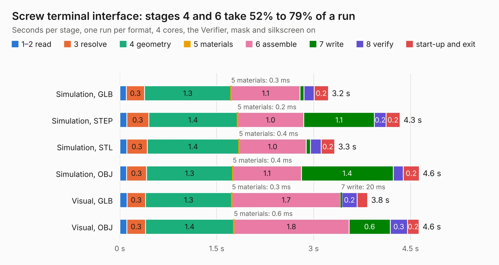

# 2623. Screw terminal interface

Board 2,623 of the 3,118 of [Corpus Testing](../Corpus-Testing.md), on [Corpus Page 25](../CorpusTestingPages/Corpus-Testing-25.md#2623-screw-terminal-interface).

| Mode and format | 1–2 read | 3 resolve | 4 geometry | 5 materials | 6 assemble | 7 write | 8 verify | start-up and exit | Total |
|---|---:|---:|---:|---:|---:|---:|---:|---:|---:|
| Simulation, GLB | 0.1 | 0.3 | 1.3 | 0.3&nbsp;ms | 1.1 | 62&nbsp;ms | 0.2 | 0.2 | 3.2 |
| Simulation, STEP | 0.1 | 0.3 | 1.4 | 0.2&nbsp;ms | 1.0 | 1.1 | 0.2 | 0.2 | 4.3 |
| Simulation, STL | 0.1 | 0.3 | 1.4 | 0.4&nbsp;ms | 1.0 | 66&nbsp;ms | 0.2 | 0.2 | 3.3 |
| Simulation, OBJ | 0.1 | 0.3 | 1.3 | 0.4&nbsp;ms | 1.1 | 1.4 | 0.2 | 0.2 | 4.6 |
| Visual, GLB | 0.1 | 0.3 | 1.3 | 0.3&nbsp;ms | 1.7 | 20&nbsp;ms | 0.2 | 0.2 | 3.8 |
| Visual, OBJ | 0.1 | 0.3 | 1.4 | 0.6&nbsp;ms | 1.8 | 0.6 | 0.3 | 0.2 | 4.6 |

<table align="center"><tr><td valign="top">

| Board | Repo: [speeduino/hardware](https://github.com/speeduino/hardware) Board: `Screw terminal interface.kicad_pcb` |
|---|---|
| Folder | v0.4 / Interface boards / Screw terminals |
| Complexity | 95&nbsp;/&nbsp;1000 (size&nbsp;95, features&nbsp;0) |
| Tested | 9th November 2026 |
| Copper&nbsp;layers | 2 |
| File&nbsp;format | KiCad 4 (4) |
| Parts,&nbsp;tracks,&nbsp;vias | 7, 29, 0 |
| Triangles,&nbsp;simulation | 292,454 in 53 parts |
| Verifier | PASS in all six runs |

</td><td valign="top">

<table>
<tr><th>File type</th><th>File size</th><th>Peak memory used</th></tr>
<tr><th colspan="3" align="left">Simulation</th></tr>
<tr><td>GLB</td><td align="right">9.7&nbsp;MB</td><td align="right">222&nbsp;MB</td></tr>
<tr><td>STEP</td><td align="right">44&nbsp;MB</td><td align="right">256&nbsp;MB</td></tr>
<tr><td>STL</td><td align="right">15&nbsp;MB</td><td align="right">222&nbsp;MB</td></tr>
<tr><td>OBJ</td><td align="right">29&nbsp;MB</td><td align="right">250&nbsp;MB</td></tr>
<tr><th colspan="3" align="left">Visual</th></tr>
<tr><td>GLB</td><td align="right">4.5&nbsp;MB</td><td align="right">255&nbsp;MB</td></tr>
<tr><td>OBJ</td><td align="right">13&nbsp;MB</td><td align="right">276&nbsp;MB</td></tr>
</table>

</td></tr></table>

| Previous | Next |
|:---|---:|
| [2622. NA6](b2622b_hardware_NA6.md) | [2624. v0.4.4d](b2624b_hardware_v0-4-4d.md) |
