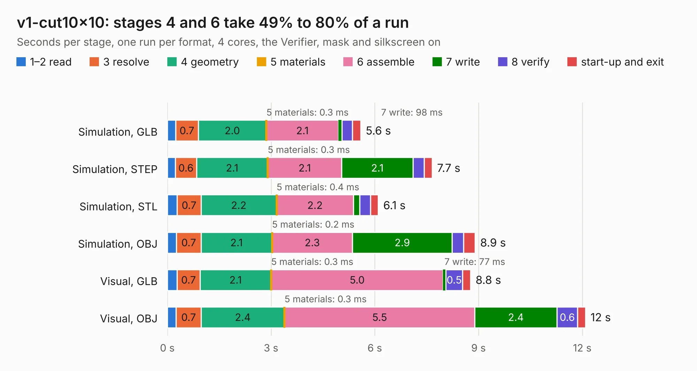

# 2623. v1-cut10x10

Board 2,623 of the 3,101 of [Corpus Testing](../Corpus-Testing.md), on [Corpus Page 25](../CorpusTestingPages/Corpus-Testing-25.md#2623-v1-cut10x10).

| Mode and format | 1–2 read | 3 resolve | 4 geometry | 5 materials | 6 assemble | 7 write | 8 verify | start-up and exit | Total |
|---|---:|---:|---:|---:|---:|---:|---:|---:|---:|
| Simulation, GLB | 0.2 | 0.7 | 2.0 | 0.3&nbsp;ms | 2.1 | 98&nbsp;ms | 0.3 | 0.2 | 5.6 |
| Simulation, STEP | 0.2 | 0.6 | 2.1 | 0.3&nbsp;ms | 2.1 | 2.1 | 0.3 | 0.2 | 7.7 |
| Simulation, STL | 0.3 | 0.7 | 2.2 | 0.4&nbsp;ms | 2.2 | 0.2 | 0.3 | 0.2 | 6.1 |
| Simulation, OBJ | 0.3 | 0.7 | 2.1 | 0.2&nbsp;ms | 2.3 | 2.9 | 0.3 | 0.3 | 8.9 |
| Visual, GLB | 0.3 | 0.7 | 2.1 | 0.3&nbsp;ms | 5.0 | 77&nbsp;ms | 0.5 | 0.2 | 8.8 |
| Visual, OBJ | 0.3 | 0.7 | 2.4 | 0.3&nbsp;ms | 5.5 | 2.4 | 0.6 | 0.2 | 12.1 |

<table align="center"><tr><td valign="top">

| Board | Repo: [ssmiao/intel-i210-network-card](https://github.com/ssmiao/intel-i210-network-card) Board: `v1-cut10x10.kicad_pcb` |
|---|---|
| Folder | PCBV3.0 / reference / OCP2PCIe-master / OCP2PCIe-H-F-4 / OCP2PCIe-H-F-4-V1.1Beta |
| Complexity | 215&nbsp;/&nbsp;1000 (size&nbsp;150, features&nbsp;65) |
| KESE&nbsp;features | through vias, rounded, trapezoid or chamfered pads, drill offsets, filled zones, curved board outline |
| Tested | 9th November 2026 |
| Copper&nbsp;layers | 2 |
| File&nbsp;format | KiCad 5 (20171130) |
| Parts,&nbsp;tracks,&nbsp;vias | 12, 349, 97 |
| Triangles,&nbsp;simulation | 509,670 in 81 parts |
| Verifier | PASS in all six runs |

</td><td valign="top">

<table>
<tr><th>File type</th><th>File size</th><th>Peak memory used</th></tr>
<tr><th colspan="3" align="left">Simulation</th></tr>
<tr><td>GLB</td><td align="right">18&nbsp;MB</td><td align="right">300&nbsp;MB</td></tr>
<tr><td>STEP</td><td align="right">78&nbsp;MB</td><td align="right">361&nbsp;MB</td></tr>
<tr><td>STL</td><td align="right">25&nbsp;MB</td><td align="right">303&nbsp;MB</td></tr>
<tr><td>OBJ</td><td align="right">52&nbsp;MB</td><td align="right">406&nbsp;MB</td></tr>
<tr><th colspan="3" align="left">Visual</th></tr>
<tr><td>GLB</td><td align="right">14&nbsp;MB</td><td align="right">355&nbsp;MB</td></tr>
<tr><td>OBJ</td><td align="right">41&nbsp;MB</td><td align="right">373&nbsp;MB</td></tr>
</table>

</td></tr></table>

| Previous | Next |
|:---|---:|
| [2622. V1](b2622b_intel-i210-network-card_PCBV3-0-reference-OCP2PCIe-master-OCP2PCIe-H-F-4-OCP2PCIe-H-F-4-V1-0Beta_V1.md) | [2624. V1](b2624b_intel-i210-network-card_PCBV3-0-reference-OCP2PCIe-master-OCP2PCIe-H-F-4-OCP2PCIe-H-F-4-V1-1Beta_V1.md) |
