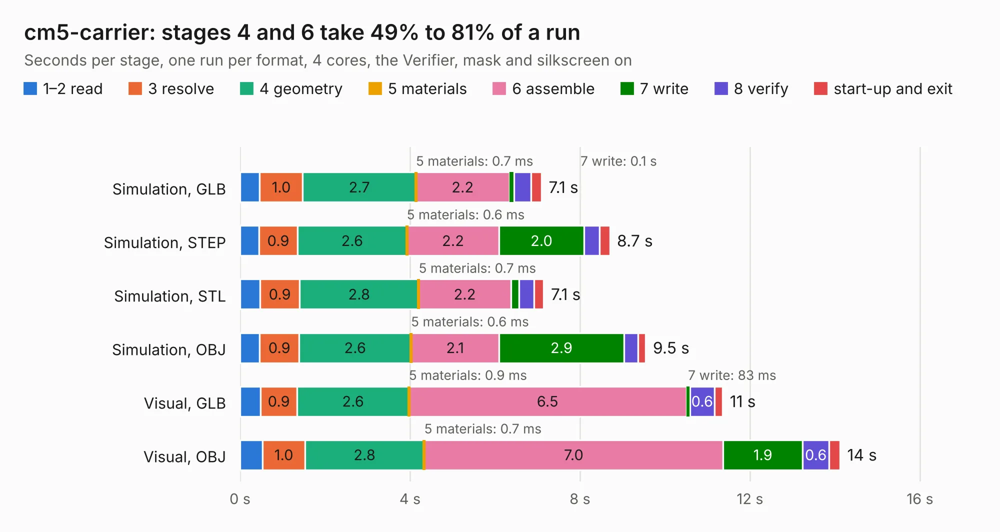

# 2623. cm5-carrier

Board 2,623 of the 3,111 of [Corpus Testing](../Corpus-Testing.md), on [Corpus Page 25](../CorpusTestingPages/Corpus-Testing-25.md#2623-cm5-carrier).

| Mode and format | 1–2 read | 3 resolve | 4 geometry | 5 materials | 6 assemble | 7 write | 8 verify | start-up and exit | Total |
|---|---:|---:|---:|---:|---:|---:|---:|---:|---:|
| Simulation, GLB | 0.5 | 1.0 | 2.7 | 0.7&nbsp;ms | 2.2 | 0.1 | 0.4 | 0.3 | 7.1 |
| Simulation, STEP | 0.4 | 0.9 | 2.6 | 0.6&nbsp;ms | 2.2 | 2.0 | 0.4 | 0.2 | 8.7 |
| Simulation, STL | 0.5 | 0.9 | 2.8 | 0.7&nbsp;ms | 2.2 | 0.2 | 0.3 | 0.2 | 7.1 |
| Simulation, OBJ | 0.5 | 0.9 | 2.6 | 0.6&nbsp;ms | 2.1 | 2.9 | 0.3 | 0.2 | 9.5 |
| Visual, GLB | 0.5 | 0.9 | 2.6 | 0.9&nbsp;ms | 6.5 | 83&nbsp;ms | 0.6 | 0.2 | 11.4 |
| Visual, OBJ | 0.5 | 1.0 | 2.8 | 0.7&nbsp;ms | 7.0 | 1.9 | 0.6 | 0.3 | 14.1 |

<table align="center"><tr><td valign="top">

| Board | Repo: [spirit-org/spirit](https://github.com/spirit-org/spirit) Board: `cm5-carrier.kicad_pcb` |
|---|---|
| Folder | EDA-kicad |
| Complexity | 362&nbsp;/&nbsp;1000 (size&nbsp;232, features&nbsp;130) |
| KESE&nbsp;features | through vias, slotted holes, custom pads, rounded, trapezoid or chamfered pads, filled zones, copper drawings, copper text, curved board outline, stack-up, dielectric εr and tanδ |
| Tested | 9th November 2026 |
| Copper&nbsp;layers | 6 |
| File&nbsp;format | KiCad 9 (20241229) |
| Parts,&nbsp;tracks,&nbsp;vias | 123, 243, 43 |
| Triangles,&nbsp;simulation | 708,064 in 381 parts |
| Verifier | PASS in all six runs |

</td><td valign="top">

<table>
<tr><th>File type</th><th>File size</th><th>Peak memory used</th></tr>
<tr><th colspan="3" align="left">Simulation</th></tr>
<tr><td>GLB</td><td align="right">25&nbsp;MB</td><td align="right">355&nbsp;MB</td></tr>
<tr><td>STEP</td><td align="right">104&nbsp;MB</td><td align="right">425&nbsp;MB</td></tr>
<tr><td>STL</td><td align="right">35&nbsp;MB</td><td align="right">355&nbsp;MB</td></tr>
<tr><td>OBJ</td><td align="right">75&nbsp;MB</td><td align="right">556&nbsp;MB</td></tr>
<tr><th colspan="3" align="left">Visual</th></tr>
<tr><td>GLB</td><td align="right">17&nbsp;MB</td><td align="right">432&nbsp;MB</td></tr>
<tr><td>OBJ</td><td align="right">50&nbsp;MB</td><td align="right">453&nbsp;MB</td></tr>
</table>

</td></tr></table>

| Previous | Next |
|:---|---:|
| [2622. DubaiXTClone](b2622b_DubaiXTClone_DubaiXTClone.md) | [2624. motherboard](b2624b_kicad-conversions-atari-260-520-st-motherboard-c070231_motherboard.md) |
