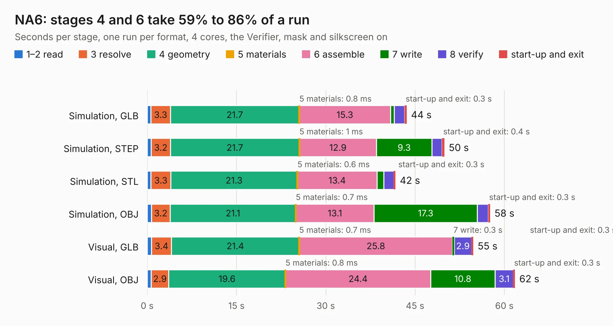

# 2624. NA6

Board 2,624 of the 3,120 of [Corpus Testing](../Corpus-Testing.md), on [Corpus Page 25](../CorpusTestingPages/Corpus-Testing-25.md#2624-na6).

| Mode and format | 1–2 read | 3 resolve | 4 geometry | 5 materials | 6 assemble | 7 write | 8 verify | start-up and exit | Total |
|---|---:|---:|---:|---:|---:|---:|---:|---:|---:|
| Simulation, GLB | 0.6 | 3.3 | 21.7 | 0.8&nbsp;ms | 15.3 | 0.6 | 1.8 | 0.3 | 43.6 |
| Simulation, STEP | 0.7 | 3.2 | 21.7 | 1&nbsp;ms | 12.9 | 9.3 | 1.7 | 0.4 | 49.9 |
| Simulation, STL | 0.6 | 3.3 | 21.3 | 0.6&nbsp;ms | 13.4 | 1.2 | 1.7 | 0.3 | 41.7 |
| Simulation, OBJ | 0.7 | 3.2 | 21.1 | 0.7&nbsp;ms | 13.1 | 17.3 | 1.9 | 0.3 | 57.6 |
| Visual, GLB | 0.7 | 3.4 | 21.4 | 0.7&nbsp;ms | 25.8 | 0.3 | 2.9 | 0.3 | 54.8 |
| Visual, OBJ | 0.7 | 2.9 | 19.6 | 0.8&nbsp;ms | 24.4 | 10.8 | 3.1 | 0.3 | 61.8 |

<table align="center"><tr><td valign="top">

| Board | Repo: [speeduino/hardware](https://github.com/speeduino/hardware) Board: `NA6.kicad_pcb` |
|---|---|
| Folder | PNPs / Miata NA6 / Prior versions / v1.2 |
| Complexity | 298&nbsp;/&nbsp;1000 (size&nbsp;228, features&nbsp;70) |
| KESE&nbsp;features | through vias, custom pads, rounded, trapezoid or chamfered pads, filled zones, copper drawings |
| Tested | 9th November 2026 |
| Copper&nbsp;layers | 2 |
| File&nbsp;format | KiCad 5 (20171130) |
| Parts,&nbsp;tracks,&nbsp;vias | 141, 963, 107 |
| Triangles,&nbsp;simulation | 2,917,634 in 234 parts |
| Verifier | PASS in all six runs |

</td><td valign="top">

<table>
<tr><th>File type</th><th>File size</th><th>Peak memory used</th></tr>
<tr><th colspan="3" align="left">Simulation</th></tr>
<tr><td>GLB</td><td align="right">100&nbsp;MB</td><td align="right">1.1&nbsp;GB</td></tr>
<tr><td>STEP</td><td align="right">516&nbsp;MB</td><td align="right">1.2&nbsp;GB</td></tr>
<tr><td>STL</td><td align="right">146&nbsp;MB</td><td align="right">1.0&nbsp;GB</td></tr>
<tr><td>OBJ</td><td align="right">309&nbsp;MB</td><td align="right">2.0&nbsp;GB</td></tr>
<tr><th colspan="3" align="left">Visual</th></tr>
<tr><td>GLB</td><td align="right">65&nbsp;MB</td><td align="right">1.2&nbsp;GB</td></tr>
<tr><td>OBJ</td><td align="right">199&nbsp;MB</td><td align="right">1.4&nbsp;GB</td></tr>
</table>

</td></tr></table>

| Previous | Next |
|:---|---:|
| [2623. NA6 v1.3](b2623b_hardware_NA6-v1-3.md) | [2625. Screw terminal interface](b2625b_hardware_Screw-terminal-interface.md) |
