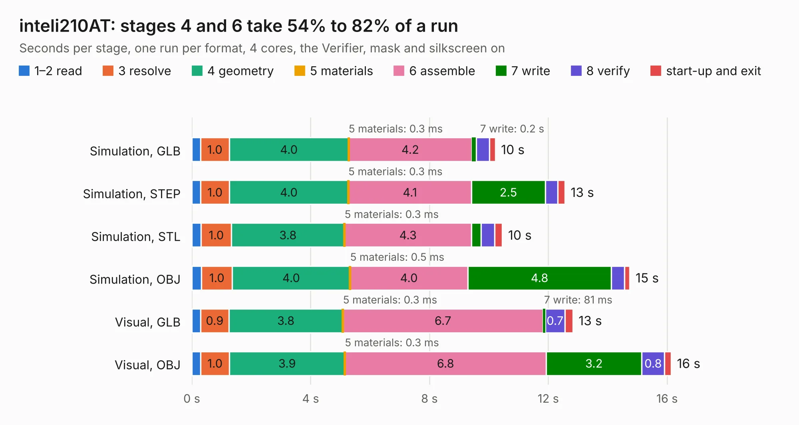

# 2624. inteli210AT

Board 2,624 of the 3,105 of [Corpus Testing](../Corpus-Testing.md), on [Corpus Page 25](../CorpusTestingPages/Corpus-Testing-25.md#2624-inteli210at).

| Mode and format | 1–2 read | 3 resolve | 4 geometry | 5 materials | 6 assemble | 7 write | 8 verify | start-up and exit | Total |
|---|---:|---:|---:|---:|---:|---:|---:|---:|---:|
| Simulation, GLB | 0.3 | 1.0 | 4.0 | 0.3&nbsp;ms | 4.2 | 0.2 | 0.4 | 0.2 | 10.2 |
| Simulation, STEP | 0.3 | 1.0 | 4.0 | 0.3&nbsp;ms | 4.1 | 2.5 | 0.4 | 0.2 | 12.6 |
| Simulation, STL | 0.3 | 1.0 | 3.8 | 0.3&nbsp;ms | 4.3 | 0.3 | 0.5 | 0.3 | 10.5 |
| Simulation, OBJ | 0.3 | 1.0 | 4.0 | 0.5&nbsp;ms | 4.0 | 4.8 | 0.4 | 0.2 | 14.7 |
| Visual, GLB | 0.3 | 0.9 | 3.8 | 0.3&nbsp;ms | 6.7 | 81&nbsp;ms | 0.7 | 0.3 | 12.8 |
| Visual, OBJ | 0.3 | 1.0 | 3.9 | 0.3&nbsp;ms | 6.8 | 3.2 | 0.8 | 0.2 | 16.1 |

<table align="center"><tr><td valign="top">

| Board | Repo: [ssmiao/intel-i210-network-card](https://github.com/ssmiao/intel-i210-network-card) Board: `inteli210AT.kicad_pcb` |
|---|---|
| Folder | PCBV3.0 |
| Complexity | 309&nbsp;/&nbsp;1000 (size&nbsp;244, features&nbsp;65) |
| KESE&nbsp;features | through vias, rounded, trapezoid or chamfered pads, filled zones, copper text, curved board outline |
| Tested | 9th November 2026 |
| Copper&nbsp;layers | 4 |
| File&nbsp;format | KiCad 5 (20171130) |
| Parts,&nbsp;tracks,&nbsp;vias | 52, 2,120, 111 |
| Triangles,&nbsp;simulation | 959,846 in 71 parts |
| Verifier | PASS in all six runs |

</td><td valign="top">

<table>
<tr><th>File type</th><th>File size</th><th>Peak memory used</th></tr>
<tr><th colspan="3" align="left">Simulation</th></tr>
<tr><td>GLB</td><td align="right">33&nbsp;MB</td><td align="right">424&nbsp;MB</td></tr>
<tr><td>STEP</td><td align="right">150&nbsp;MB</td><td align="right">525&nbsp;MB</td></tr>
<tr><td>STL</td><td align="right">48&nbsp;MB</td><td align="right">433&nbsp;MB</td></tr>
<tr><td>OBJ</td><td align="right">98&nbsp;MB</td><td align="right">687&nbsp;MB</td></tr>
<tr><th colspan="3" align="left">Visual</th></tr>
<tr><td>GLB</td><td align="right">20&nbsp;MB</td><td align="right">533&nbsp;MB</td></tr>
<tr><td>OBJ</td><td align="right">59&nbsp;MB</td><td align="right">547&nbsp;MB</td></tr>
</table>

</td></tr></table>

| Previous | Next |
|:---|---:|
| [2623. Watchy](b2623b_watchy-hardware_Watchy.md) | [2625. V1](b2625b_intel-i210-network-card_PCBV3-0-reference-OCP2PCIe-master-OCP2PCIe-H-F-4-OCP2PCIe-H-F-4-V0-1Beta_V1.md) |
