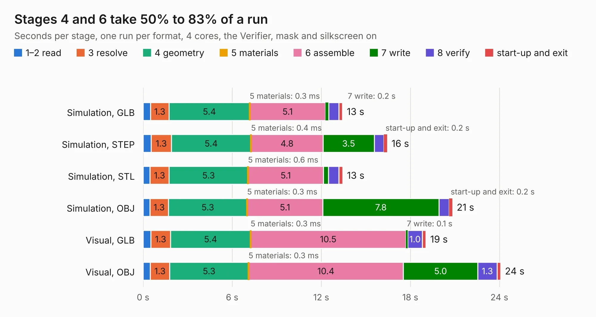

# 2625 SparkFun_GNSS_Flex_Module_mosaic-X5

Board 2,625 of the 3,138 of [Corpus Testing](../Corpus-Testing.md), on [Corpus Page 25](../CorpusTestingPages/Corpus-Testing-25.md#2625-sparkfun_gnss_flex_module_mosaic-x5).

| Mode and format | 1–2 read | 3 resolve | 4 geometry | 5 materials | 6 assemble | 7 write | 8 verify | start-up and exit | Total |
|---|---:|---:|---:|---:|---:|---:|---:|---:|---:|
| Simulation, GLB | 0.5 | 1.3 | 5.4 | 0.3&nbsp;ms | 5.1 | 0.2 | 0.7 | 0.2 | 13.4 |
| Simulation, STEP | 0.5 | 1.3 | 5.4 | 0.4&nbsp;ms | 4.8 | 3.5 | 0.6 | 0.2 | 16.4 |
| Simulation, STL | 0.5 | 1.3 | 5.3 | 0.6&nbsp;ms | 5.1 | 0.3 | 0.7 | 0.3 | 13.4 |
| Simulation, OBJ | 0.5 | 1.3 | 5.3 | 0.3&nbsp;ms | 5.1 | 7.8 | 0.7 | 0.2 | 20.8 |
| Visual, GLB | 0.5 | 1.3 | 5.4 | 0.3&nbsp;ms | 10.5 | 0.1 | 1.0 | 0.3 | 19.1 |
| Visual, OBJ | 0.5 | 1.3 | 5.3 | 0.3&nbsp;ms | 10.4 | 5.0 | 1.3 | 0.2 | 24.1 |

<table align="center"><tr><td valign="top">

| Board | Repo: [sparkfun/sparkfun_gnss_flex_system](https://github.com/sparkfun/sparkfun_gnss_flex_system) Board: `SparkFun_GNSS_Flex_Module_mosaic-X5.kicad_pcb` |
|---|---|
| Folder | flex_boards / SparkPNT_GNSS_Flex_Module_mosaic-X5 / hardware |
| Complexity | 357&nbsp;/&nbsp;1000 (size&nbsp;237, features&nbsp;120) |
| KESE&nbsp;features | through vias, rounded, trapezoid or chamfered pads, arc tracks, filled zones, copper text, knockout text, stack-up, dielectric εr and tanδ, mask and silkscreen colours |
| Tested | 9th November 2026 |
| Copper&nbsp;layers | 4 |
| File&nbsp;format | KiCad 8 (20240108) |
| Parts,&nbsp;tracks,&nbsp;vias | 28, 524, 212 |
| Triangles,&nbsp;simulation | 1,304,334 in 80 parts |
| Verifier | PASS in all six runs |

</td><td valign="top">

<table>
<tr><th>File type</th><th>File size</th><th>Peak memory used</th></tr>
<tr><th colspan="3" align="left">Simulation</th></tr>
<tr><td>GLB</td><td align="right">46&nbsp;MB</td><td align="right">621&nbsp;MB</td></tr>
<tr><td>STEP</td><td align="right">199&nbsp;MB</td><td align="right">660&nbsp;MB</td></tr>
<tr><td>STL</td><td align="right">65&nbsp;MB</td><td align="right">708&nbsp;MB</td></tr>
<tr><td>OBJ</td><td align="right">137&nbsp;MB</td><td align="right">907&nbsp;MB</td></tr>
<tr><th colspan="3" align="left">Visual</th></tr>
<tr><td>GLB</td><td align="right">29&nbsp;MB</td><td align="right">718&nbsp;MB</td></tr>
<tr><td>OBJ</td><td align="right">88&nbsp;MB</td><td align="right">719&nbsp;MB</td></tr>
</table>

</td></tr></table>

| Previous | Next |
|:---|---:|
| [2624 SparkFun_GNSS_Flex_Module_mosaic-X5_panelized](b2624b_sparkfun-gnss-flex-system_SparkFun-GNSS-Flex-Module-mosaic-X5-panelized.md) | [2626 SparkFun_GNSS_Flex_Module_ZED-X20P_Tilt_panelized](b2626b_sparkfun-gnss-flex-system_SparkFun-GNSS-Flex-Module-ZED-X20P-Tilt-panelized.md) |
