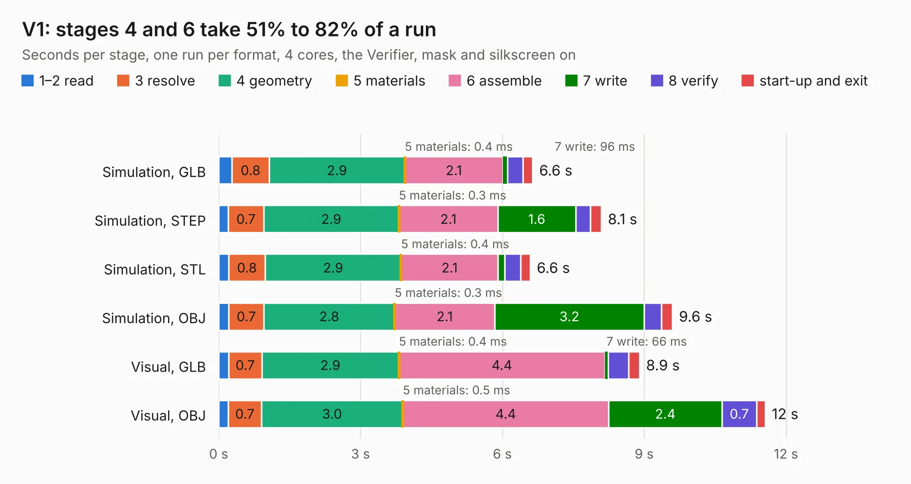

# 2626. V1

Board 2,626 of the 3,101 of [Corpus Testing](../Corpus-Testing.md), on [Corpus Page 25](../CorpusTestingPages/Corpus-Testing-25.md#2626-v1).

| Mode and format | 1–2 read | 3 resolve | 4 geometry | 5 materials | 6 assemble | 7 write | 8 verify | start-up and exit | Total |
|---|---:|---:|---:|---:|---:|---:|---:|---:|---:|
| Simulation, GLB | 0.3 | 0.8 | 2.9 | 0.4&nbsp;ms | 2.1 | 96&nbsp;ms | 0.3 | 0.2 | 6.6 |
| Simulation, STEP | 0.2 | 0.7 | 2.9 | 0.3&nbsp;ms | 2.1 | 1.6 | 0.3 | 0.2 | 8.1 |
| Simulation, STL | 0.2 | 0.8 | 2.9 | 0.4&nbsp;ms | 2.1 | 0.1 | 0.3 | 0.2 | 6.6 |
| Simulation, OBJ | 0.2 | 0.7 | 2.8 | 0.3&nbsp;ms | 2.1 | 3.2 | 0.4 | 0.2 | 9.6 |
| Visual, GLB | 0.2 | 0.7 | 2.9 | 0.4&nbsp;ms | 4.4 | 66&nbsp;ms | 0.4 | 0.2 | 8.9 |
| Visual, OBJ | 0.2 | 0.7 | 3.0 | 0.5&nbsp;ms | 4.4 | 2.4 | 0.7 | 0.2 | 11.6 |

<table align="center"><tr><td valign="top">

| Board | Repo: [ssmiao/intel-i210-network-card](https://github.com/ssmiao/intel-i210-network-card) Board: `V1.kicad_pcb` |
|---|---|
| Folder | PCBV3.0 / reference / OCP2PCIe-master / OCP2PCIe-H-F-4 / OCP2PCIe-H-F-4-V2.0Beta |
| Complexity | 230&nbsp;/&nbsp;1000 (size&nbsp;155, features&nbsp;75) |
| KESE&nbsp;features | through vias, slotted holes, rounded, trapezoid or chamfered pads, drill offsets, filled zones, curved board outline |
| Tested | 9th November 2026 |
| Copper&nbsp;layers | 2 |
| File&nbsp;format | KiCad 5 (20171130) |
| Parts,&nbsp;tracks,&nbsp;vias | 10, 361, 195 |
| Triangles,&nbsp;simulation | 606,444 in 82 parts |
| Verifier | PASS in all six runs |

</td><td valign="top">

<table>
<tr><th>File type</th><th>File size</th><th>Peak memory used</th></tr>
<tr><th colspan="3" align="left">Simulation</th></tr>
<tr><td>GLB</td><td align="right">21&nbsp;MB</td><td align="right">327&nbsp;MB</td></tr>
<tr><td>STEP</td><td align="right">83&nbsp;MB</td><td align="right">411&nbsp;MB</td></tr>
<tr><td>STL</td><td align="right">30&nbsp;MB</td><td align="right">326&nbsp;MB</td></tr>
<tr><td>OBJ</td><td align="right">62&nbsp;MB</td><td align="right">451&nbsp;MB</td></tr>
<tr><th colspan="3" align="left">Visual</th></tr>
<tr><td>GLB</td><td align="right">16&nbsp;MB</td><td align="right">392&nbsp;MB</td></tr>
<tr><td>OBJ</td><td align="right">47&nbsp;MB</td><td align="right">407&nbsp;MB</td></tr>
</table>

</td></tr></table>

| Previous | Next |
|:---|---:|
| [2625. V1-cut10x10](b2625b_intel-i210-network-card_V1-cut10x10.md) | [2627. m5-pantilt](b2627b_stack-chan_m5-pantilt.md) |
